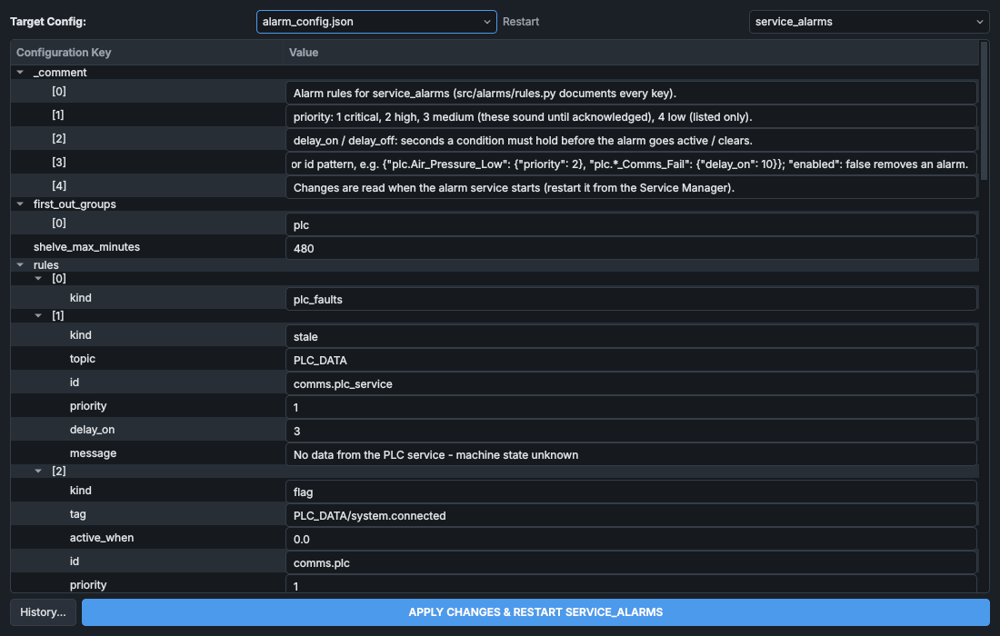

# Configuration files and the config editor

The configuration files in `config/` and what reads them, the tag registry built from them, the hard caps no file can get past, the readback tolerances, and the HMI's config editor, which changes the files safely.

## The configuration files

| File | Holds | Read by |
|---|---|---|
| `network_config.json` | the ZeroMQ host and ports; the PLC's address, rack, slot and data block numbers; the Waveshare bridges; the magnet, X-steerer, SMU and ADAM addresses | every program, when it starts |
| `plc_config.json` | the PC's limits for the PLC's setpoints: extraction, the target (cathode), filament, thermionic, caesium oven, steering | the registry builder |
| `fault_config.json` | the PLC fault words and their bits: name, severity, description | `service_plc`, `service_alarms`, the HMI, the event helper of every program (fault descriptions), `plc/build_plc_types.py` |
| `mpd_config.json` | the Spellman buses and supplies: address, type, voltage range, current-limit range, the default current limit, and the software arc detection | `service_spellman_mpd`, the registry builder |
| `vac_gauges_config.json` | for each gauge controller: the gauge names, and each relay's channel and on and off points; the rapid-rise threshold; which relays are wired into the safety relay's loop (`system_interlocks.safety_loop_relays`, below); gauges judged by a software trip with a ride-through (`system_interlocks.software_trips`, below) | `service_vac_gauge_controllers`, the registry builder, the HMI's Interlocks panel (re-read within a few seconds of a change) |
| `magnet_config.json`, `steerer_magnet_config.json` | maximum current, voltage and power; the coil resistance checks; the degauss steps and step time | the magnet services, the registry builder |
| `smu_config.json` | the bias voltage range and the compliance current | `service_smu`, the registry builder |
| `logger_config.json` | the logger's row rate, chunk interval and crash-journal interval | `service_logger` |
| `readback_tolerance.json` | the readback tolerance rules | `service_monitor`, which reloads it within a few seconds of a change |
| `alarm_config.json` | the alarm rules and overrides | `service_alarms` |
| `turbo_guard.json` | the source turbo's load guard: its normal readings, margins and stage times (below) | `service_source_turbo` |
| `system_tags.json` | the tag registry, generated (below) | the device services, the logger, the sequencer, the HMI, the data viewer |
| `recipes/` | the recipes (in git) | the HMI's recipe panel and builder, `service_sequencer` |
| `recipe_templates/` | the recipe builder's templates (in git): start-up, shutdowns, mass scan, degauss, HV conditioning | the recipe builder's **New** |
| `recipe_ai.json` | the recipe builder's drafting: the model, its time limits (below) | the recipe builder, each time it opens |
| `appearance.json`, `workspace_profiles.json`, `plot_settings.json` | the theme, and the data viewer's profiles, per machine (nothing reads `plot_settings.json` now) | the HMI and the data viewer |
| `backups/` | previous versions of files changed in the config editor, and of recipes saved in the recipe builder (`backups/recipes/`) | the config editor's **History...** |

The per-machine files and `backups/` are not in git. The services read their files when they start, so a change made outside the config editor needs the service restarted, except `readback_tolerance.json`.

## The gauge relay in the safety relay's loop

The gauge controller's set-point relay that is wired into the safety relay's hardwired loop is named in `vac_gauges_config.json` as `system_interlocks.safety_loop_relays`: a list of controller node and relay, such as `["10.4"]` for gauge controller 1 (node 10), relay 4. The [Interlocks](../panels/interlocks.md) panel uses it to rule that relay in or out when the safety relay won't close. It ships as `[]`, as the wiring hasn't been checked yet; meanwhile the panel checks every relay the file lists for node 10. The config editor refuses anything but a node and relay 1 to 6 that the file configures.

## Software trips with a ride-through

A gauge listed in `vac_gauges_config.json` under `system_interlocks.software_trips` is judged by the vacuum service rather than by its relays, so that short pressure spikes don't trip the machine (`src/core/software_trips.py`). It ships with VG1, for the spikes from powdered targets:

```json
"software_trips": {"VG1": {"trip_mbar": 8.0e-6, "reset_mbar": 5.5e-6, "ride_through_s": 2.5}}
```

- `trip_mbar`: a reading above this starts an excursion, as the relay's off point would open it.
- `reset_mbar`: a reading at or below this ends it, as the relay's on point. At most `trip_mbar`.
- `ride_through_s`: an excursion that lasts this long reports the gauge above its set point, until it ends: the PLC closes the gate valve and the safety relay opens (its fault stays latched until **RESET FAULTS**). A shorter one is ridden through and logged.

The gauge's relays are then only a hardware backstop, and should be set above the spikes: VG1's relays 1 and 4 ship at 5 mbar on and 10 mbar off. The hard caps (below) hold the trip point to the gate valve's 1×10⁻⁵ mbar and the ride-through to 2.5 s, as approved; a backstop relay may go up to 20 mbar, but only while its gauge has a valid software trip. The config editor refuses an entry for a gauge that isn't VG1 to VG6, a value that isn't a number above 0, a reset above the trip point, or a gauge whose channel the file doesn't configure. The vacuum service reads the file when it starts, and writes the relays' set points to the controller then: restart it after a change (the config editor's **Save and restart** does). See [Riding through short spikes (VG1)](../panels/vacuum.md#riding-through-short-spikes-vg1).

To go back to the relays, set the gauge's relays back to the gate valve's points in the config editor (for VG1, 5.5×10⁻⁶ mbar on and 8×10⁻⁶ mbar off): the relay then trips on every spike again, and the software trip, left in place, never acts first. Taking the entry out altogether is a hand edit of the file (the config editor changes values only), in the same change as the relays.

## The source turbo's load guard

`turbo_guard.json` sets the turbo service's load guard, which warns when the source turbo works harder than normal at full speed and, if its current doesn't fall back, shuts the source down (see [The source turbo's load guard](../how-it-works/turbo-guard.md), which lists every setting). The values it ships with are the pump's on 26 October 2026: normal 0.8 A, bearing 43 °C, converter 28 °C; a warning at 0.3 A over for 2 minutes, critical 10 minutes later, the source shut down 20 minutes after the warning unless the current is falling back. Keys starting with `_` are notes.

The config editor checks each value against its range (for example `normal_current_a` 0.1 to 10 A, `trip_after_s` 60 s to 4 h) and that the critical alarm comes before the trip; the turbo service uses the default for a value with a problem, and logs `turbo_guard.json: <problem> - its default is used`. Set `shut_down_source` to false to have the stages and alarms without the shutdown, for instance while trying new normal values. Changing the file in the config editor restarts the turbo service; a trip it has already made stays (in `data/turbo_guard_state.json`) until **RESET FAULTS**.

## Recipe drafting

The recipe builder's drafting (see [Drafting and reviewing with AI](../panels/recipes.md#drafting-and-reviewing-with-ai)) is set in `config/recipe_ai.json`, which is in git, so nothing secret goes in it. The API key goes in the file `.env` in the SINDIE folder, which isn't in git: a line `GEMINI_API_KEY=<key>` (or the `GEMINI_API_KEY` environment variable, which wins). The builder reads both each time it opens: no restart is needed.

| Setting | Default | What it does |
|---|---|---|
| `enabled` | `true` | `false` hides drafting in the builder. |
| `model` | `gemini-3.8-flash` | The Gemini model: Google's newest stable Flash model (October 2026). A larger model (a Pro or flagship one) is slower and costs more per draft. |
| `fallback_models` | `gemini-3.6-flash`, `gemini-flash-latest` | Tried in turn, each once, if the model isn't found (retired). `gemini-flash-latest` is Google's name for its newest Flash model: it can be a preview, with tighter rate limits, so it comes last. |
| `max_rounds` | 16 | Answers from the model in one draft before it is given up. |
| `max_proposals` | 3 | Proposals with errors sent back to the model; after that the last is shown with its errors. |
| `timeout_s` | 120 | For each answer from the service, in seconds (the service has 15 s to accept the connection). A request the service is too busy for, or that meets the key's rate limit, is tried twice more (after the wait the service asks for, if it is 30 s or less) before its message is shown. |
| `thinking_level` | `""` | `""` leaves it to the model; `low`, `medium` or `high` for Gemini 3 and later. |
| `temperature` | `null` | `null` leaves it to the model (Google advises leaving it for Gemini 3). |

A setting that isn't valid is logged and its default used. To see whether this PC reaches the model (and how fast it answers): `python -m src.core.recipe_ai.cli check`, or **Test the connection** in the builder's **Draft** tab. To see exactly what the model is told: `python -m src.core.recipe_ai.cli prompt`; to try a draft from a terminal: `python -m src.core.recipe_ai.cli draft "<request>" --recipe config/recipes/<file>`. Each request and how long its answer took are logged (`Recipe drafting: ...` in the HMI's log).

## The tag registry

`config/system_tags.json` lists every tag: which service it belongs to (`source`), its data type, whether the PC may write it (`writable`), its unit and labels, for the PLC's tags where it is in DB10 (`db_number`, `byte_offset`, `bit_offset`), and for every setpoint the limits the services accept (`min_val`, `max_val`).

It is generated from the other files:

```
python src/utils/build_registry.py
```

The builder reads the PLC interface block, `plc/generated/PLC_PC_Interface.scl`, for the PLC's tags and their places in DB10 (a tag in `From_PC` is writable), and the other config files for the other services' tags and the setpoint limits. It keeps the display fields of an existing registry (data type, unit, scale, multiplier, description, labels) so hand-made labels survive a rebuild, and writes the new file whole, so a crash can't leave half of one. `--out` writes it elsewhere.

Rebuild it after changing a limit in `mpd_config.json`, `magnet_config.json`, `steerer_magnet_config.json`, `smu_config.json`, `vac_gauges_config.json` or `plc_config.json`, or after changing the PLC interface block, then restart the services and the HMI. The config editor rebuilds it by itself. The simulator and the tests build their own from the config files every time they start.

What reads it:

- the device services: the limits of every setpoint command (a setpoint with no limits is refused);
- `service_plc`: which PLC tags exist, where they are and which may be written;
- `service_logger`: which values are logged;
- the HMI: the ranges of the setpoint boxes;
- the data viewer: the channels, their labels and units;
- `service_sequencer`: the limits of mass scans and the optimiser;
- command routing: which service owns a tag.

## Hard caps

Some values have a ceiling that no config file can raise. They are set in the code, in `src/core/hard_caps.py`:

| What | Cap | Why |
|---|---|---|
| VG1 and VG2 relay on and off points | 1×10⁻⁵ mbar | they decide when the gate valve may open |
| a gauge's software trip and reset points (`system_interlocks.software_trips`) | 1×10⁻⁵ mbar for VG1 and VG2, 1 mbar for the others | as its relays' |
| a software trip's ride-through | 2.5 s | as approved (Josh Bird, October 2026) |
| the relays of a gauge with a valid software trip (its backstop) | 20 mbar | above the spikes it rides through |
| other gauge relay points | 1 mbar | |
| every Spellman supply | ±22 kV | |
| analyser magnet supply | 95 A, 25 V | |
| X-steerer supply | 80 A, 40 V | |
| SMU bias | ±200 V | |

Nothing gets past them:

- the config editor refuses a file with a value past a cap, marks the field red and gives the reason in its tooltip; no confirmation tick gets past it;
- the registry builder keeps every setpoint limit within the caps;
- the services check them when they start and on every command. A magnet service given a config value past its cap uses the cap, with an ERROR event; the vacuum service doesn't write such a relay to the controller, and for VG1 or VG2 withholds the gate-valve permissive;
- **ENABLE** is refused while a Spellman or magnet supply holds a setpoint past its cap (set at its front panel, say);
- mass scans, the optimiser and **CALCULATE & SET AMPS** name the cap when they refuse.

Raising a cap is a change to the code, reviewed and committed like any other.

## Readback tolerances

`service_monitor` compares readbacks with their setpoints, using the rules in `config/readback_tolerance.json`. Out of tolerance is information, not a fault: nothing trips or stops.

When a readback stays outside its tolerance for the rule's delay, the monitor writes one TOLERANCE event and the HMI outlines that readback in amber; another TOLERANCE event follows when it is back. The allowed deviation is the larger of `abs_tol` and `rel_tol` × |setpoint|, in the tags' own units.

| Key | Meaning |
|---|---|
| `name` | the label used in events |
| `setpoint`, `readback` | the two tags |
| `abs_tol`, `rel_tol` | the tolerance (above) |
| `delay_s` | how long it must stay out before it counts |
| `only_when` | a tag that must be 1 for the rule to apply, normally the output's enabled flag |
| `min_setpoint` | the rule is ignored while the setpoint is below this |
| `enabled` | `false` switches a rule off |

Keys left out of a rule come from `defaults` (5 s, no absolute tolerance, 5 %). The file has rules for the source einzel, extraction, target, filament, thermionic, analyser magnet, X-steerer and Faraday cup bias; the caesium oven rule is there but switched off. The monitor checks the file every 2 s and reloads it when it changes, with no restart.

## The config editor

The HMI's config editor changes the files in `config/` with checks, a confirmation, a backup and a record of the change.

### Opening it

Click **Config** in the HMI's menu bar and enter the engineering password. The password is set in the HMI's code (`src/gui/control/control_main.py`), not in a configuration file.

The **System Configuration Editor** lists every file in `config/` except the generated registry and the per-machine files. Choose one under **Target Config**. Its contents appear as a tree of **Configuration Key** and **Value**. The **Restart** box shows which service the change will restart; it can be changed.



When the file opens it is checked, and any problem is listed above the tree: the services are using the file as it is. A file that isn't valid JSON can't be edited; put a working version back with **History...**.

### What can be changed

Values only. Keys can't be added, removed or renamed, because the services look supplies, gauges and ports up by name: renaming a Spellman supply, for example, cut it off from its service. A value stays the same kind (number, text, true or false), numbers keep their full precision, and a `bus_id` can't be changed. A field past a hard cap is marked red.

### Applying a change

**APPLY CHANGES & RESTART ...** does this, in order:

1. **Checks.** The edited file is checked: types, physical ranges, limits the right way round, duplicate ports, addresses or names, gauge relay points the controllers can store (two significant figures). A problem stops it with **Not Applied**, a value past a hard cap with **Refused: Hard Cap**, and no change at all with **Nothing To Apply**.
2. **Confirmation.** The changes are listed, with a box for the reason, which is kept in the history. A number that changes by more than a factor of 3, or changes sign, is listed again under **Large changes - check these are meant**, and **OK** stays greyed until **I have checked the large changes** is ticked. Changes to or from zero, and small whole numbers up to 10, aren't counted as large.
3. **Unchanged on disk.** If the file was changed on disk since the editor opened it (by hand, or by a `git pull`), nothing is written; open it again and make the change again.
4. **Backup and write.** The current file is copied to `config/backups/<name>.<date>-<time>.json`; the newest 50 of each file are kept. Only the changed values are rewritten, so the file's layout and its other values stay as they were typed, and the new file replaces the old one whole.
5. **Registry.** If the file feeds the tag registry, the registry is rebuilt. If that fails, the previous file is put back and nothing is applied.
6. **Git.** The file is committed to git on its own, with the message `Config editor: <file> - <reason>`. The lab PC then has local commits: pull with `git pull --rebase`.
7. **Record.** A CONFIG_CHANGE event goes to `data/events.db`, with the changes, the reason, the backup and the commit.
8. **Restart.** The service manager is asked to restart what reads the file (below). A service stopped on purpose is left stopped, and reads the new settings when it is started.

| File | Restarted |
|---|---|
| `alarm_config.json` | `service_alarms` |
| `fault_config.json` | `service_plc` and `service_alarms`; restart the HMI by hand too |
| `logger_config.json` | `service_logger` |
| `magnet_config.json` | `service_magnet_psu` |
| `steerer_magnet_config.json` | `service_steerer_magnet_psu` |
| `smu_config.json` | `service_smu` |
| `mpd_config.json` | `service_spellman_mpd` |
| `vac_gauges_config.json` | `service_vac_gauge_controllers` |
| `plc_config.json` | `service_plc` |
| `readback_tolerance.json` | `service_monitor` |
| `network_config.json` | nothing |

`network_config.json` is read by every program, the service manager and the HMI included, when it starts. Restarting the services alone would leave them on other ports than the manager. So for this file the button reads **APPLY CHANGES (THEN RESTART BY HAND)**: the editor restarts nothing and says so. Restart the service manager and the HMI by hand at a safe moment; until then everything keeps running with the old settings.

A change that rebuilds the registry changes the setpoint limits, which the HMI and `service_sequencer` read when they start: restart them too to pick the new limits up.

> [!NOTE]
> Restarting `service_plc` stops the PC watchdog to the PLC for a few seconds; the PLC treats 3 s without it as lost communication. See [The PLC program](../how-it-works/plc.md#the-watchdog).
>
> Restarting `service_vac_gauge_controllers`, after a change to `vac_gauges_config.json`, doesn't close the gate valve: the PLC keeps its last judgment of the vacuum for up to 60 s while it restarts. See [When the vacuum service restarts](../panels/vacuum.md#when-the-vacuum-service-restarts).

### History

**History...** lists the kept versions of the open file by the time they were replaced. Choosing one checks it, lists what would change and asks for confirmation, as for any change; the version is then put back byte for byte, with the current file backed up, the registry rebuilt where needed, a git commit and a CONFIG_CHANGE event.

## See also

- [Services and messaging](../how-it-works/services.md)
- [Alarm handling](../how-it-works/alarms.md)
- [Data logging and storage](../how-it-works/data-logging.md)
- [Service Manager](../panels/service-manager.md)
- [Tests](testing.md)
