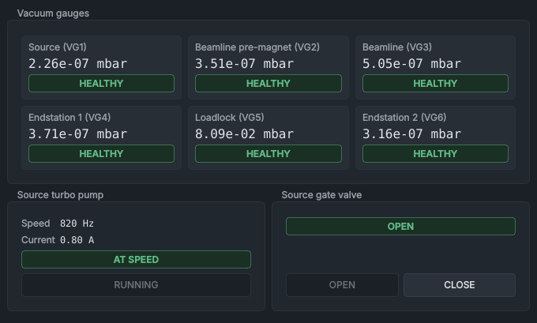

# Writing help pages

How the help works, how to add or change a page, and the house style. Read this before editing anything in `docs/`.

## How the help works

The help pages are Markdown files in the `docs/` folder of the repository. The same files are used in two places:

- **In the programs.** **Help** in the HMI or the data viewer opens the help window. It shows a page at a time, with the contents on the left, a search box, and back and forward buttons. **F1** opens the page for the panel under the mouse pointer.
- **On GitHub.** The pages link to each other with relative links, so the `docs/` folder also reads as a small wiki in the repository.

The help window is in `src/gui/help/`. It converts each page to HTML when it is opened (with the `Markdown` package; without it, Qt's own Markdown support is used and the pages look plainer), styles it in the current theme, and scales screenshots to fit the window.

The contents list on the left of the help window is read from the **Contents** section of [the home page](../README.md). A bold item without a link is a group; a linked item is a page. A page that isn't in that list can still be linked to and searched, but it won't appear in the contents.

The page that **F1** opens for each HMI panel is set in `src/gui/help/pages.py`. A test checks that every panel has a page, that every page is in the contents and every page in the contents exists, and that every link and image in every page points at something that exists.

## Adding a page

1. Write the page as a `.md` file in the right folder (see the contents on the home page).
2. Add it to the **Contents** list on the home page, in the right group.
3. If it is a panel's page, add the panel to `PANEL_PAGES` in `src/gui/help/pages.py`.
4. Run the help tests: `python -m pytest tests/test_help.py`.

## Screenshots

Screenshots live in `docs/images/` and are made by a script, so they can be taken again whenever the HMI changes:

```
python src/utils/make_help_screenshots.py
```

It starts the simulator without showing any windows, brings the simulated machine up (gate valve open, safety relay on, a beam on the Faraday cup), and saves each panel, the whole HMI and the data viewer. Take screenshots from the simulator, never of the HMI running the real machine.

Refer to an image with a relative path and a short description of what it shows:

```

```

The help window scales an image down to fit the page; it never scales one up.

## What the help window understands

Use only these, so that a page looks the same in the help window and on GitHub:

- headings: one `#` title per page, then `##` sections and `###` subsections;
- paragraphs, **bold**, *italic* and `code`;
- bulleted and numbered lists. Leave a blank line before a list, and indent a list inside a list by **four** spaces;
- tables (GitHub pipe tables), with a blank line before and after;
- links to other pages (`[Alarms](../panels/alarms.md)`), to a section of a page (`[Fault reset](alarms-and-faults.md#resetting-faults)`) and to web pages (opened in the web browser);
- images, as above;
- code blocks fenced with three backticks;
- call-outs, written the GitHub way:

```
> [!WARNING]
> Never open the source gate valve with the source chamber at atmosphere.
```

  The five kinds are `NOTE` (useful to know), `TIP` (a quicker or better way), `IMPORTANT` (needed to get it right), `WARNING` (risk to the machine or the experiment) and `CAUTION` (risk to people). Use them sparingly: a page full of call-outs has none.

A link to a section uses the heading's text in lower case, with spaces turned into hyphens and punctuation left out: the heading `## Resetting faults` is `#resetting-faults`. Keep punctuation out of headings so these links stay simple.

## House style

**Who reads it.** Trained operators running SINDIE, and the engineers who look after it. Write for someone who knows ion beams but not this software.

**Voice.** Plain British English. Speak to the reader ("Press **RESET FAULTS**"), in the present tense and the active voice. Short sentences. Say what something does and when you would use it; leave out how hard it was to build.

**Names on the screen.** Write a button, label or menu exactly as it appears, in bold: **ENABLE SAFETY RELAY**, **View > Reset layout**, **Acknowledge selected**. Write a panel by its title, in bold the first time on a page: the **Vacuum System** panel. In ordinary text use British spelling (caesium, colour, optimiser) even where the screen differs (the source panel's row is labelled **Cesium oven**).

**Names in the code.** Tag names, file names, folders and commands go in `code`: `ion_beam.facilities.safety_relay_active`, `config/alarm_config.json`, `python run_simulation.py`.

**Numbers.** A space between a number and its unit: 12 kV, 5 s, 0.5 A, 1×10⁻⁵ mbar, 200 °C.

**Words to use.**

| Use | Not |
|---|---|
| panel | dock, widget |
| the HMI | the GUI, the control program |
| the data viewer | the viewer program, the plotter |
| the safety relay | the HV relay, the interlock relay |
| switch on, switch off | enable/disable as verbs in prose (but the buttons are **ENABLE**) |
| the service manager | the manager process |
| caesium | cesium (except when quoting the screen) |

**Each page** starts with its title and one or two sentences saying what it covers. Panel pages then show a screenshot of the panel, a table of its controls ("Control" and "What it does"), what its colours and states mean, and anything that is locked out and why. End with a short **See also** list of related pages.

**Be exact.** Describe what the software does now, as the code does it: what happens on a click, what is greyed out and when, what a colour means. Where something depends on the lab (procedures, local rules), say so in a `NOTE` call-out rather than guessing.

**No emoji, no exclamation marks, no marketing words** (powerful, seamless, simply, just).
