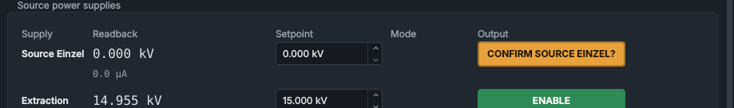

# How the controls behave

The HMI's controls follow a few rules everywhere: what the colours mean, how a setpoint is sent, why a button needs two clicks, and why a control can be greyed out. This page explains them once; the panel pages assume them.

## Colours

The colours follow high-performance HMI practice: normal is grey, and colour is kept for what you need to notice. A screen with nothing wrong is mostly grey.

| Colour | Means | Examples |
|---|---|---|
| Grey | Normal, or off | **SHUTDOWN SEQ: INACTIVE**, an **ENABLE** button whose output is off |
| Green outline | Healthy, connected, running | **HEALTHY**, **PLC COMMS: OK**, **ONLINE**, **AT SPEED** |
| Solid green | An output is switched on | an **ENABLE** button whose supply is on, **ENABLE MAGNET** with the magnet on |
| Blue | Automatic modes, and the main action of a panel | **AUTO EMISSION: ON**, **ACK ALL**, **SET NEW PHASE** |
| Violet | A sequence (recipe, mass scan, optimiser) holds that control | the **SEQUENCE** badge on a supply, the Automation bar |
| Amber | Needs your attention, or high voltage is live | **SAFETY: LIVE**, **DISABLE SAFETY RELAY**, a button waiting for its confirming click, a readback out of tolerance (amber outline) |
| Red | A fault or a trip | **TRIPPED**, latched PLC faults, **INITIATE SHUTDOWN** (red outline) |
| Dashes, dashed outline | Not known: no data from the service | a readout showing `---`, a button with a dashed outline |
| Greyed value, dashed **STALE** chip | Not live: the last value read, with how long ago | a vacuum gauge's pressure, or the turbo pump's speed, after its reading has stopped |

Alarms have their own colours, by priority: see [Alarms](../panels/alarms.md).

Both programs have a dark theme (the default) and a light one. **View > Theme**, or Ctrl+Shift+T, switches while they run, and the other program follows within a second. The colours mean the same in both.

## Switching an output on takes two clicks

Buttons that energise something (the source supplies, the caesium heater, the analyser magnet, the steering, the beamline einzel and neutral traps) and the magnet's **DEGAUSS ROUTINE** ask for confirmation:

1. The first click doesn't switch anything. The button turns amber and asks you to confirm, naming what it will switch on: for example **CONFIRM EXTRACTION?**, **CONFIRM MAGNET?** or **CONFIRM HEATER?**.
2. A second click within 4 seconds sends the command. If you don't click again, the button quietly goes back to how it was.

Switching an output **off** is always a single click: making the machine safer never takes longer.

The **ENABLE SAFETY RELAY** button works differently: see [System Health](../panels/system-health.md).

## Entering a setpoint

A setpoint box shows the live setpoint until you start to change it. To send a new value:

- type it and press **Enter**, or move on to another control (Tab, or click another box or button); or
- step it with the arrow keys, the box's own arrow buttons, or Page Up and Page Down, then press **Enter** or move on.

Nothing else sends a value:

- The mouse wheel never changes a value box or a drop-down list, so scrolling down a panel can't change a setpoint.
- The keyboard focus passing through a box sends nothing.
- If you switch to another window part-way through typing, the entry waits for you to come back.
- **Escape** throws the entry away.

An entry is not sent, and a **Not sent** note appears at the top right of the HMI saying why, if:

- the box was locked while you were typing (hover over it to see why it is locked);
- its panel was closed, or its tab switched away, before you pressed Enter;
- what you typed isn't a number;
- the setpoint changed while you were typing (someone or something else set it).

While a setpoint isn't known (no data yet, or the service has stopped reporting it) the box is empty and its arrows don't work, because a step from a wrong number would send a wrong value. You can still type a whole value.

A box won't take a value past its limit. Where the limit is a hard cap, the box's tooltip names it.

## When a control is greyed out

Each service says, for everything it controls, whether it would accept a command from you now and, if not, why. The HMI greys out the controls it won't accept and shows the reason as the control's tooltip. Hover over a greyed-out control to read it. Typical reasons:

- the safety relay is off (the source supplies, the steering, the magnet);
- the PLC has the supply under its own control (a shutdown sequence, an arc quench, auto-emission);
- a sequence holds it (see below);
- the service isn't connected to its device, or isn't running.

[Messages and what they mean](../messages.md) lists the reasons and what to do about each.

## When a sequence has control

A recipe, a mass scan or the optimiser takes control of the subsystems it drives (for example the analyser magnet and the SMU during a mass scan). While it does:

- the Automation bar at the top of the HMI says which sequence holds what;
- the source panel marks a held supply **SEQUENCE**, in violet;
- your controls for that subsystem are greyed out, so you and the sequence can't fight over a setpoint.

You can always take control back: press **TAKE CONTROL** on the Automation bar twice. A recipe then pauses (**RESUME** carries on from the step it was on); a mass scan or the optimiser stops. If the sequencer itself stops running, its claim lapses after 5 seconds and the controls come back to you.

The safety relay, the shutdown controls, **RESET FAULTS** and the gate valve can never be taken by a sequence. See [The Automation bar](../panels/automation-bar.md).

## When a command is refused

Every command you send gets an answer from the service that carries it out. If it is refused or fails, a pop-up titled **Command refused** (or **Command failed**, **No reply to command**, **Service not running**) appears at the top right of the HMI with the command and the reason, for example `target.cmd_enable = True: rejected - safety relay de-energised - it can't be switched on`. The [Command Log](../panels/command-log.md) panel lists every command and its answer.

Switching the target (cathode), the filament or the thermionic supply off while the caesium is hot is refused in this way, not greyed out: the PLC service won't switch them off until the caesium has cooled.

## Readbacks out of tolerance

When a supply's readback stays away from its setpoint by more than its tolerance, its readout gets an amber outline and the event is logged. This is information, not a fault: nothing is switched off. The tolerances are set in `config/readback_tolerance.json`.

## See also

- [A tour of the HMI](screen-tour.md)
- [Messages and what they mean](../messages.md)
- [The Automation bar](../panels/automation-bar.md)
