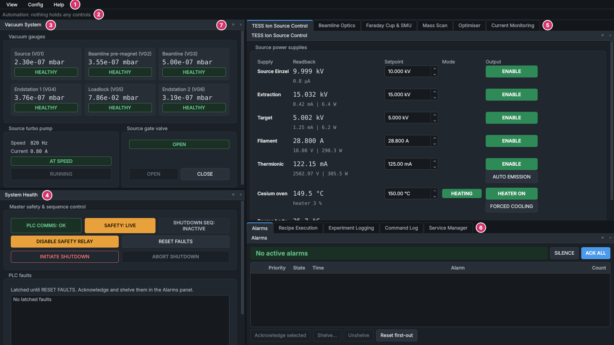

# A tour of the HMI

What is where on the HMI's screen, how to arrange its panels, and the keyboard shortcuts.

## The parts of the screen

1. **The menu bar.**
    - **View**: **Panels** opens and closes each panel; **Layouts** saves the arrangement of the panels under a name and brings it back; **Reset layout** puts every panel back where it starts; **Theme** switches between dark and light; **Capture GUI figure...** saves any panel or the whole window as a figure for a report (F12).
    - **Config**: the configuration editor, for engineers (it asks for the engineering password). See [Configuration files and the config editor](../engineering/configuration.md).
    - **Help**: this help, the most-used pages, and **About SINDIE**, which shows the version that is running.
2. **The Automation bar.** Which recipe, scan or optimiser run holds which controls, with a **TAKE CONTROL** button for each. When nothing is running it reads "Automation: nothing holds any controls". See [The Automation bar](../panels/automation-bar.md).
3. **[Vacuum System](../panels/vacuum.md):** the six gauges, the source turbo pump and the source gate valve.
4. **[System Health](../panels/system-health.md):** the PLC connection, the safety relay, the PLC's shutdown sequence, **RESET FAULTS**, and the list of latched PLC faults.
5. **The machine panels**, as tabs: [TESS Ion Source Control](../panels/ion-source.md), [Beamline Optics](../panels/beamline-optics.md), [Faraday Cup & SMU](../panels/faraday-cup-smu.md), [Mass Scan](../panels/mass-scan.md), [Optimiser](../panels/optimiser.md) and [Current Monitoring](../panels/current-monitoring.md). Click a tab to bring its panel forward.
6. **The record-keeping panels**, as tabs: [Alarms](../panels/alarms.md), [Recipe Execution](../panels/recipes.md), [Experiment Logging](../panels/experiment-logging.md), [Command Log](../panels/command-log.md) and [Service Manager](../panels/service-manager.md).
7. **A panel's own buttons:** pull the panel out into a window of its own, or close it.

Press **F1** with the mouse pointer over any panel to open its page in this help.

## Arranging the panels

Every panel can go anywhere in the window, beside or on top of the others, or in a window of its own.

- **Move a panel:** drag it by its title bar, or drag its tab out of a tab group. As you drag, the window shows where it will land; drop it at the edge of the window or of another panel to put it beside that panel, or on the middle of another panel to make them tabs.
- **Move a whole tab group:** drag the group by its title bar. Drag a single tab to move only that panel.
- **Pull a panel out:** double-click its title bar, or use its pull-out button. Double-click the title bar again to put it back.
- **Close a panel:** its close button. Reopen it from **View > Panels**.
- **Make a panel narrower than its contents:** it scrolls rather than pushing the window wider, and its cards (gauges, current monitors, buttons) fold into fewer columns.

The arrangement is saved when the HMI closes and comes back the next time. To keep several, arrange the panels and use **View > Layouts > Save layout as...**; choose a saved name from **View > Layouts** to bring it back. **View > Reset layout** puts back the default: **Vacuum System** over **System Health** on the left, the machine panels over the record-keeping panels on the right, sized for the screen.

The window always stays on a screen and no bigger than it, so a layout saved on a big monitor still opens properly on a laptop.

> [!NOTE]
> A panel behind another tab, or closed, isn't kept up to date while it can't be seen. It catches up the moment you bring it forward. The alarm horn, the Automation bar, and the recipe, scan and optimiser panels always keep up.

## Light and dark

The HMI and the data viewer use the dark theme unless you choose the light one. **View > Theme > Light**, or Ctrl+Shift+T, switches both programs at once, while they run, and the choice is remembered on that computer. See [How the controls behave](controls-and-colours.md#colours) for what the colours mean.

## Keyboard shortcuts

| Keys | Where | What they do |
|---|---|---|
| F1 | HMI, data viewer | Help: the page of the panel under the mouse pointer |
| F12 | HMI, data viewer | Capture a panel or the window as a figure |
| Ctrl+Shift+T | HMI, data viewer | Switch between the dark and light themes |
| Enter | a setpoint box | Send the value you typed or stepped |
| Escape | a setpoint box | Throw away the value you typed |
| Up, Down, Page Up, Page Down | a setpoint box | Step the value (sent when you press Enter or move on) |
| Alt+Left, Alt+Right | help window | Back and forward |
| Ctrl+F | help window | Search the help |
| Ctrl+= and Ctrl+- | help window | Larger and smaller text |

## See also

- [How the controls behave](controls-and-colours.md)
- [Starting the software](starting-the-software.md)
- [Safety rules](../safety.md)
