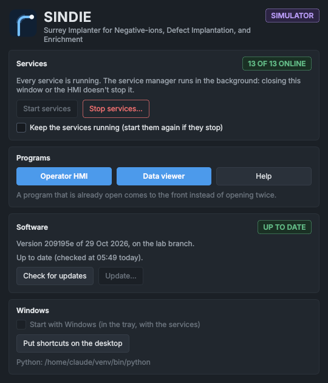
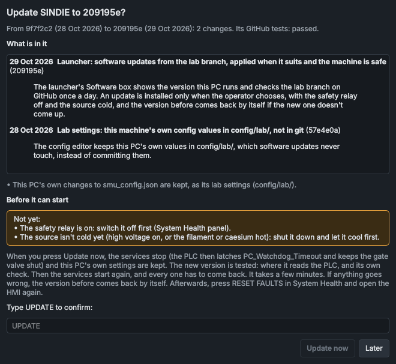

# Starting the software

How to start and stop the SINDIE software on the lab PC, with the launcher or by hand, what each part is for, how to update it, and how to run the simulator instead when you want to practise or try something out without the machine.

## The parts

| Part | What it does | How to start it |
|---|---|---|
| The services | Talk to the PLC and the instruments, keep the alarms, run recipes and scans, log the data. Thirteen programs, started and watched over by the service manager. | The launcher (**Start services**), or `python src/services/service_manager.py` |
| The HMI | The operator screen: shows what the services report and sends your commands to them. | The launcher or the **SINDIE HMI** shortcut, or `python src/hmi.py` |
| The data viewer | Plots the logged data, live or from any time in the past; exports data and figures. | The launcher or the **SINDIE Data Viewer** shortcut, or `python src/gui/data_viewer/viewer_main.py` |
| The launcher | Starts the others without PyCharm, and keeps the services running in the background with an icon in the Windows tray. | The **SINDIE** shortcut, or `pythonw main_launcher.py` |

The services do the work and hold the machine's state. The HMI and the data viewer only show it and pass on your commands, so you can close and reopen either of them at any time: nothing on the machine changes, and a recipe or scan that is running carries on.

## The launcher



| Control | What it does |
|---|---|
| **Services** chip | The services as the service manager reports them: **13 OF 13 ONLINE** (green), fewer (amber, with which are waiting below it), **STARTING**, **NOT ANSWERING** (the service manager runs but hasn't reported for a while), **STOPPING...**, **NOT RUNNING** (red), **STOPPED** (stopped on purpose with **Stop services...**, with when and by whom), **UPDATING...** or **HELD** (after an update that didn't finish: see [When the services are HELD](#when-the-services-are-held)). |
| **Start services** | Starts the service manager in the background, with no command window to close by mistake. It starts every service, as before. It runs on its own, not as part of the launcher, so closing the launcher (or stopping it in PyCharm) leaves it running. Greyed out while it runs. |
| **Stop services...** | Stops every service and the service manager, after you have read what that does and typed `STOP` (see [Stopping](#stopping)). |
| **Keep the services running** | Starts the service manager whenever it isn't running: at once when ticked, and again if it stops, after 5 s, then 30 s, then every 2 minutes. A service manager it has just started gets 30 s to come up before it is started again. Services stopped on purpose stay stopped: see [Stopping](#stopping). |
| **Operator HMI**, **Data viewer** | Start the program, or bring it to the front if it is already open: each runs once. |
| **Help** | This help. |
| **Start the simulator** | `run_simulation.py` in a window of its own (see [The simulator](#the-simulator)). Windows only. |
| **Software** | The version this PC runs, and whether there is a newer one: **Check for updates**, **Update...** and **Go back...** (see [Updating the software](#updating-the-software)). |
| **Start with Windows** | Logging on to Windows starts the launcher in the tray, and it starts the services (it ticks **Keep the services running**). Only the real system's launcher offers it, not the simulator's. |
| **Put shortcuts on the desktop** | **SINDIE** (the launcher), **SINDIE HMI** and **SINDIE Data Viewer**. |
| **Python** | The Python that the launcher, the programs it starts and its shortcuts use. |

Closing the launcher's window leaves it in the Windows tray. Its icon carries a dot for the services: green, all online; amber, some starting or restarting; red, the service manager isn't running. Click the icon to open the window; right-click it for the programs, the services' state, **Stop services...** and **Close the launcher**. Closing the launcher never stops the services: they run on their own. The tray also says when a software update is available.

The HMI and the data viewer open each other: **View > Open the data viewer** in the HMI, **View > Open the operator HMI** in the data viewer. Each program runs once per system and Windows user: starting it again, from a shortcut or the launcher, brings the open one to the front. If the open one doesn't answer (it is busy, or hung), you are told so rather than a second copy being opened: wait a moment and try again, or close it (with Task Manager if need be). The simulator's programs are kept apart from the real system's, so both can be open at once.

### Setting it up on the lab PC

Once:

1. Start the launcher with the Python that PyCharm uses for the project: in PyCharm, run `main_launcher.py`; or, in a command window in the SINDIE folder, run the `pythonw.exe` beside that Python with `main_launcher.py`. Nothing needs installing: the launcher, and everything it starts, use that Python, which already has every library SINDIE needs. Its path is at the bottom of the launcher.
2. Press **Put shortcuts on the desktop**.
3. Tick **Start with Windows**.

From then on PyCharm isn't needed to run SINDIE: the services start when Windows does, and the desktop shortcuts open the HMI and the data viewer.

> [!NOTE]
> The shortcuts point at that Python. If the project moves to another Python (a new virtual environment), start the launcher with the new one, press **Put shortcuts on the desktop** again, and untick and tick **Start with Windows**.

## Starting on the lab PC

1. Check the services are running: the launcher's tray icon has a green dot. If not, press **Start services** in the launcher. Give the service manager about 15 seconds to bring them all up.
2. Start the HMI. On the **Service Manager** panel, every service should show **ONLINE**; on the **System Health** panel, the PLC connection should show OK.
3. Start the data viewer if you want to watch trends while you work.

When the HMI opens it sends nothing to the machine. It shows the values the services publish, and every setpoint box shows the live setpoint. A value shows as dashes (`---`) until it has been received, and again whenever its service stops reporting it, so a dash never hides a stale number.

Without the launcher, run each command in the table above in its own command window, from the SINDIE software folder, with the project's Python.

> [!NOTE]
> The first time the HMI opens after an update it may show its default arrangement of panels instead of the one you saved: arrangements saved by an older version are not restored. Arrange the panels again and save the arrangement under **View > Layouts > Save layout as...**.

## Stopping

- **The HMI and the data viewer:** close their windows. The machine and the services carry on.
- **The services:** **Stop services...** in the launcher or its tray menu. It says what stopping does (and whether the safety relay is on or the source hot), and goes ahead only once you have typed `STOP`. It stops every service, the most recently started first and the event log last, then the service manager. A service manager started by hand in a command window stops with Ctrl+C there.

Services stopped with **Stop services...** stay stopped until someone presses **Start services**, even with **Keep the services running** ticked, and even after the launcher or Windows restarts: the stop is recorded for the system (in `data/launcher_state_0.json`), and the launcher shows **STOPPED** with when and by whom. A service manager started some other way meanwhile clears it.

> [!WARNING]
> Shut the source down before you stop the services. The PC writes a watchdog value to the PLC every half second. If it stops changing for 3 seconds, the PLC treats the PC as lost. It latches a watchdog fault, which takes away the gate valve's open permissive, so the PLC closes the gate valve and the safety relay drops, even with the source hot. It also starts its own shutdown sequence. See [Shutting down](../procedures/beam-shut-down.md) and [The PLC program](../how-it-works/plc.md).

Restarting one service from the **Service Manager** panel leaves the others running. Restarting the PLC service pauses the watchdog for a few seconds, which can be enough to set this off. The watchdog fault then stays latched, and the gate valve won't open, until **RESET FAULTS** is pressed.

If the service manager doesn't answer **Stop services...**, the launcher offers to end it and the services it started at once, without tidying up. The next start clears anything left over.

## Updating the software

The launcher keeps the software up to date from GitHub, but only when you choose, and only when the machine is safe.

Josh puts each version that is ready for the lab on the `lab` branch on GitHub, once its automatic tests have passed. Nothing else reaches the lab PC. Once a day the launcher checks whether that branch has a newer version than the PC runs. It never installs anything by itself: when there is a newer version, the **Software** box says **UPDATE AVAILABLE** and a message comes up from the tray icon. **Check for updates** checks at once.

| **Software** box | Meaning |
|---|---|
| **UP TO DATE** | The PC runs the newest version on the lab branch. |
| **UPDATE AVAILABLE** (blue) | A newer version is ready: **Update...** shows what is in it. |
| **UPDATE AVAILABLE** (amber) | A newer version is there, but it can't be installed from the launcher: **Update...** says why (see [What the launcher can't install](#what-the-launcher-cant-install)). |
| **CAN'T CHECK** | GitHub couldn't be reached, or git didn't work: the line below says which. The launcher tries again the next day. |
| **NOT CHECKED** | Not checked since this version was installed. |
| **UPDATING...** | An update is running. |



To update:

1. Press **Update...**. It checks GitHub again and lists what is in the new version, newest first.
2. Read **Before it can start**. The update waits until:
    - the PLC reports the safety relay off and the source cold (extraction and target off, filament and caesium cold), and no recipe, mass scan or optimiser is running; or the services have been stopped for at least a minute, so that the PLC has switched the relay off itself (with no SINDIE service left running without the service manager: one could still be keeping the relay on);
    - the HMI and the data viewer are closed: they would carry on with the version before;
    - no other SINDIE system on this PC runs (the simulator's services, say): they share the software.

    The list changes as you put each thing right.
3. Type `UPDATE` and press **Update now**. The launcher looks at the conditions once more as you press it. Or press **Later** to leave the update for a better time: it stays on offer.
4. Wait a few minutes while the window lists each step. The services stop: the PLC latches **PC_Watchdog_Timeout** and keeps the gate valve shut. This PC's own settings are kept. The new version is tested: it has to read and write the PLC exactly where this one does, and pass its own check. Then the services start again, and every service that was **ONLINE** has to come back, with the PLC answering.
5. When the window says **Updated to ...**, press **Restart the launcher**. The launcher starts again, so that it runs the new version too.
6. Press **RESET FAULTS** in **System Health**, and open the HMI again.

If any step fails, the update puts the version before back by itself and starts the services again as they were. The window says what went wrong: tell Josh. While the update runs, the launcher can't be closed.

An update keeps this PC's own config values (its [lab settings](../engineering/configuration.md#lab-settings), in `config/lab/`), its recipes and its data. If a config file was changed on this PC, by hand or by an older config editor, the update keeps the change as a lab setting.

### What the launcher can't install

Some versions need more than the launcher can do safely. The window says why, and Josh installs them by hand:

- a change to the data the PC and the PLC exchange (`plc/generated/`), or to where the PC finds the PLC (its address, in `config/network_config.json`): the PLC program has to be changed in TIA Portal first, or the PLC refuses the PC's reads;
- other Python packages (`requirements.txt`): they can't be installed while SINDIE's programs run;
- a version whose GitHub tests failed, or haven't finished: check again in a quarter of an hour;
- a version that meets changes made on this PC: to the software itself (the programs, in `src/`, say), or to a recipe, data file or script that the new version changes too.

Edits to anything that isn't the software itself - a plotting script in `testing/`, a notebook - don't stop an update: they are kept as they are.

### Going back

After an update, **Go back...** returns to the version the PC ran before it, the same way: what going back takes away, the same conditions, `BACK` typed to confirm. Use it if the new version misbehaves, and tell Josh. The launcher then still offers the newer version, with a note that the PC went back from it.

### When the services are HELD

If the version before couldn't be put back completely after a failed update, or the launcher stopped half way through an update (the PC lost power, say), the services are left stopped and no launcher starts them by itself, even with **Keep the services running** ticked: the **Services** box says **HELD**, and why. The launcher also says so when it opens. Call Josh. **Start services** asks before it starts them; answer **Yes** only once Josh has checked the software.

> [!NOTE]
> Everything an update does is recorded in `data/updates/` and `SystemLogs/launcher.log`. How versions reach the lab branch, and the first update to this version, are in [Releasing to the lab](../engineering/releasing.md).

## The simulator

The simulator runs the whole system against simulated devices, so you can learn the HMI, try a recipe or check a change without the machine:

```
python run_simulation.py
```

It starts the services, the HMI and the data viewer (the launcher's **Start the simulator** runs it in a window of its own). The HMI's title bar ends with **[SIMULATION - fake devices]**. The simulator uses its own network ports and keeps its data and logs in `data_sim/`, so it can run on the lab PC beside the real system without touching it.

The command window it was started from shows a menu for making things go wrong: the PLC lost, a safety relay trip, an einzel arc, the analyser magnet 10 % low, a gauge controller unreachable and more. Type a number to switch a fault on or off, `c` to clear them all and `q` to stop everything.

Closing the HMI and the data viewer doesn't stop the simulator: its services carry on until `q` is typed in that window. Started again meanwhile (the launcher's **Start the simulator** too), it says the simulator is already running and asks: `o` opens its HMI and data viewer again, with the fault menu, `r` restarts it, `s` stops it and `q` leaves it running.

The simulated machine starts as the real one does after a power-up: gate valve shut, safety relay off. Open the gate valve and switch the safety relay on before the supplies accept commands. How closely the simulator follows the real source is described in [The simulator](../how-it-works/simulator.md).

Each program also takes `--sim` on its own, for example `python src/hmi.py --sim`. It then uses the simulator's devices, ports and data, so it never talks to the real machine. `main_launcher.py --sim` is a launcher for the simulator's system: its buttons start the simulator's services, HMI and data viewer.

## Where things are kept

| What | Where |
|---|---|
| Logged telemetry | `data/parquet_logs/` (today's, in 15-minute files) and `data/daily_logs/` (one file per day) |
| Events: alarms, faults, commands, markers | `data/events.db` |
| Each program's log file | `SystemLogs/` |
| Configuration | `config/` (see [Configuration files](../engineering/configuration.md)), and this PC's own values in `config/lab/` |
| Recipes | `config/recipes/` |
| Software updates: what each one did, and the copies it kept | `data/updates/` |

**Help > About SINDIE** shows which version of the software is running and the folders it is using. Quote those details when reporting a problem.

## See also

- [A tour of the HMI](screen-tour.md)
- [Safety rules](../safety.md)
- [Service Manager](../panels/service-manager.md)
- [Troubleshooting](../troubleshooting.md)
- [Releasing to the lab](../engineering/releasing.md)
