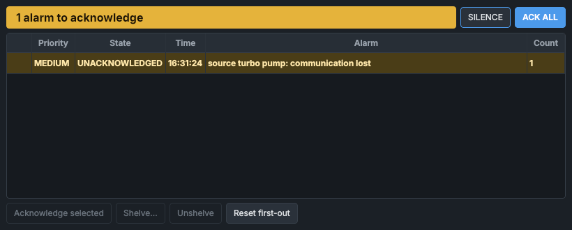

# Alarms

The **Alarms** panel lists the machine's alarms, most urgent first, sounds the horn for new ones, and is where you acknowledge, shelve and silence them. The alarms come from the alarm service (`service_alarms`), which checks every service's data twice a second; the panel shows its list.

> [!IMPORTANT]
> Acknowledging an alarm does not reset a PLC fault. A PLC fault stays latched until it is reset with **RESET FAULTS** on the [System Health](system-health.md) panel; only then does its alarm clear.

## What the panel shows

The banner at the top sums up the list:

| Banner | Colour | Meaning |
|---|---|---|
| **1 alarm to acknowledge**, **2 alarms to acknowledge** ... | the colour of the most urgent unacknowledged alarm in the list, shelved and suppressed ones included | Alarms are waiting for you. |
| **1 active alarm (acknowledged)** ... | amber | Alarms are active, and all have been acknowledged. |
| **No active alarms** | green | Nothing is active or waiting. |
| **ALARM SERVICE NOT RUNNING** | red | See [If the alarm service is not running](#if-the-alarm-service-is-not-running). |

After the count, the banner adds how many alarms are shelved, and **silenced** while the horn is silenced with alarms waiting.

The list has one row per alarm:

| Column | Shows |
|---|---|
| (first column) | A star for the first-out alarm, a "zzz" sign for a shelved alarm, a curved arrow for a suppressed one. |
| **Priority** | **CRITICAL**, **HIGH**, **MEDIUM** or **LOW**. |
| **State** | **UNACKNOWLEDGED**, **ACKNOWLEDGED** or **CLEARED, UNACKNOWLEDGED**. |
| **Time** | When the alarm last became active; for a cleared alarm, when it cleared. |
| **Alarm** | What is wrong. A shelved alarm adds when its shelf ends and why it was shelved. The tooltip gives the alarm's name, for example `plc.Safety_Relay_Tripped`. |
| **Count** | How many times the alarm has become active. |

Unacknowledged alarms come first, then cleared-unacknowledged ones, then acknowledged ones; within each group, by priority and then newest first. Shelved and suppressed alarms come last.

### Priorities and colours

| Priority | Colour | Sound |
|---|---|---|
| **CRITICAL** | red | Sounds, loudest. |
| **HIGH** | orange | Sounds. |
| **MEDIUM** | yellow | Sounds, quieter. |
| **LOW** | blue | Never sounds: listed only. |

Each priority that sounds has a sound of its own.

### States

| State | Row | Meaning |
|---|---|---|
| **UNACKNOWLEDGED** | Flashes between its priority's colour and a softer shade; bold. | The condition is active and nobody has acknowledged it. It sounds the horn. |
| **ACKNOWLEDGED** | The softer shade, steady. | The condition is still active. The alarm leaves the list when the condition clears. |
| **CLEARED, UNACKNOWLEDGED** | Its priority's colour, steady; bold italic. | The condition cleared before anyone acknowledged it. It does not sound, and leaves the list when you acknowledge it. |
| Shelved or suppressed | Grey. | Listed, but it does not sound and does not count as waiting. |

An alarm becomes active only once its condition has held for the alarm's delay (5 s for a lost connection, for example), so a brief flicker raises nothing. When the data an alarm depends on stops arriving, the alarm keeps its state; the lost data raises an alarm of its own.

## Controls

| Control | What it does |
|---|---|
| Click a row | Selects that alarm; **Ctrl**+click or **Shift**+click selects several. The selection stays with the alarms when the list is re-sorted. |
| **SILENCE** | Stops the horn without acknowledging anything. The next new alarm sounds again. |
| **ACK ALL** | Acknowledges every alarm waiting, shelved and suppressed ones included. |
| **Acknowledge selected** | Acknowledges the selected alarms. Greyed out until the selection includes an unacknowledged alarm. |
| **Shelve...** | Shelves the selected alarm (see [Shelving](#shelving)). Greyed out unless exactly one alarm is selected. |
| **Unshelve** | Ends the shelf of the selected shelved alarms. Greyed out until the selection includes a shelved alarm. |
| **Reset first-out** | Clears the first-out mark, so that the next PLC trip is marked (see [First-out](#first-out)). |

The tooltips of **Acknowledge selected**, **Shelve...** and **Unshelve** say what they would act on, or how to select.

## The horn

The horn plays the sound of the most urgent alarm that is unacknowledged, active, and neither shelved nor suppressed, over and over until that alarm is acknowledged or the horn is silenced. A more urgent alarm changes the sound to its own. Low-priority alarms and cleared alarms never sound.

**SILENCE** stops the sound until another alarm becomes unacknowledged. It acknowledges nothing: the alarms stay in the list, waiting.

The horn sounds whenever the HMI is running, even with the **Alarms** panel closed or behind another panel's tab. Each HMI that is running has its own horn.

## Acknowledging

Acknowledge an alarm to record that you have seen it: select it and press **Acknowledge selected**, or press **ACK ALL**.

- An active alarm becomes ACKNOWLEDGED. It stops sounding and stays in the list until its condition clears.
- A cleared alarm (CLEARED, UNACKNOWLEDGED) leaves the list.

Acknowledging changes nothing on the machine. A PLC fault stays latched until it is reset with **RESET FAULTS** on the System Health panel; then its alarm clears and, once acknowledged, leaves the list. A supply's arc alarm is latched in the same way until the fault reset.

Acknowledgements are recorded in the event log and survive a restart of the alarm service.

## Shelving

Shelve an alarm to take it out of annunciation for a while, for example while a gauge is being replaced. Select one alarm and press **Shelve...**:

1. Under **Shelve for:**, choose how long: 1 to 480 min (30 min to start with).
2. Under **Reason:**, type why. **OK** stays greyed out until there is a reason.
3. Press **OK**.

A shelved alarm does not sound and does not count as waiting, even if its condition clears and comes back. It stays in the list, grey and near the bottom, with the time its shelf ends and the reason. The alarm service still tracks its condition. Shelving does not acknowledge the alarm.

The shelf ends by itself at the time shown; **Unshelve** ends it early. The alarm then comes back in whatever state it is in: if it is active and unacknowledged, it sounds. Shelves survive a restart of the alarm service.

## First-out

When the PLC trips, one fault often brings others with it. Among the PLC fault alarms, the first to become active since the last **Reset first-out** is marked with a star, so that the cause of a cascade of trips stands out.

No later PLC alarm is marked until you press **Reset first-out**, even after the marked alarm has left the list. Press it once the cause is understood, so that the next trip is marked. The mark survives a restart of the alarm service.

## Suppressed alarms

A suppressed alarm is explained by another alarm that is active. Each vacuum gauge's communication alarm is suppressed while a gauge controller's (GRAPHIX) communication alarm is active, so that only the controller's alarm sounds. A suppressed alarm is listed grey, with **(suppressed: explained by another alarm)**, and does not sound.

## What leaves the list when

| Alarm | Leaves the list when |
|---|---|
| ACKNOWLEDGED | Its condition clears. |
| CLEARED, UNACKNOWLEDGED | You acknowledge it. |
| UNACKNOWLEDGED | It has been acknowledged and its condition has cleared, in either order. |
| Shelved | Its shelf has ended, and it has been acknowledged and is clear. |

## Where the alarms come from

| Alarm | Priority |
|---|---|
| A PLC fault: **PLC:** and the fault's description, one alarm per fault bit | High, or medium for the faults of severity 2 in `config/fault_config.json`. Critical for the safety relay trip and the PC watchdog. |
| **No data from the PLC service - machine state unknown**, **The PLC service has lost the PLC** | Critical |
| **No data from the service manager** | High |
| A service that is not running, has crashed, hangs or is waiting to be restarted | High |
| A service stopped by an operator (**was stopped by the operator**) | Low |
| A device that has lost communication (**communication lost**) | Medium |
| A gauge's pressure above its set point, or rising rapidly | High |
| A gauge's pressure approaching its set point | Medium |
| **Gauge relay set points not confirmed against vac_gauges_config.json** | High |
| A supply's arc (**arc (output collapsed) - latched until fault reset**) | High |
| A failed recipe, mass scan or optimiser sweep (**failed:** and the reason) | Medium. It clears when the next run of the same kind starts. |

The rules, priorities and delays are in `config/alarm_config.json`, which the alarm service reads when it starts (see [Configuration files and the config editor](../engineering/configuration.md)). Every change of an alarm (active, cleared, acknowledged, shelved, unshelved) is recorded as an `ALARM` event in `data/events.db`.

## If the alarm service is not running

When no list arrives from the alarm service, the banner reads **ALARM SERVICE NOT RUNNING** and the panel raises a critical alarm of its own: **The alarm service is not running - alarms are NOT being monitored. Restart it from the Service Manager panel.** It sounds the critical horn. You can silence it but not acknowledge it; it goes when the alarm service is back. Restart `service_alarms` on the [Service Manager](service-manager.md) panel. The same happens for a moment each time the HMI starts, until the first list arrives.

## See also

- [Alarms and faults](../procedures/alarms-and-faults.md)
- [Alarm handling](../how-it-works/alarms.md)
- [System Health](system-health.md)
- [Service Manager](service-manager.md)
- [Messages and what they mean](../messages.md)
- [How the controls behave](../getting-started/controls-and-colours.md)
