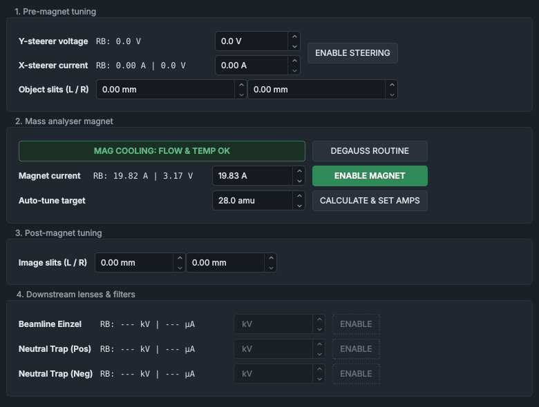

# Beamline Optics

The **Beamline Optics** panel sets the beam steerers, the analyser magnet and the downstream lenses, and records the slit widths you set by hand. **CALCULATE & SET AMPS** sets the magnet for a chosen mass from the mass-scan calibration.

## What it shows

The panel follows the beam in four groups:

- **1. Pre-magnet tuning**: the **Y-steerer voltage** (electrostatic, through the PLC), the **X-steerer current** (magnetic, on its own power supply), **ENABLE STEERING** for both, and the **Object slits (L / R)**.
- **2. Mass analyser magnet**: the magnet cooling chip, **DEGAUSS ROUTINE**, the **Magnet current** and the **Auto-tune target** mass.
- **3. Post-magnet tuning**: the **Image slits (L / R)**.
- **4. Downstream lenses & filters**: the **Beamline Einzel**, **Neutral Trap (Pos)** and **Neutral Trap (Neg)** Spellman supplies.

The readbacks start with **RB:**.

| Row | Readback |
|---|---|
| **Y-steerer voltage** | The voltage the PLC is applying, V: its working setpoint, 0 V while steering is off. There is no measured readback. |
| **X-steerer current** | Current, A, and voltage, V, from the steerer power supply. |
| **Magnet current** | Current, A, and voltage, V, from the magnet power supply. |
| Downstream lenses | Voltage, kV, and current, µA. |

As on the other panels, dashes mean a value isn't known, an empty setpoint box means its setpoint isn't known, and an amber outline means a readback has stayed outside its tolerance of the setpoint (`config/readback_tolerance.json`; information, not a fault).

The magnet cooling chip shows the PLC's magnet coolant switch (water flow and thermal cut-out):

| Chip | Colour | Meaning |
|---|---|---|
| **MAG COOLING: FLOW & TEMP OK** | green | The switch is made. |
| **MAG COOLING: FAULT** | red | The switch is open. The PLC latches **MAG_COOLANT_FLOW_LOW** and drops the safety relay's permissive, so the relay opens. |
| **MAG COOLING: UNKNOWN** | dashed outline | No PLC data. |

## Controls

| Control | What it does |
|---|---|
| **ENABLE STEERING** | Two clicks switch both steerers on: the Y steerer (through the PLC) and the X-steerer power supply. One click switches both off. Green only when both are on. Greyed out if either service won't take a command. |
| **Y-steerer voltage** box | −200 V to +200 V, sent to the PLC. Shows the PLC's requested setpoint, steering on or off. |
| **X-steerer current** box | 0 A up to the steerer's limit (80 A hard cap), sent to the steerer service. |
| **ENABLE MAGNET** | Two clicks switch the magnet power supply's output on, one switches it off. |
| **Magnet current** box | 0 A up to the magnet's limit (95 A hard cap), sent to the magnet service, which also sets the supply's voltage limit from it. |
| **DEGAUSS ROUTINE** | Two clicks (**CONFIRM DEGAUSS?**) start the magnet service's degauss. Reads **DEGAUSSING...** (violet) while it runs. See [Degaussing the magnet](#degaussing-the-magnet). |
| **Auto-tune target** box | The mass, in amu (1 to 250), for **CALCULATE & SET AMPS**. It sends nothing by itself. |
| **CALCULATE & SET AMPS** | One click works out the magnet current for that mass and sends it. See [Setting the magnet for a mass](#setting-the-magnet-for-a-mass). |
| Slit boxes | Record the widths, in mm, that you set by hand on the **Object slits** (before the magnet) and **Image slits** (after it): typically 10 mm each for a first tune. Entering one writes a marker to the event log ("Manual Adjustment: Object Slit Left set to 2.5 mm"); nothing is sent to the machine. Greyed out while the events service isn't running. |
| **ENABLE** (downstream lenses) | Two clicks switch a Spellman supply on, one switches it off. |
| Lens boxes | Voltage in kV, sent to the Spellman service. |

The first click on a two-click button turns it amber and asks for confirmation (**CONFIRM STEERING?**, **CONFIRM MAGNET?** and so on); the second click must come within 4 s. A setpoint box sends what you type on Enter or when you move on to another control, and Escape drops it. [How the controls behave](../getting-started/controls-and-colours.md) has the details.

The magnet controls (**ENABLE MAGNET**, the **Magnet current** box, **DEGAUSS ROUTINE**, the **Auto-tune target** box and **CALCULATE & SET AMPS**) are greyed out together, with the magnet service's reason as their tooltip: magnet PSU not connected, the safety relay de-energised (or no PLC data), or a sequence holding the magnet. A mass scan, the optimiser or a recipe holds what it drives while it runs; take it back with **TAKE CONTROL** in the [Automation bar](automation-bar.md).

## Degaussing the magnet

**DEGAUSS ROUTINE** starts the magnet service's degauss sequence. The service switches the magnet output on and steps the current through the list `degauss_steps_amps` in `config/magnet_config.json`, holding each step for `degauss_step_time_sec`. As configured now that is 50, 0, 40, 0, 30, 0, 20, 0, 10, 0, 5 and 0 A, 10 s each: about 2 minutes. It ends at 0 A with the output still on.

A new magnet setpoint, typed or from **CALCULATE & SET AMPS**, ends the degauss and takes the magnet to that setpoint. The safety relay dropping also ends it. The service won't start it if a step is past the 95 A hard cap.

## Setting the magnet for a mass

Type the mass in the **Auto-tune target** box and click **CALCULATE & SET AMPS**. The panel takes the calibration from the [Mass Scan](mass-scan.md) panel, `AMU = k (I + I_off)^2 / E`, with E the live beam energy: the target (cathode) plus extraction voltage readbacks, for singly charged ions. It works out the magnet current I, puts it in the **Magnet current** box and sends it. It also writes a marker in the event log giving the current, mass, energy, k, I_off and where the calibration came from: fitted to peaks, loaded from a trace, entered by hand, or "default values (not fitted this session)".

It sends nothing, and says why in a message, when:

- the target or extraction readback isn't known (**Beam energy unknown**);
- the beam energy isn't positive (**Calculation error**);
- the current would be past the 95 A hard cap (**Hard cap**) or outside the box's range (**Out of range**).

> [!TIP]
> The mass scan calibrates with the current rising, and the magnet has hysteresis. Approach the current from below, or degauss first, for the best match.

## Things to know

- When the safety relay drops, the magnet and X-steerer services force their outputs to 0 A and off, and keep them off when the relay comes back. Switch them on and set them again.
- The magnet service sets the power supply's voltage limit from the current; it doesn't take voltage setpoints. Until the supply has reported its ratings, the service accepts only 0 A and output off.
- The magnet service checks the coil's resistance and reads the supply's own alarms (over-temperature, power fail, over-voltage, over-current). These go to the PLC, which latches them as faults (**MAGNET_SHORT_CIRCUIT**, **MAGNET_PSU_OVERTEMP** and the like) on the [System Health](system-health.md) panel.
- The aperture ladder has no control in the HMI: it is set by hand, and fully retracted gives the largest opening.
- In the present `config/mpd_config.json` only the source einzel is configured, so the three downstream lens rows show dashes and stay greyed out ("not configured in mpd_config.json" with the relay on).

> [!CAUTION]
> The X-steerer power supply is not powered through the safety relay. Its only interlock is the steerer service, which holds it at 0 A and off while the relay is off or the PLC is silent. A de-energised relay doesn't mean the X steerer is dead.

## See also

- [Mass Scan](mass-scan.md)
- [Optimiser](optimiser.md)
- [Bringing up a beam](../procedures/beam-start-up.md)
- [Selecting a mass and tuning the beam](../procedures/tuning-the-beam.md)
- [Faraday Cup & SMU](faraday-cup-smu.md)
- [The Automation bar](automation-bar.md)
- [Experiment Logging](experiment-logging.md)
- [How the controls behave](../getting-started/controls-and-colours.md)
