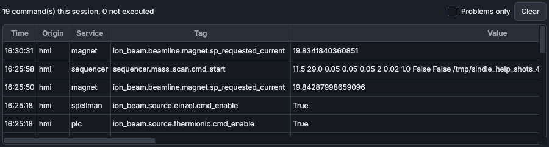

# Command Log

The **Command Log** panel lists the commands this HMI has sent since it started, newest first, with the answer each service gave. Look here when a click seems to have done nothing: the answer says whether the command was carried out and, if not, why.

## What it shows

The line at the top counts the session's commands: **No commands yet**, or for example **12 command(s) this session, 1 not executed**.

| Column | Shows |
|---|---|
| **Time** | When the answer came back, by the HMI PC's clock. |
| **Origin** | Who sent the command: `hmi` for this HMI. |
| **Service** | The service the command went to: `plc`, `spellman`, `magnet`, `steerer_magnet`, `smu`, `vacuum`, `src_turbo`, `adam`, `sequencer`, `alarms` or `manager`. |
| **Tag** | The tag the command set. The tooltip shows it in full. |
| **Value** | The value sent. For a command with several fields (to the service manager, the sequencer, the alarm service, or a take of control) the field values are listed one after another, for example `restart service_plc` or `take`. |
| **Result** | The answer (below). |
| **Reason** | Why, when the service gave a reason. The tooltip shows it in full. |

The table keeps the latest 500 commands; older ones drop off the bottom.

## Results

| Result | Colour | Meaning |
|---|---|---|
| **OK** | normal | The service carried out the command (written to the PLC or the device). |
| **ACCEPTED** | normal | The service received the command and it passed every check; the service reported no separate result. |
| **REJECTED** | red | The service refused the command before touching the hardware: out of its limits or past a hard cap, locked out, held by a sequence, sent too long ago, an unknown tag. Nothing was done. |
| **FAILED** | red | The service tried, but the device write failed or the device is not answering. |
| **TIMEOUT** | amber | No answer in time (3 s for most commands): the service is busy, hung, or was restarted while the command was on its way. The HMI can't tell whether it was carried out: check the readback. |
| **UNREACHABLE** | amber | The service is not running or not connected. Nothing was sent. |

A command that was not carried out (any result other than OK or ACCEPTED) also pops up for 7 s at the top right of the HMI: **Command refused**, **Command failed**, **No reply to command** or **Service not running**, with the tag, the value, the result and the reason. The same command with the same result pops up at most once every 5 s; every one is still listed here.

Some reasons you may see:

| Reason | Meaning |
|---|---|
| **stale: sent** ... **s ago (limit** ... **s)** | The command reached the service too late (the HMI or the service was busy), so it was dropped rather than carried out late. |
| ... **is controlled by** ... **- stop it, or take control, first** | A sequence holds that subsystem. See [The Automation bar](automation-bar.md). |
| **Hard cap:** ... | The value is past a limit fixed in the code. |
| ... **is outside the allowed range** ... | The value is outside the limits in the tag registry. |
| ... **service is not running or not connected** | With UNREACHABLE: start the service on the [Service Manager](service-manager.md) panel. |
| **no reply from** ... **within** ... **s** | With TIMEOUT. |

[Messages and what they mean](../messages.md) explains more of them.

## Controls

| Control | What it does |
|---|---|
| **Problems only** | Shows only the commands that were not carried out (hides OK and ACCEPTED). |
| **Clear** | Empties the table and resets the counts. The permanent record (below) is not touched. |

## What is not in the list

The panel lists only what this HMI sent in this session. It starts empty each time the HMI starts, and it does not show:

- the commands that recipes, mass scans and optimiser sweeps send, because those run in the sequencer service, not in the HMI. Starting, pausing, stopping and answering them from the HMI is listed;
- commands sent by another HMI or by scripts;
- the panels fetching scan points from the sequencer.

Every command that reaches a service, from any program, is recorded by that service with its answer, the sender and the lease it was sent under: as an event of type `COMMAND` in `data/events.db`, and in the service's own log file in `SystemLogs/`. The data viewer shows these events when **Operator Commands (audit)** is ticked under **Event markers**. A command that never reached a service (UNREACHABLE) has no `COMMAND` event; the HMI writes the ones it sent, like every command that was not carried out, to its own log file.

## See also

- [Messages and what they mean](../messages.md)
- [Troubleshooting](../troubleshooting.md)
- [The Automation bar](automation-bar.md)
- [Service Manager](service-manager.md)
- [How the controls behave](../getting-started/controls-and-colours.md)
- [Services and messaging](../how-it-works/services.md)
