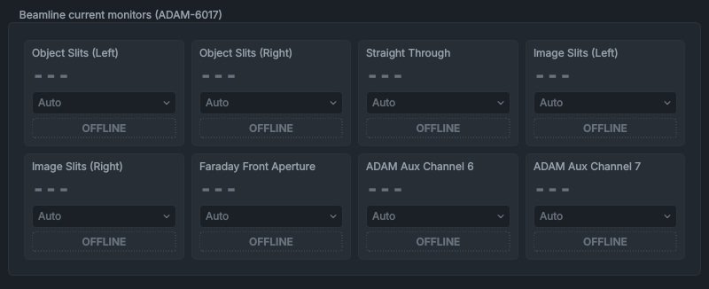

# Current Monitoring

The **Current Monitoring** panel shows the beam current collected on the beamline's slits and apertures, measured on eight inputs of an ADAM-6017 analogue input module: the object and image slit jaws, the straight-through input, the Faraday cup's front aperture and two spare channels.

> [!NOTE]
> At present the ADAM module is out of use (a hardware fault), and the service manager doesn't start its service, so every card shows **OFFLINE**. To bring it back once the module is repaired, uncomment its entry in `SERVICES_CONFIG` in `src/services/service_manager.py`, keeping the key `service_adam_monitor`.

## What it shows

The **Beamline current monitors (ADAM-6017)** group has a card for each input: **Object Slits (Left)**, **Object Slits (Right)**, **Straight Through**, **Image Slits (Left)**, **Image Slits (Right)**, **Faraday Front Aperture**, **ADAM Aux Channel 6** and **ADAM Aux Channel 7**. Each card shows the current, an input range drop-down and a status chip.

The ADAM module measures a voltage on each input; the ADAM service divides it by 100 kΩ to give the current, and corrects the sign of the inputs wired the other way round. The current is shown with its sign, in mA, µA, nA or pA, whichever fits.

| Chip | Colour | Meaning |
|---|---|---|
| **OK [+/- 1 V]** | green | A valid reading. The brackets give the input range in use (**UNKNOWN** if the service doesn't say). |
| **CLIP [+/- 1 V]** | amber | The input is at the end of its range: the value reads **OVERRANGE**. Choose a wider range, or **Auto**. |
| **RANGING** | blue | The module is changing range: the value reads **RANGING...** for about 1 s. |
| **OFFLINE** | dashed outline | No data from the ADAM service, the module isn't answering, or the PLC link is down. The value reads `---` and the drop-downs are greyed out. |

## Controls

| Control | What it does |
|---|---|
| Range drop-down | Choosing an entry sends it to the ADAM service at once. **Auto** lets the service choose the range; the others fix it. The drop-down follows the range mode the service reports, except while it has the keyboard focus. Greyed out while the card is **OFFLINE**. |

The ranges, and the full-scale current each gives through 100 kΩ:

| Range | Full scale |
|---|---|
| **+/- 150 mV** | ±1.5 µA |
| **+/- 500 mV** | ±5 µA |
| **+/- 1 V** | ±10 µA |
| **+/- 5 V** | ±50 µA |
| **+/- 10 V** | ±100 µA |

In **Auto**, which every input starts in, the service puts the input on the smallest range whose 75 % is above the reading, and goes straight to **+/- 10 V** when the input saturates. Each change takes about 1 s to settle, shown as **RANGING**.

## Things to know

- The mouse wheel doesn't change a range drop-down: click it and choose.
- When the service runs, the logger records these currents with the rest of the telemetry, so the [data viewer](../viewer/data-viewer.md) can plot them.
- The Faraday cup current itself is measured by the SMU, on the [Faraday Cup & SMU](faraday-cup-smu.md) panel.

## See also

- [Faraday Cup & SMU](faraday-cup-smu.md)
- [Beamline Optics](beamline-optics.md)
- [Service Manager](service-manager.md)
- [Troubleshooting](../troubleshooting.md)
- [How the controls behave](../getting-started/controls-and-colours.md)
