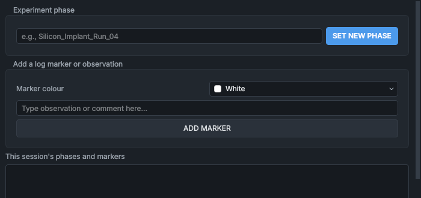

# Experiment Logging

The **Experiment Logging** panel records the phases of an experiment and your observations as time-stamped events, alongside the logged machine data. They appear on the plots in the data viewer, so you can see later what was happening when.

## Controls

| Control | What it does |
|---|---|
| **Experiment phase** box and **SET NEW PHASE** | Records the start of a new phase with the name you type, for example a run name. Press **SET NEW PHASE**, or **Enter** in the box. The name is stored in capitals. |
| **Marker colour** | The colour of the next marker: **White**, **Cyan**, **Yellow**, **Magenta**, **Purple** or **Pink**. |
| Observation box and **ADD MARKER** | Records a marker with the text you type, in the chosen colour, at the moment you press **ADD MARKER** (or **Enter** in the box). |
| **This session's phases and markers** | What you have recorded in this panel since the HMI started, newest first, with the time: phases in bold with a green square, markers with their colour. |

Nothing is recorded for an empty box.

### When the panel is greyed out

The panel's controls are greyed out when the events service, which writes the events to the database, is not running, or when the HMI can't tell:

| Tooltip | Meaning |
|---|---|
| **Disabled: service_events is** and a state | `service_events` is not ONLINE. Start or restart it on the [Service Manager](service-manager.md) panel. |
| **Disabled: Service Manager is offline.** | No word from the service manager for 2.5 s, so the HMI can't tell whether the events service is running. |

## Where phases and markers are stored

Both are events in the events database, `data/events.db` (in the simulator, `data_sim/events.db`), written by `service_events`:

| You record | Stored as |
|---|---|
| A phase | An event of type `PHASE_CHANGE`, with the message **PHASE CHANGE:** and the name in capitals. |
| A marker | An event of type `USER_MARKER`, with your text as the message and the colour. |

They are kept with the rest of the event log, and the nightly backup copies the database. The list in the panel is not read from the database: it starts empty each time the HMI starts, and it does not show markers added elsewhere.

## Where they appear

In the [data viewer](../viewer/data-viewer.md), events are drawn on the plots at their time. Tick them under **Event markers** in the sidebar:

- **User Markers** (ticked when the viewer starts): the markers, as lines in their colour, with their text. A colour that would not stand out against the plot background (white on the light theme, for example) is darkened or lightened until it does.
- **Phase Changes**: the phase changes, as green lines.

Click an event's label or line in the viewer to read it in full. A user marker can be deleted there (right-click it); a phase change can't.

The panel is not the only source of user markers. Others are added by:

| Source | Colour | Text |
|---|---|---|
| The data viewer (double-click a plot) | the one you choose | your text |
| The [Optimiser](optimiser.md), at the start and end of a sweep | cyan | **Scan of** ... **against** ... |
| A double-click on the [Mass Scan](mass-scan.md) plot | purple | **Manual Magnet Jump:** ... |
| **CALCULATE & SET AMPS** on the [Beamline Optics](beamline-optics.md) panel | blue | **Magnet set to** ..., with the calibration used |
| A slit width typed on the Beamline Optics panel | purple | **Manual Adjustment:** ... |

The panel's **Cyan** and **Purple** are the same colours as the optimiser's and the magnet jumps' markers, so a different colour keeps your own markers apart from them.

> [!NOTE]
> The colours mean nothing to the software. Any convention for what each colour means is the lab's, and is to be confirmed.

## See also

- [Recording an experiment](../procedures/recording-an-experiment.md)
- [Using the data viewer](../viewer/data-viewer.md)
- [Data logging and storage](../how-it-works/data-logging.md)
- [Service Manager](service-manager.md)
