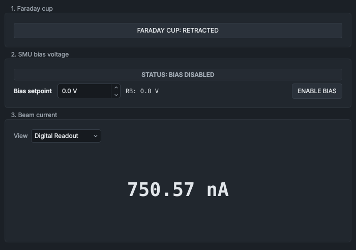

# Faraday Cup & SMU

The **Faraday Cup & SMU** panel moves the Faraday cup into and out of the beam, sets the bias that the source-measure unit (SMU) puts on the cup, and shows the beam current the SMU measures.

## What it shows

**1. Faraday cup** is one button that both shows where the cup is, from the PLC's inserted and retracted flags, and moves it:

| Button | Colour | Meaning |
|---|---|---|
| **FARADAY CUP: INSERTED** | blue | In the beam path. |
| **FARADAY CUP: RETRACTED** | plain | Out of the beam path. |
| **FARADAY CUP: TRAVELLING** | amber | Neither flag is set: the cup is moving, or unpowered. |
| **FARADAY CUP: LOGIC ERROR** | red | Both flags are set. |
| **FARADAY CUP: UNKNOWN** | dashed outline | No live position: no PLC data. The button's tooltip says what the position was, and when. |

**2. SMU bias voltage** has a status chip, the **Bias setpoint** box, the bias readback (**RB:**, V) and **ENABLE BIAS**.

| Chip | Colour | Meaning |
|---|---|---|
| **STATUS: BIAS LIVE** | amber | The bias is on. |
| **STATUS: BIAS DISABLED** | grey | The bias is off: the SMU holds the cup at 0 V. |
| **STATUS: SAFETY LOCK** | grey | The safety relay is off: the SMU service holds the bias at 0 V and off. **RB** reads 0.0 V. |
| **STATUS: SMU OFFLINE** | red | The SMU isn't answering, the SMU service is silent, or the PLC link is down. |
| **STATUS: OFFLINE** | dashed outline | No data yet. |

**3. Beam current** shows the current the SMU measures on the cup, as a number (**Digital Readout**) or on a dial (**Analog Gauge**), chosen with **View**.

- The number is in mA, µA, nA or pA, whichever fits, with a minus sign for a negative current.
- On the dial, the needle shows the size of the current against the **Dial scale**, and the large sign shows its polarity. The arc is green for a positive current, blue for a negative one, and amber above 95 % of the scale.
- **NO MEASUREMENT** shows in amber while the safety relay is off, and in red with **STATUS: SMU OFFLINE**. `---` means there is no reading.

## Controls

| Control | What it does |
|---|---|
| **FARADAY CUP: ...** button | One click asks the PLC to insert the cup if it is out, or to retract it if it is in. No confirmation. |
| **Bias setpoint** | The bias in V, from −200 V to +200 V (the SMU bias hard cap). Type it and press Enter, or move on to another control. The SMU service takes it only while the bias is on. |
| **ENABLE BIAS** | One click switches the bias on or off; green while it is on. No confirmation. |
| **View** | **Digital Readout** or **Analog Gauge**. |
| **Dial scale** | The full scale of the dial: **10nA**, **100 nA**, **1 µA**, **10 µA**, **100 µA** or **1 mA**. Shown only with **Analog Gauge**. |

The cup button is greyed out while the PLC link is down, while compressed air is lost ("Facility air pressure is lost. Actuator cannot be moved."), while the PLC is holding the cup itself ("Faraday Cup is locked ... by an active PLC sequence"), or when the PLC service gives a reason, such as a sequence holding the cup.

The bias controls are greyed out while the SMU or the PLC link is offline, while the safety relay is off ("Bias requires Safety Relay to be closed."), or when the SMU service gives a reason, such as a mass scan holding the SMU. Take a held control back with **TAKE CONTROL** in the [Automation bar](automation-bar.md).

## The bias

- **Switch the bias on first, then set it.** The SMU service refuses a bias setpoint while the bias is off ("bias output is disabled - enable it before setting a voltage").
- **Switching the bias off sets 0 V**, and switching it on again doesn't bring the old value back: type the bias again.
- **A safety relay trip** makes the SMU service set 0 V, switch the bias off and forget the setpoint. Set it again once the relay is back on.
- **If the SMU reconnects**, the service restores the bias it had only if fresh PLC data confirms the relay is on; otherwise it starts at 0 V with the bias off.
- The **Bias setpoint** label's tooltip says: positive bias suppresses secondary electron emission; negative bias repels ambient electrons.

> [!IMPORTANT]
> For a correct beam-current measurement, set a bias of more than 50 V.

## The current measurement

The SMU service ranges the SMU itself, through 10 nA, 100 nA, 1 µA, 10 µA, 100 µA and 1 mA. It moves up a range when the current passes 95 % of the present one (or overloads it) and down when it falls below 8 %, and discards the reading taken while the range changes. The SMU's current compliance is `compliance_current` in `config/smu_config.json`.

The SMU measures the cup current whether or not the bias is on; with the bias off it holds the cup at 0 V. The [Mass Scan](mass-scan.md) and the [Optimiser](optimiser.md) panels both use this current as their beam reading, and a mass scan holds the SMU while it runs.

## Things to know

- The PLC also changes the cup request itself, at PLC start-up, during shutdown sequences and when a fault latches, so the cup can move without a click here. The button always shows the PLC's inserted and retracted flags.
- The cup and the bias are switched with one click each: unlike the source and magnet supplies, they don't ask for a confirming second click.

## See also

- [Beamline Optics](beamline-optics.md)
- [Mass Scan](mass-scan.md)
- [Current Monitoring](current-monitoring.md)
- [Bringing up a beam](../procedures/beam-start-up.md)
- [Selecting a mass and tuning the beam](../procedures/tuning-the-beam.md)
- [The Automation bar](automation-bar.md)
- [How the controls behave](../getting-started/controls-and-colours.md)
