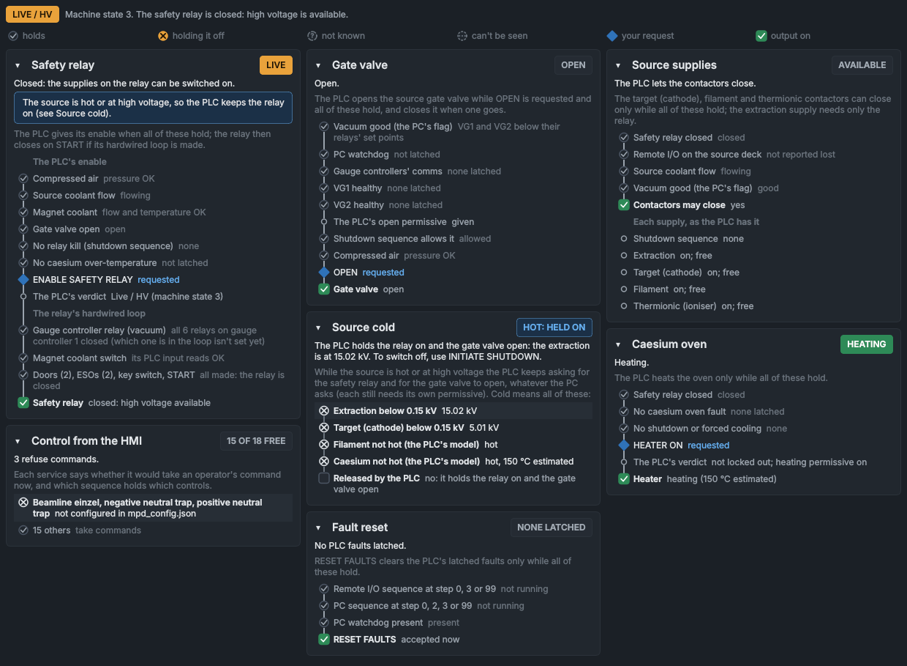
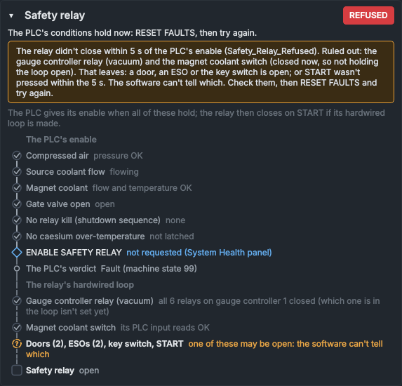

# Interlocks

The **Interlocks** panel shows every interlock between you and the machine, and what is holding each one now: why the safety relay won't switch on, why the gate valve won't open, why the source supplies or the caesium oven can't be switched on, whether a fault reset would be accepted, and which controls the services are refusing. It only shows; it has no controls.

In the default layout it is a tab behind **System Health**. **View > Panels > Interlocks** opens it if it has been closed.

## Reading a card

Each card is one permissive: the conditions the PLC (or the PC) needs, one under another, and at the bottom what they allow, such as the safety relay closing. All of them must hold, as in a rung of ladder logic. The line down the left of the card is solid as far as the conditions hold and dashed after the first one that doesn't, so your eye goes straight to what is holding it.

The marks along the line:

| Mark | Meaning |
|---|---|
| Grey circle with a tick | The condition holds. |
| Circle with a cross | The condition doesn't hold, so it holds the output off. It is amber when you have asked for the output (or the card is in trouble), red for a latched PLC fault, and plain otherwise: the machine simply isn't on yet. The first such row is shaded, and the card's summary names it. |
| Dashed circle with **?** | Not known: the PLC or the service that reports it isn't sending data, or it hasn't been read yet. |
| Dotted circle | Part of the safety relay's hardwired loop, which no software can see (see [When the relay won't close](#when-the-relay-wont-close)). |
| Blue diamond | Your request, such as **ENABLE SAFETY RELAY** or **OPEN**: filled while it is requested. |
| Small circle | The PLC's own verdict, or something worth knowing that isn't a condition. |
| Square | The output. Green while it is on. |
| Violet dot | A recipe, scan or optimiser run holds these controls. |

The key at the top of the panel shows the marks. Above it are the machine state as the PLC reports it (**SAFE / NOT READY**, **READY**, **LIVE / HV**, **FAULT**) and what that means now, including any shutdown sequence that is running. **PLC OFFLINE** (dashed) means there is no data from the PLC, so every condition it reports is unknown.

Under each card's heading is one sentence: what holds the output off, or what it would take. Then come any notes, a line saying what the card decides, and the conditions.

- **(see Gate valve)** after a condition, and the like, goes to the card that explains it.
- Hold the mouse over a condition to see the tag it is read from. Plot that tag in the [data viewer](../viewer/data-viewer.md) to see its history.
- Click a card's heading to fold it away; click again to open it. The panel remembers which cards you fold.
- The cards stand in one column in a narrow panel, and two or three side by side in a wide one.

## The cards

### Safety relay

The PLC gives the relay's loop its enable when all of these hold, and you have pressed **ENABLE SAFETY RELAY**:

- compressed air pressure OK;
- source coolant flowing;
- magnet coolant flow and temperature OK;
- the gate valve open;
- no relay kill from a shutdown sequence;
- no `Cesium_Oven_OverTemp` latched.

**The PLC's verdict** is its machine state: **Ready** means it counts these conditions as met. The summary goes by it: if the PLC reports not ready although the conditions listed hold, the summary says so.

The relay then closes when **START** is pressed, if its hardwired loop is made. The card lists the loop as well: the gauge controller's set-point relay, the magnet coolant switch, and the doors, ESOs, key switch and **START**.

| Chip | Meaning |
|---|---|
| **OFF** | The relay is open and nothing has been asked for. |
| **PRESS START** | The PLC gives its enable: press **START** on the **High Voltage Systems Control** box. The summary counts down the seconds left. |
| **HELD** | Requested, but a condition holds the enable off. |
| **LIVE** (amber) | The relay is closed: high voltage is available. |
| **REFUSED** (red) | `Safety_Relay_Refused` is latched: the relay didn't close within 5 s of the enable. |
| **TRIPPED** (red) | `Safety_Relay_Tripped` is latched: the relay opened without being switched off. |

### When the relay won't close

The two door switches, the two ESOs and the key switch are wired in series in the relay's loop, with **START**. The PLC can't tell them apart: it only sees that it gave its enable for 5 s and the relay didn't close, so a door, an ESO or the key switch is open, or **START** wasn't pressed.

Two other things in the loop can be seen from the PC, and the card rules them in or out:

- **The gauge controller's set-point relay.** It closes when the gauge's pressure falls below its on point and opens when the pressure rises above its off point. The vacuum service reads each relay of gauge controller 1 about every 10 s. The card counts the relay as closed only on a current reading: read as closed within the last 25 s, with its gauge answering and the pressure no higher than the off point (and the relay's set points confirmed on the controller). A pressure above the off point counts as open, whatever was read before. Anything else counts as not known, for example a reading from before the vacuum service restarted. VG1's relays are only a backstop, at 10 mbar: its software trip closes the gate valve first, and a spike it rides through leaves them closed (see [Riding through short spikes (VG1)](vacuum.md#riding-through-short-spikes-vg1)).
- **The magnet coolant switch.** The PLC has an input from it.

When the relay has refused or tripped, a note says what that leaves. What the card can see is judged now: a gauge relay that is closed now isn't holding the loop open now, whatever it did when the relay refused.

Check those by hand (see [The safety relay does not switch on](../troubleshooting.md#the-safety-relay-does-not-switch-on)), press **RESET FAULTS** on the [System Health](system-health.md) panel, and try again.

If the gauge controller's relay in the loop is open, the card says so, with the gauge's pressure: that alone holds the loop open, though a door, an ESO or the key switch could be open as well. If one of the PLC's own conditions holds its enable off too, the note names it, and still says what the loop leaves for when it clears.

> [!NOTE]
> Which of gauge controller 1's relays is wired into the loop isn't recorded yet. Until it is set, the card checks every relay that `config/vac_gauges_config.json` lists for that controller (all six, as shipped): if they are all closed, the one in the loop is closed too; if one is open, it might be the one, and the card lists it with the doors, ESOs, key switch and **START**. While the safety relay is closed, an open relay can't be the one in the loop, and the card says so. Once the wiring has been checked, set it as `system_interlocks.safety_loop_relays` in that file, for example `["10.4"]` for controller 10 (gauge controller 1), relay 4 (see [Configuration files](../engineering/configuration.md)). If the relay you set reads open while the safety relay is closed, an amber note says the setting needs checking.

> [!NOTE]
> The card judges the gauge relay as it is now. A burst of pressure that opened the loop for a moment and has passed doesn't show on it: look at VG1 in the data viewer to see one.

### Gate valve

The PLC opens the source gate valve while **OPEN** is requested and all of these hold, and closes it when one goes:

- **Vacuum good (the PC's flag):** the vacuum service's judgment that VG1 and VG2 are below their set points (VG1: its software trip, with its 2.5 s ride-through), read recently, with their relays confirmed. When it isn't good, the card says why, for example `VG1 above its set point (9.5E-06 mbar)` or `the vacuum service isn't sending data`. Through a restart of the vacuum service the PLC keeps its last judgment for up to 60 s; the card then says how long is left.
- **PC watchdog:** `PC_Watchdog_Timeout` not latched, and the PLC still receiving the watchdog.
- **Gauge controllers' comms:** `Graphix_1_Comms_Fail` and `Graphix_2_Comms_Fail` not latched.
- **VG1 healthy** and **VG2 healthy:** none of the gauge's faults latched (not found, type mismatch, above set point, rapid rise). These stay latched after the pressure recovers, until **RESET FAULTS**.
- **The PLC's open permissive:** the PLC's own verdict on the conditions above. The summary goes by it.
- **Shutdown sequence allows it:** a shutdown at **CESIUM COOLDOWN** keeps the valve shut. As the PLC program reads, its permission also stays off after an operator shutdown until **RESET FAULTS**.
- **Compressed air:** the valve is pneumatic.

The chip shows the valve: **OPEN**, **CLOSED**, **MOVING** (between its limit switches) or **CONFLICT** (both limit switches made). See [Vacuum System](vacuum.md).

### Source cold

While the source is hot or at high voltage, the PLC keeps asking for the safety relay and for the gate valve to open, whatever the PC asks. Each still needs its own permissive: the gate valve closing still opens the relay. Cold means the extraction and target (cathode) readbacks are below 0.15 kV, and the PLC's models of the filament and the caesium aren't hot (the caesium's estimated temperature is shown).

| Chip | Meaning |
|---|---|
| **COLD** | The relay can be switched off and the gate valve closed. |
| **HOT: HELD ON** (blue) | The relay is closed and the PLC holds it on, with the gate valve open. The summary names the first reason, such as `the extraction is at 15.00 kV`. To switch off, use **INITIATE SHUTDOWN** on the [System Health](system-health.md) panel. This is why **ENABLE SAFETY RELAY** reads **RELAY ENERGIZED (LOCKED)**. |
| **HOT** (blue) | The relay is open, after a trip for example, so the source deck has no power, but the source isn't cold yet. The PLC keeps asking for the relay and for the gate valve to open until it is. |

### Source supplies

The target (cathode), filament and thermionic contactors can close only with the safety relay closed, the remote I/O on the source deck present, the source coolant flowing and the PC's vacuum flag good. The extraction supply needs only the relay.

The remote I/O can only be known with the relay closed: the PLC reports it lost only once the relay has been closed for 25 s, and clears that as the relay opens. With the relay open it shows as not known; with the relay closed and no loss reported, as **not reported lost**.

Below the conditions come any shutdown sequence that is running (the PLC then drives the supplies' setpoints itself), and each supply as the PLC has it: on or off, and whether it is locked out or driven by the PLC (PLC auto, auto-emission, arc quench).

The chip reads **AVAILABLE** or **HELD**.

### Caesium oven

The PLC heats the oven only with the safety relay closed (the oven is on the source deck), none of its faults latched (`Cesium_Oven_OverTemp`, `Cesium_Oven_HeatFail`, `Cesium_Oven_CoolFail`), and no shutdown or forced cooling. An operator shutdown cancelled at **HOLD HOT PHASE** leaves the forced cooling on until **RESET FAULTS** (a known issue in the PLC program); the card says so. Then come **HEATER ON** (your request, on the [TESS Ion Source Control](ion-source.md) panel), the PLC's lockout and heating permissive, and the heater.

The chip reads **HEATING** or **ON** (green), **OFF**, **HELD**, or **LOCKED OUT** (red, a latched fault).

### Fault reset

**RESET FAULTS** clears the PLC's latched faults only while:

- the remote I/O shutdown sequence is at step 0, 3 or 99;
- the PC shutdown sequence is at step 0, 2, 3 or 99;
- the PLC is receiving the PC's watchdog.

So a reset is refused during a hold, during an operator shutdown, and without the watchdog (see [The PLC program](../how-it-works/plc.md#resetting-faults)). The card says whether a reset would be accepted now, and lists the latched faults with their descriptions.

At step 2 of the PC sequence (**CESIUM COOLDOWN**) a reset is accepted, but it ends the cool-down with the caesium possibly still hot (a known issue in the PLC program). The card warns of it then.

The chip reads **NONE LATCHED**, the number latched (red, for example **2 LATCHED**), or **REFUSED NOW**.

### Control from the HMI

Each service says whether it would take an operator's command now. The card puts the subsystems that refuse together under their reason, for example `Extraction, target (cathode)` with `safety relay de-energised`, and lists the ones a recipe, scan or optimiser run holds, with a violet dot. These are the reasons a control is greyed out on the other panels. To take back controls a sequence holds, use the [Automation bar](automation-bar.md).

The chip counts the subsystems that take commands, for example **14 OF 22 FREE**.

## When the PLC's verdict doesn't match

Where the PLC publishes its own verdict, the card compares it with the conditions it lists: **Ready** in the machine state for the safety relay, the gate valve's open and close permissives, and the caesium oven's lockout. If they disagree for more than 3 s, an amber note says so, for example `The PLC's open permissive is given, but by the conditions listed it should be withheld: the PLC program may differ from its description.` The PLC's verdict is what the PLC acts on; the note means this panel's description of the PLC program (from [The PLC program](../how-it-works/plc.md)) needs checking against the program.

## What it can't tell you

- Which door, ESO or key switch is open, or whether **START** was pressed. Nothing reports them separately.
- Anything shorter than its readings: the PLC is read every 0.1 s, the gauge controllers' relays about every 10 s. A latched fault and the alarm marked first-out on the [Alarms](alarms.md) panel say what the PLC saw first.
- Whether something is safe.

> [!CAUTION]
> This panel describes the interlocks from the PLC's and the services' data. It isn't one of them, and a value can be stale or wrong. Never decide from it that something is safe to touch: isolate it by the lab's procedure (see [Safety rules](../safety.md)).

In the simulator, the faults `safety_loop_open` (a door, an ESO or the key switch open) and `air_low` show the panel at work (see [The simulator](../how-it-works/simulator.md)).

## See also

- [System Health](system-health.md)
- [Vacuum System](vacuum.md)
- [The PLC program](../how-it-works/plc.md)
- [Safety rules](../safety.md)
- [Troubleshooting](../troubleshooting.md)
