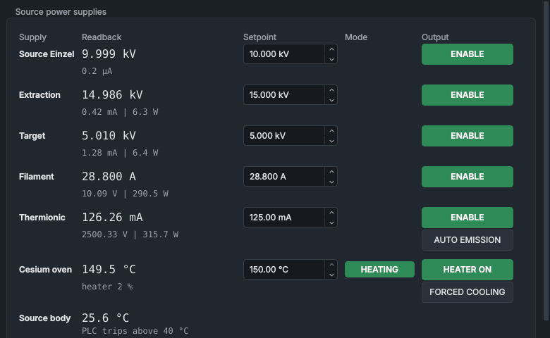

# TESS Ion Source Control

The **TESS Ion Source Control** panel runs SINDIE's ion source, the TESS (Thermionic Emission Sputter Source). It sets and switches the source supplies (the source einzel, extraction, target (cathode), filament and thermionic, also called the ioniser), the PLC's auto-emission loop and the caesium oven, and shows the source body temperature. The source einzel is a Spellman supply, run by the Spellman service; everything else on the panel is run by the PLC.

## What it shows

The **Source power supplies** group has a row for each supply, and one for the source body temperature, under the headings **Supply**, **Readback**, **Setpoint**, **Mode** and **Output**. The readback has a large first line and a smaller second one:

| Row | Readback | Second line |
|---|---|---|
| **Source Einzel** | voltage, kV | current, µA |
| **Extraction** | voltage, kV | current, mA, and power, W |
| **Target** | voltage, kV | current, mA, and power, W |
| **Filament** | current, A | voltage, V, and power, W |
| **Thermionic** | emission current, mA | voltage, V, and power, W |
| **Cesium oven** | temperature, °C | heater duty cycle, % |
| **Source body** | temperature, °C | **PLC trips above 40 °C** |

- The **Source body** row is a reading only, with no controls. Above 40 °C for 0.2 s the PLC latches **SRC_BODY_TEMP_HIGH**, switches off the extraction, target and filament, and starts a shutdown.
- `---` means the value isn't known: its service is silent or the supply isn't answering. With the safety relay off the source einzel and the source deck are unpowered and can't be read, so the einzel, filament, thermionic and **Source body** readings show `---` too, and the caesium oven shows the PLC's estimate (below).
- **[?]** after a readback means the PLC link is down; on the **Source Einzel** row it also shows while the Spellman service isn't **ONLINE** on the [Service Manager](service-manager.md) panel.
- **~** before the caesium temperature (for example **~64.3 °C**) means the thermocouple can't be read, because the relay is off or the remote I/O is lost. The value is the PLC's estimate from its thermal model.
- An amber outline round a readback means it has stayed outside its tolerance of the setpoint (rules in `config/readback_tolerance.json`). It is information, not a fault: a TOLERANCE event is logged and nothing is switched off.
- A setpoint box shows the setpoint the PLC, or the einzel supply, is using, except while you are typing in it. It is empty while that setpoint isn't known.

The **Mode** column shows a badge when the PLC, an interlock or a sequence is in charge of the supply, and **HEATING** while the oven's temperature control is on. While a badge shows, the setpoint box is greyed out, except with **HEATING**. Where more than one applies, the first in this table shows:

| Badge | Colour | Meaning |
|---|---|---|
| **LOCKED** | red | The PLC reports an interlock or fault blocking the supply. On the caesium oven: the relay is off, or an over-temperature, heat-fail or cool-fail fault is latched. |
| **AUTO-EMIS** | blue | Filament only: auto-emission is on, and the PLC sets the filament current. |
| **SEQUENCE** | violet | A sequence (recipe, mass scan or optimiser) holds the supply. The badge's tooltip names it. |
| **HEATING** | green | Caesium oven only: the PLC's temperature control is on (mode 1). |
| **AUTO** | blue | The PLC is driving the supply itself (mode 1), as it does during a shutdown sequence. |
| **RECIPE** | violet | The PLC reports mode 2 (Recipe). Recipes run by the sequencer show **SEQUENCE** instead. |
| **CASCADED** | blue | The PLC reports mode 3: the auto-emission loop is driving the supply. |
| **ARC QUENCH** | amber | The PLC is holding the output at 0 for 1 s after an arc (mode 4). |

## Controls

| Control | What it does |
|---|---|
| **ENABLE** | Switches a supply's output on with two clicks and off with one. Green while the output is on; a dashed outline while its state is unknown. The source einzel's goes to the Spellman service, the others to the PLC. |
| Setpoint box | Type a value and press Enter, or move on to another control, to send it; Escape drops it. The box takes only values within the setpoint limits in the tag registry (from `config/plc_config.json`, and `config/mpd_config.json` for the einzel); a value past its maximum doesn't go in. The einzel's tooltip names its 22 kV hard cap. |
| **AUTO EMISSION** | Thermionic row. One click switches the PLC's auto-emission loop on or off. Reads **AUTO EMISSION: ON** (blue) while it runs. |
| **HEATER ON** | Caesium oven row. Two clicks switch the oven's temperature control on, one switches it off. |
| **FORCED COOLING** | Caesium oven row. One click asks the PLC to open the oven's cooling-air valve, and the button then reads **FORCED COOLING: ON** (blue); another click stops asking. It shows your request, not the valve: whether the air is on is shown on the oven's second line. Available whenever the PLC link is up, relay on or off. |

The first click on an **ENABLE** or **HEATER ON** button doesn't switch anything: the button turns amber and asks for confirmation (**CONFIRM SOURCE EINZEL?**, **CONFIRM EXTRACTION?**, **CONFIRM HEATER?** and so on). A second click within 4 s sends the command; otherwise the button goes back. Switching off is always one click. [How the controls behave](../getting-started/controls-and-colours.md) has more on two-click switching and on setpoint boxes.

While the cooling air is on, for whatever reason, the oven's second line ends in **cooling air on** (for example **heater 0 % | cooling air on**), and its tooltip says why: forced cooling, the safety relay being off, a shutdown sequence, or the PLC's own protection (see [The caesium oven](#the-caesium-oven)). The air can be on with **FORCED COOLING** off: with the safety relay off, the PLC keeps it on whatever you ask. **FORCED COOLING: ON** would read **COMPRESSOR RESTING** (amber) if the PLC reported cooling waiting for the air compressor; the present PLC program never reports that.

After you switch the filament off, its **ENABLE** reads **DISARMING...** and is greyed out while the PLC ramps the current down to 0 A; the contactor stays closed until then.

## Typical values

These are typical operating values for the TESS, not limits: the limits are the setpoint boxes' and the PLC's. [Bringing up a beam](../procedures/beam-start-up.md) gives the order to set them in.

| Row | Typical setting | What to expect |
|---|---|---|
| **Extraction** | 15 to 20 kV | With no beam, the current is what flows through the supply's 50 MΩ bleed resistor, 0.02 mA per kV: 0.3 to 0.4 mA. |
| **Target** | 5 to 9 kV | With no beam, the bleed current again: 0.1 to 0.18 mA. As the caesium heats up, the target and extraction currents rise; aim for a target current of about 1 mA, depending on the target material. |
| **Source Einzel** | 8 to 16 kV, tuned later on the beam | The current stays close to zero. A current above 50 µA points to failing einzel electrode insulators. |
| **Filament** | 28 to 30 A | Hold a new filament, or one that has been at air, at 15 A first to degas it: the source pressure (VG1) spikes, then falls back to a low baseline. |
| **Thermionic** | 100 to 150 mA | The emission current rises over about 15 s as the filament warms. **AUTO EMISSION** (optional) holds it at its setpoint, which keeps the ioniser power steady. |
| **Cesium oven** | 100 to 150 °C | Reached and settled in about 15 minutes. Before heating, check that forced cooling is off: the button reads **FORCED COOLING**, not **FORCED COOLING: ON**. |

The beam energy is the extraction voltage plus the target voltage, for singly charged ions; **CALCULATE & SET AMPS** on the [Beamline Optics](beamline-optics.md) panel uses the same sum.

Before start-up the source pressure should be below 5×10⁻⁷ mbar. When the safety relay first comes on, the **Source body** and **Cesium oven** temperatures read between 10 °C and room temperature, and every supply readback reads zero.

## When a control is greyed out

A greyed-out control's tooltip starts "Disabled:" and gives the reason the owning service reports:

| Reason | Applies to |
|---|---|
| safety relay de-energised | Extraction, target, filament, thermionic and the caesium heater. The source einzel says "safety relay de-energised - supply unpowered". |
| remote I/O to the source deck lost | Filament, thermionic, caesium oven. |
| automated source shutdown in progress | The five PLC supplies, while a shutdown sequence runs. |
| PLC Auto, Recipe, Cascaded (PID slave) or Arc quench: the PLC is controlling this | A supply the PLC is driving itself (badges **AUTO**, **RECIPE**, **CASCADED**, **ARC QUENCH**). Not the oven's **HEATING**. |
| PLC interlock (lockout) | The PLC reports an interlock on the supply (badge **LOCKED**). |
| ... is controlled by ... - stop it, or take control, first | A sequence holds it (badge **SEQUENCE**). Take it back with **TAKE CONTROL** in the [Automation bar](automation-bar.md). |
| PLC not connected; the PLC reports lost communication with the PC (watchdog) | The PLC link. |
| bus ... not connected; supply not answering; not configured in mpd_config.json | The source einzel's Spellman link. |
| no live data from the PLC service (or the Spellman service) | The service isn't publishing. |

A command can still be refused by its service. A **Command refused** message then appears at the top right of the HMI with the reason, and the [Command Log](command-log.md) keeps it. Refusals here include:

- switching the target, thermionic or filament off while the caesium is hot ("... the PLC keeps the target and the ioniser on until it has cooled ... - use forced cooling or a source shutdown");
- a target setpoint below the PLC's minimum while the caesium is hot ("the target must stay at or above ... kV until it has cooled");
- switching a supply on with the safety relay off;
- switching the source einzel on while it holds a voltage setpoint past the 22 kV hard cap, for example one set on its front panel ("Set the voltage here first.").

## What the PLC does

### Setpoints and permissives

- While the safety relay is open, the PLC zeroes the requested setpoints of its source supplies; the caesium oven's goes to 20 °C. It also zeroes the requested setpoint of an extraction, target, filament or thermionic supply that is switched off, so switch those supplies on before you set them.
- It limits what it applies: extraction 0 to 20 kV, target 0 to 10 kV (at least 3 kV while the caesium is hot), filament 0 to 40 A, thermionic 0 to 150 mA, caesium oven 20 to 200 °C. The setpoint boxes can be narrower.
- It moves the filament current towards a new setpoint at 1 A/s.
- The extraction needs only the safety relay. The target, filament and thermionic contactors also need the remote I/O on the source deck, source coolant flow, and the vacuum good for the gate valve.

### Auto-emission

**AUTO EMISSION** asks the PLC to hold the thermionic emission current at the **Thermionic** setpoint by adjusting the filament current itself. While it runs:

- the PLC drives the filament in its cascaded mode, never above 36 A;
- the filament row shows **AUTO-EMIS** and its setpoint box shows the current the PLC is setting;
- the PLC service refuses filament commands, so the filament's **ENABLE** is greyed out too ("Cascaded (PID slave) ...");
- it stops by itself if the filament or thermionic supply is switched off, the filament is ramping down, or a thermionic fault latches.

Switch **AUTO EMISSION** off to set the filament by hand again.

### The caesium oven

- **HEATER ON** puts the oven under the PLC's temperature control. The PLC ramps its working setpoint towards yours, much more slowly going up than coming down, and never drives the heater above 50 % duty.
- Heating is locked out (**LOCKED**) while the safety relay is off, and after an over-temperature, heat-fail or cool-fail fault until the fault is reset.
- The PLC opens the cooling-air valve, if compressed air is available, for **FORCED COOLING**, when a shutdown sequence calls for it, while the safety relay is off, when the relay drops or heating is lost with the oven hot, on an over-temperature, and after a cool-fail fault. While the relay is off it keeps the air on however cold the oven is; switching **FORCED COOLING** off then only withdraws your own request.
- During a shutdown sequence, or when the oven's heating permissive is lost, the PLC holds the oven at 20 °C in mode 1, so the badge can read **HEATING** while the oven is cooling.
- Above 200 °C for 0.2 s the PLC latches **CESIUM_OVEN_OVERTEMP**: the safety relay's permissive goes, heating is locked out, the oven is cooled and the source shut down.
- The PLC counts the caesium as hot above 30 °C (from its thermal model). While it is hot, the target is kept at 3 kV or more, the target, thermionic and filament can't be switched off from the HMI, the gate valve can't be closed and the safety relay can't be switched off.

### Arcs

The PLC watches the target and thermionic supplies for arcs: the target below 0.5 kV while drawing more than 5 mA with more than 1 kV applied, or the thermionic below 50 V while drawing more than 100 mA. On an arc it sets the supply's output to 0 for 1 s (badge **ARC QUENCH**; the thermionic contactor also opens), then restores your setpoint. Each arc adds one to a count that falls by one every 10 s; at three, the PLC latches **TARGET_SUSTAINED_ARC** or **THERMIONIC_SUSTAINED_ARC** and starts the cool-down shutdown (see [System Health](system-health.md)). The PLC has the same check for the extraction, but as programmed it can't trigger: the extraction current readback stops at 5 mA.

The source einzel has the Spellman service's own arc check: an output that collapses below 10 % of its setpoint, or a current above 500 µA, on two polls in a row, latches **UNIT1_ARC_EXCEEDED** until **RESET FAULTS**. It doesn't switch the einzel off. It isn't judged below 0.5 kV; the settings are under `arc_detection` in `config/mpd_config.json`.

## Things to know

- When the safety relay drops, everything on this panel starts again from zero: the PLC zeroes the requested setpoints, and the source einzel, unpowered, loses its setpoint. Set them again once the relay is back.
- The first time the source einzel is given a voltage or switched on after power-up, the Spellman service gives it a current limit if it holds none (`default_current_ua` in `config/mpd_config.json`, 50 µA); the reply in the Command Log says so.
- Most PLC faults on these supplies (over-current, over-voltage, not following the setpoint, sustained arcs, source body or oven over-temperature, coolant flow) switch a supply off or start a shutdown. They are listed on the System Health panel.

## See also

- [Safety rules](../safety.md)
- [Bringing up a beam](../procedures/beam-start-up.md)
- [System Health](system-health.md)
- [How the controls behave](../getting-started/controls-and-colours.md)
- [Shutting down](../procedures/beam-shut-down.md)
- [Selecting a mass and tuning the beam](../procedures/tuning-the-beam.md)
- [The Automation bar](automation-bar.md)
- [The PLC program](../how-it-works/plc.md)
