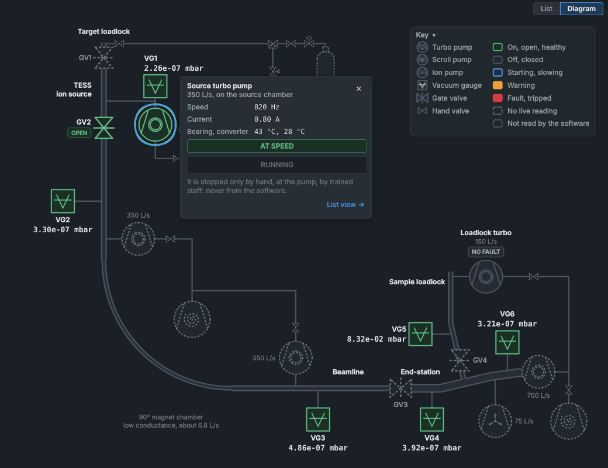
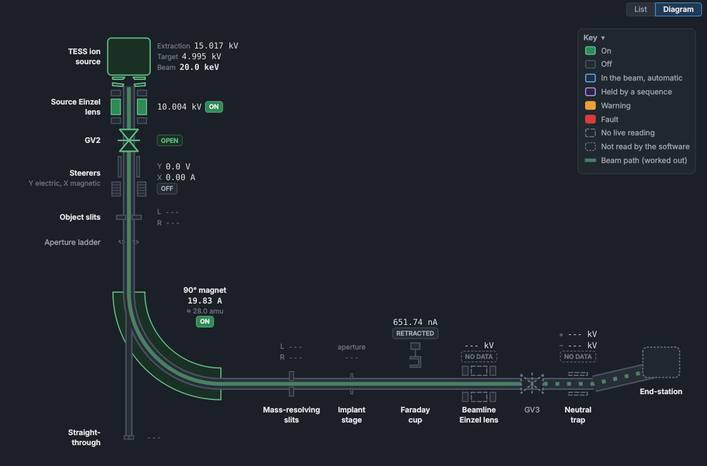
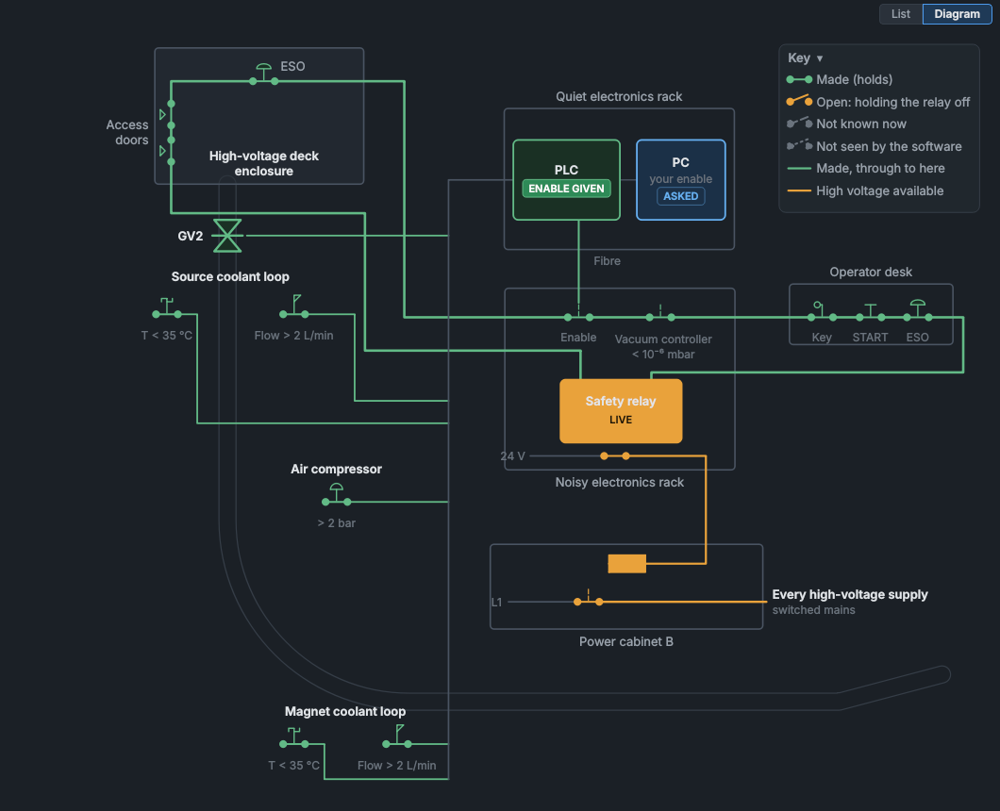
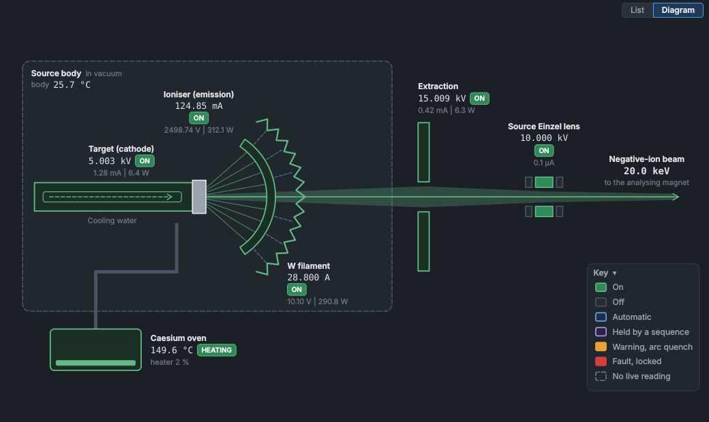

# Machine diagrams (test)

Four panels can also be shown as a diagram of their part of the machine, drawn as it is laid out, live: **Vacuum System**, **Beamline Optics** (the beam path), **Interlocks** (the safety chain) and **TESS Ion Source Control**. Displays like these are known as mimic diagrams. They are a test of a more visual way to run SINDIE. Each diagram shows what its panel's list shows, from the same telemetry, and adds nothing of its own; its controls are the panels' own controls.

## Showing a panel as its diagram

Each of the four panels has a **List | Diagram** switch at its top right. Click **Diagram** to show the diagram in place of the list, in the same panel; click **List** to bring the list back. The panel stays where it is and keeps its single entry in **View > Panels**.

- Each panel remembers its choice, also the next time the HMI starts. Until you choose, a panel shows its list.
- A layout saved with **View > Layouts > Save layout as...** keeps the choice of each panel, and choosing the layout brings the choices back with it. A layout saved before November 2026 leaves them as they are.
- A value typed in a setpoint box but not yet sent with **Enter** is dropped when you switch the panel, as when you close it, and a message says so.
- **F1** over a diagram opens this page; over a list, the panel's own page.

## Reading a diagram

The colours are the panels' colours:

| Colour | Meaning |
|---|---|
| Grey | Off, closed, or normal. |
| Green | On, open, running or healthy. |
| Blue | Automatic, or moving (a turbo pump starting, a cup in the beam). |
| Violet | Held by a sequence (a recipe, a scan or the optimiser). |
| Amber | A warning, or something you asked for that is being held off. |
| Red | A fault or a trip. |

The outline says how much the software knows:

- **Solid**: read live.
- **Dashed**: no live reading now (a service isn't sending data, or a device isn't answering).
- **Dotted**: the software can't read this part at all, such as most of the pumps, GV1, GV3, GV4, the hand valves, the doors and the ESOs. The diagram shows no state for it, so check it at the machine.

Point at a part to see its name, and click it to open its faceplate. The key in the corner explains the symbols; click its title to fold it away, and again to open it. A diagram always fits its panel. As the panel is made smaller its text shrinks only a little, down to the size each diagram is drawn readable at; smaller than that, the whole drawing shrinks together, like a picture zoomed out, so nothing is cut off. To read it at full size, make the panel larger or drag it out as a floating panel. Only a very small panel scrolls. With larger text (**View > Text size**) a diagram keeps its labels at that size: it shrinks only down to the size that needs, and a smaller panel scrolls. The card a part opens is at the larger size too.

## Faceplates

Clicking a part opens a card beside it with what the part reads and the controls it has. The controls are its panel's own: a faceplate's button presses the panel's button, and a faceplate's setpoint box sends what you type as the panel's box does. So everything works as on the panel:

- A button that can't be pressed now is greyed out. Hold the mouse over it to see why.
- Switching a supply on takes two clicks, as on its panel.
- A value you type is sent when you press **Enter**, and checked as from the panel.
- The source turbo pump can be started, never stopped: it is stopped by hand, at the pump.

Close a faceplate with **✕**, **Esc**, a click on an empty part of the diagram, or a click on another part. The links at the bottom of the card go to the full panels: **List view** switches this panel to its list, and a link named after another panel, such as **Faraday Cup & SMU panel**, brings that panel forward.

## Vacuum System

The vacuum system as the thesis' drawing of it lays it out: the source column with the target loadlock and the argon line at the top, the 90° magnet chamber, the beamline, and the end-station with its sample loadlock.

- The six gauges show their pressure. A gauge's chip appears only when it isn't healthy (**WARNING**, **TRIPPED**, **STALE**, **OFFLINE** and so on), and the tube beside it turns amber or red while it warns or has tripped.
- The source turbo pump shows its speed, and an arc around it fills with its speed. Its faceplate has **START PUMP** only.
- **GV2** opens and closes from its faceplate, with the same permissives as on the Vacuum System panel.
- The sample loadlock's turbo shows only the faults its controller reports. The software can't tell whether it is running, so it is drawn grey, not green, while it reports none.

VG6 isn't on the thesis' drawing: its place on the diagram is a guess.

## Beamline Optics: the beam path

The optics along the beam: down the source column from TESS through the source Einzel lens, GV2, the steerers, the object slits and the aperture ladder; round the magnet (or straight on to the straight-through cup); and along the beamline through the mass-resolving slits, the implant stage, the drop-in Faraday cup, the beamline Einzel lens, GV3 and the neutral trap to the end-station. Each element shows its readback, and the slits their jaws' currents.

The green band is the beam's path, worked out from the panels rather than measured:

- it starts when the extraction supply is on;
- it stops at GV2 unless GV2 is open;
- it goes round the magnet while the magnet is on, and straight on to the straight-through cup while it is off;
- it stops at the Faraday cup while the cup is in;
- past GV3, which the software can't read, it is dotted.

A part that a sequence holds (a recipe, a scan or the optimiser), as the Automation bar lists it, is drawn violet with **SEQUENCE** under its own chip: the steerers, the magnet and the Faraday cup, as the source Einzel lens has its panel's **SEQUENCE** badge. Their controls are greyed out on their panels and faceplates until the sequence ends or you take control.

The magnet's **≈ amu** is the mass it passes now, from its current, the beam's energy and the Mass Scan panel's calibration (as **CALCULATE & SET AMPS** uses it, the other way round). To set a mass, use the Beamline Optics panel.

## Interlocks: the safety chain

What the safety relay's closing depends on, laid out as the thesis' drawing of it, with every state as the [Interlocks](interlocks.md) panel works it out:

- the PLC's inputs where they are on the machine: the source and magnet coolant switches, the compressed air, and GV2;
- the PLC and the PC in the quiet rack: the PLC gives its enable down the fibre once its inputs hold and you have pressed **ENABLE SAFETY RELAY**;
- the relay's hardwired loop: the PLC's enable, the vacuum controller's relay, the high-voltage enclosure's doors and ESO, and the operator desk's key, **START** and ESO;
- the relay, and the contactor in power cabinet B that switches the mains to every high-voltage supply.

A wire is green where its switches are made. The relay's output and the contactor are amber while the relay is closed, as **SAFETY: LIVE** on System Health. A switch holding the relay off is amber when you have asked for the relay, red for a latched PLC fault, and plain otherwise. The doors, the ESOs, the key and **START** are wired where no software can see them: they are dotted, and drawn made only while the relay is closed (so all of them must be).

The relay's faceplate has System Health's own buttons: **ENABLE SAFETY RELAY** with its countdown to press **START**, **RESET FAULTS**, **INITIATE SHUTDOWN** and **ABORT SHUTDOWN**.

## TESS Ion Source Control: the source

The source as the thesis' schematic draws it: the water-cooled cathode with the target at its end, the ioniser heated by electron bombardment, the tungsten filament behind it, the caesium oven, the extraction electrode, and the source Einzel lens downstream. Each electrode is drawn in its supply's colour, with its readback and mode beside it:

| Part | Supply on the TESS Ion Source panel |
|---|---|
| Target (cathode) | Target |
| Ioniser | Thermionic: its emission, and **AUTO EMISSION** |
| W filament | Filament |
| Caesium oven | Caesium oven: its heater and **FORCED COOLING** |
| Extraction electrode | Extraction |
| Source Einzel lens | Source Einzel |

The caesium ions, the electrons and the beam are drawn while the supplies that make them are on: a picture of how the source works, not a measurement. The cooling water shows the source coolant flow switch's state, as the Interlocks panel reads it.
