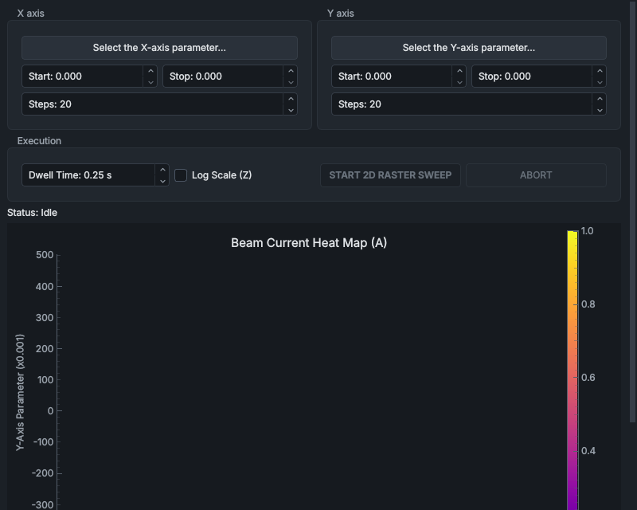

# Optimiser

The **Optimiser** panel sweeps two setpoints over a grid, measures the beam current on the Faraday cup at every point and draws the result as a heat map. Use it to find where two settings, for example an einzel voltage and a steerer, give the most beam, and to go there. The sweep reads the Faraday cup, so insert the cup and bias it at more than 50 V first, as for a [mass scan](mass-scan.md#before-you-scan).

## How a sweep runs

The sweep runs in the sequencer service (`service_sequencer`), not in the HMI. The panel only starts and stops it and draws the points as they arrive. Closing the HMI does not stop a sweep, and an HMI that is opened again shows the last sweep's map.

While it runs, the sweep holds a control lease on the subsystems the two setpoints belong to (both steering voltages, for example, belong to the steering subsystem). The [Automation bar](automation-bar.md) shows **optimiser holds:** and those subsystems, and their controls in the other panels are greyed out, with the reason in their tooltip.

The sequencer runs a sweep like this:

1. It reads the present value of both setpoints, so that it can put them back afterwards: the device's own setpoint readback where there is one, otherwise the measured readback. It refuses to start if either has no live value.
2. Each axis has **Steps** values, evenly spaced from its **Start** to its **Stop**. For each X value in turn, the sequencer sets X and waits 0.2 s. Then, for each Y value, it sets Y, waits the **Dwell Time** and reads the Faraday cup current (`ion_beam.beamline.faraday.smu.rb_current`). Y goes back to its **Start** at every new X.
3. When the sweep ends, whether it completed, was aborted or failed, it sets both setpoints back to the values it read at the start and waits 0.5 s. If you picked a point on the map during the sweep, it goes there instead.

A sweep takes about X steps × (0.2 s + Y steps × dwell time): a 20 × 20 grid at 0.25 s takes nearly 2 minutes. The panel does not show an estimate.

A sweep fails if a service refuses one of its setpoints (**X setpoint refused:** or **Y setpoint refused:** and the reason) or if the beam-current reading is not live when it is due. A failed sweep raises a medium-priority alarm on the [Alarms](alarms.md) panel, which clears when the next sweep starts.

The sequencer also logs a cyan user marker, naming the two parameters, when a sweep starts and when it ends, so the sweep shows in the [data viewer](../viewer/data-viewer.md).

> [!NOTE]
> If you take control with the Automation bar during a sweep, the sweep stops and cannot put the setpoints back, because it no longer holds them: they stay at the last point swept. Press **ABORT** instead to stop a sweep and have them put back.

## Controls

| Control | What it does |
|---|---|
| **Select the X-axis parameter...**, **Select the Y-axis parameter...** | Open the parameter list (see below). The button then shows the parameter and its unit, for example **X: Magnet Current Cmd [A]**. |
| **Start:**, **Stop:** (each axis) | The first and last value of that axis. Choosing a parameter sets them to its whole range from the tag registry; they cannot go outside it. The tooltip gives the parameter's hard cap, if it has one. |
| **Steps:** (each axis) | Number of values on that axis, 2 to 500. |
| **Dwell Time:** | Wait after each Y setpoint before the beam current is read, 0.10 to 60 s. |
| **Log Scale (Z)** | Colours the map by the logarithm of the current. Zero and negative currents are left blank. Available at any time. |
| **START 2D RASTER SWEEP** | Asks the sequencer to start the sweep. Greyed out during a sweep and when a sweep could not start (see below). |
| **ABORT** | Stops the sweep; both setpoints are put back. Available only during a sweep. |
| **Status:** | What the sweep is doing, how it ended, or why the sequencer refused a command. |
| Drag a box on the map | When no sweep is running: sets both axes' **Start** and **Stop** to the box and starts a new sweep of that region at once, with the same numbers of steps, so the grid is finer. |
| Double-click on the map, during a sweep | Ends the sweep and leaves both setpoints at that point instead of putting them back. The point must be within both setpoints' ranges. |
| Double-click on the map, no sweep running | Sends both setpoints to that point at once. |
| Mouse wheel | Does nothing on the map, so that a scroll cannot start a sweep. |

The parameter buttons, **Start**, **Stop**, **Steps** and **Dwell Time** are locked during a sweep.

> [!WARNING]
> Dragging a box on the map starts a sweep at once, and a double-click with no sweep running sends both setpoints at once. Neither asks for a second click. Both go to the services as ordinary commands, so they are refused if a setpoint is locked out or held by another sequence.

### Choosing the parameters

The parameter list (**Select X-Axis Sweep Parameter** or **Select Y-Axis Sweep Parameter**) shows the setpoints that the tag registry marks as available to automation and that have limits, grouped by area, with their units. Examples are the analyser and steerer magnet currents, the electrostatic steering voltages, the Faraday cup bias and the source supplies. Double-click a parameter, or select it and press **OK**. X and Y must be different setpoints.

The list also shows the vacuum gauge controllers' relay set points. These cannot be swept: with one of them chosen, **START 2D RASTER SWEEP** stays greyed out (no live data from the service that drives it).

> [!WARNING]
> The optimiser watches only the beam current. When a sweep changes an einzel voltage, watch the einzel current yourself: while tuning it must stay below 50 µA, and more means the einzel electrode insulators are failing. Press **ABORT** if it goes above that.

### When START is greyed out

The tooltip of **START 2D RASTER SWEEP** gives the reason:

| Tooltip | What to do |
|---|---|
| **Disabled: Select both X and Y parameters to sweep.** | Choose both parameters. |
| **Disabled: The sequencer service is not running (see the Service Manager panel).** | Start or restart `service_sequencer` on the [Service Manager](service-manager.md) panel. |
| **Disabled: No live data from the service that drives** and a tag | The service for that parameter is not publishing. |
| **Disabled:**, the subsystem's name and a reason | That service would refuse an operator command now, for example because the safety relay is off or another sequence holds it. |
| **Disabled: Hardware output for selected target is disabled.** | Switch the output on first, on its own panel. |

The sequencer checks the sweep again when it starts it. It refuses the same setpoint on both axes, a setpoint that is not available to automation, a **Start** equal to its **Stop**, values outside a setpoint's range or past its hard cap, steps outside 2 to 500, a dwell time outside 0.05 to 60 s, and a setpoint with no live value to put back afterwards. The reason appears on the status line.

## The heat map

The map, **Beam Current Heat Map (A)**, has the X parameter across and the Y parameter up, labelled with their names and units. Each measured point is coloured from dark purple (least current) to yellow (most), on the scale of the colour bar to its right, which runs from the lowest to the highest value measured so far. Points not yet measured are blank.

Hover over the map to see the X and Y values under the pointer and the current I at the nearest measured point. When no sweep is running, a cyan cross marks where the two chosen setpoints are now.

## See also

- [Selecting a mass and tuning the beam](../procedures/tuning-the-beam.md)
- [Mass Scan](mass-scan.md)
- [The Automation bar](automation-bar.md): control leases and taking control
- [Faraday Cup & SMU](faraday-cup-smu.md)
- [Beamline Optics](beamline-optics.md)
- [How the controls behave](../getting-started/controls-and-colours.md)
