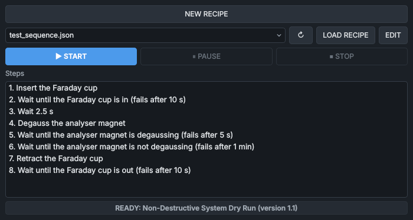
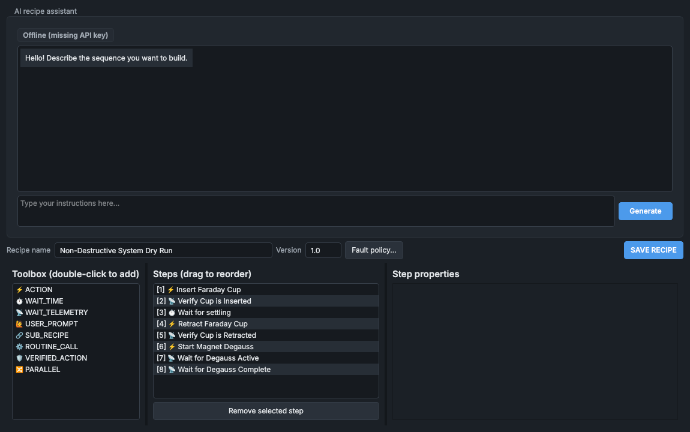
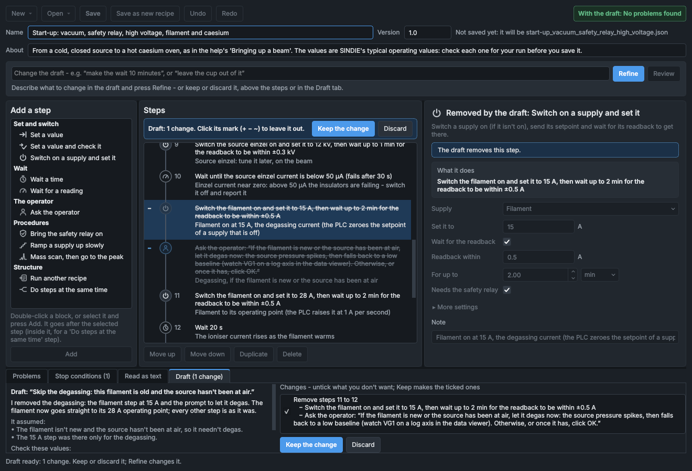

# Recipe Execution and the recipe builder

A recipe is a list of steps that the sequencer carries out in order: commands, waits, checks, operator prompts and procedures such as a mass scan. The **Recipe Execution** panel loads, starts, pauses and stops recipes and shows their progress. The recipe builder makes and edits them.



## How recipes run

Recipes run in the sequencer service (`service_sequencer`), not in the HMI. The panel only sends the sequencer commands and shows what it reports. Closing the HMI does not stop a recipe, and an HMI that is opened again picks it up: its steps, its status and any prompt waiting for an answer.

- **Checked before it starts.** Before the sequencer starts a recipe it reads it, and every recipe it runs as a step, and checks them all against the machine's tags (see [The checks](#the-checks)). A recipe with an error is refused at once, with the first errors in the refusal, so a run never stops half way at a step that could never work. **LOAD RECIPE** in the panel makes the same checks.
- **Logged.** The start is in the event log with the recipe's version and the SHA-256 checksum of each file it runs, for example `Recipe 'Automated Mass Resolution' version 1.3 started (auto_tune.json, SHA-256 3f9c0a1b2c4d)`. The log says exactly what ran.
- **One recipe at a time.** A recipe can run alongside a mass scan and an optimiser sweep, but two of them can never drive the same thing at once: a recipe that needs a control another sequence holds fails.
- **Control leases.** Before its first command to a subsystem (the analyser magnet, a supply, the Faraday cup ...), the recipe claims a control lease on it. While the recipe holds the lease, that subsystem takes commands only from the recipe: its controls in the other panels are greyed out, with the reason in their tooltip, and the [Automation bar](automation-bar.md) shows what the recipe holds, for example **recipe 'Automated Mass Resolution' holds: diagnostics, magnet, smu**. The leases are released when the recipe ends. The safety relay, shutdown, fault reset and gate valve controls are never leased: they stay with the operator.
- **Steps in order.** The steps run one at a time. A step is done when its purpose is met: a **Set a value** step, for example, when the service confirms it has carried out the command.
- **Any failure ends the recipe.** A step that fails or times out ends the recipe at once. There are no retries and no alternative paths. The status line gives the step and the reason, and the step turns red. A failed recipe also raises a medium-priority alarm on the [Alarms](alarms.md) panel, which clears when the next recipe starts.
- **No fault resets, no turbo stop.** A recipe can't reset faults, and can't stop the source turbo pump: the checks refuse such a recipe. Reset faults yourself with **RESET FAULTS** on the [System Health](system-health.md) panel. Trained staff stop the turbo pump by hand, at the pump.
- **The machine still has the last word.** The services apply the same limits and hard caps to a recipe's commands as to yours, and whatever a recipe asks for, the PLC applies its own interlocks, limits and shutdown sequences.

## The Recipe Execution panel

| Control | What it does |
|---|---|
| **NEW RECIPE** | Opens the recipe builder with a new, empty recipe. Its **New** button starts one from a template. |
| Recipe list | The recipe files (`.json`) in `config/recipes`. |
| **↻** | Reads the recipe folder again, to list files added since. |
| **LOAD RECIPE** | Reads the selected recipe, checks it as the sequencer will, and lists its steps. What the checks find shows above the steps (see below). |
| **EDIT** | Opens the selected recipe in the recipe builder. EDIT again on a recipe that is already open brings its window to the front. |
| **START** | Asks the sequencer to run the loaded recipe from step 1: the recipe last loaded, not whatever is selected in the list. After a run has finished the button reads **RESTART** and runs the same recipe again. Greyed out until a recipe is loaded, while the loaded recipe has errors, while a recipe is running, and while the sequencer is not running; the tooltip says which. |
| **PAUSE** | Pauses the recipe. While it is paused the button reads **RESUME**. Available only while a recipe is running. |
| **STOP** | Stops the recipe. Available only while a recipe is running. |
| **ACKNOWLEDGE** | In the prompt box: answers the prompt (see [Operator prompts](#operator-prompts)). |
| **STOP RECIPE** | In the prompt box: stops the recipe, as **STOP** does. |
| **Steps** | The steps of the recipe loaded or running, each as a sentence saying what it does, for example **3. Wait until the Faraday cup is in (fails after 10 s)**. Hover over a step to see its note. |

After **LOAD RECIPE**, a box above the steps shows what the checks found:

- **Can't be started - the sequencer would refuse it** and the first errors (red). **START** stays greyed out and the status line reads **NOT READY:** with the recipe's name. Open the recipe with **EDIT**: the builder lists every problem.
- **... warnings (it can still run)** and the first warnings (amber). The recipe can be started, but read them first.
- Nothing, when the checks find nothing.

A file that can't be read as a recipe at all (not valid JSON, an unknown step type, a value of the wrong kind) isn't loaded: the status line reads **NOT LOADED:** with the file name and the reason.

A recipe saved in the recipe builder while it is loaded here is loaded again, so the steps shown are the ones that will run.

> [!NOTE]
> The sequencer reads and checks the recipe file again when you press **START**. If someone has changed the file since you loaded it, the run follows the changed file, or the start is refused if the change has an error.

### The status line

The status line shows the state, the recipe's name and version in brackets (inside a sub-recipe, the path to it, such as **Silicon Implantation Run > Standard Beamline Startup**) and what is happening.

| Status line | Colour | Meaning |
|---|---|---|
| **STATUS: IDLE** | grey | Nothing loaded or run since the HMI started. |
| **READY:** a name and its version | grey | A recipe is loaded and can be started. |
| **NOT READY:** a name **has errors** | red | The loaded recipe has errors: the sequencer would refuse it. |
| **NOT LOADED:** a file and the reason | red | The file can't be read as a recipe. |
| **RUNNING** | violet | The recipe is running, and holds the controls it has claimed. |
| **PROMPT** | amber | The recipe is waiting for you. |
| **PAUSED** | amber | Paused by you, or because you took control of something it drives. |
| **FINISHED** and **Recipe completed successfully.** | green | Every step is done. |
| **FINISHED** and **Stopped by operator at step** ... **- outputs left as they were.** | grey | You stopped it. |
| **FINISHED** and the reason it failed | red | A step failed (**Step 3 failed:** and why), or a stop condition stopped it. |
| **START refused:** (or another command) and the reason | red | The sequencer refused your command: the recipe has an error, or the sequencer is still starting up. |
| **SEQUENCER OFFLINE** | dashed outline | The sequencer service is not running. Start it from the [Service Manager](service-manager.md) panel. When it is back, the line says again what is loaded. |

In the step list:

| Step | Meaning |
|---|---|
| Plain | Not reached yet. |
| Violet | The step the recipe is on (also while it is paused). |
| Amber | The step is waiting for you. |
| Green, with a tick (✓) | Done. |
| Red, with a cross (✗) | Failed. |

Inside a sub-recipe the list shows the sub-recipe's steps. A **Do steps at the same time** step is one row.

### Operator prompts

When a recipe reaches a prompt (an **Ask the operator** step, or a procedure that needs you), the box **Recipe action required** appears above the steps, with the step number and what to do. The recipe waits as long as it takes: prompts have no time limit.

1. Do what the prompt asks.
2. Press **ACKNOWLEDGE**. The sequencer checks the step's conditions, if it has any, against live values.
3. If a condition is not met, your answer is refused and the box shows **Not accepted - not yet:** and each condition that doesn't hold, with its present value, for example **waiting until the source gate valve is closed (ion_beam.source.chamber.stat_gv_closed = 0.0)** (**no live value** if there is none). The prompt stays: press **ACKNOWLEDGE** again once the conditions hold.

Each prompt carries a number, so an answer meant for an earlier prompt can't answer a later one. The box is hidden while the recipe is paused and comes back when you resume it. Prompts and answers are recorded in the event log.

## Pausing and stopping a recipe

| You press | What happens |
|---|---|
| **PAUSE** | The recipe halts at the step it is on and sends nothing more. The step's timers stop: a wait, a time limit, a check, and the timers of the procedures (a ramp's hold, a scan's settling). The recipe keeps the controls it holds. The stop conditions are not checked while it is paused. |
| **RESUME** | The step carries on where it was, with its timers moved on by the length of the pause. |
| **RESUME** after you took control | The step starts again from its beginning: its command is sent again, a wait starts from zero, a procedure from its first stage. The recipe claims its controls again. |
| **STOP** or **STOP RECIPE** | The recipe ends at once (**Stopped by operator at step** ... **- outputs left as they were.**). Nothing is switched off and no setpoint is put back: every output stays as the completed steps left it, and a command already sent is still carried out. The recipe's controls are released. |

> [!WARNING]
> **STOP** does not make the machine safe: it leaves every supply as it is. To shut the source down, use **INITIATE SHUTDOWN** on the [System Health](system-health.md) panel; the automated shutdown takes about 20 minutes (see [Shutting down](../procedures/beam-shut-down.md)).

If you take control of something a running recipe drives, with **TAKE CONTROL** on the [Automation bar](automation-bar.md), the recipe pauses: **Paused: the operator took control of the** ... **Resume to carry on (the current step starts again), or stop.**

## Stop conditions

A recipe's stop conditions (its fault policy, in the file) end it as failed as soon as one holds. There are two kinds:

- **a PLC fault**: the recipe stops when that fault is latched, for example **Safety Relay Tripped**: **Stopped at step 4: fault Safety_Relay_Tripped is active.**;
- **a condition** on a live reading, for example the source pressure above 5×10⁻⁶ mbar, with an optional message: **Stopped at step 4:** the message **(the source pressure (VG1) is above 5e-06 mbar).**

The sequencer checks them every time it moves the recipe on (about 50 times a second), together with the stop conditions of every sub-recipe running (**... (a stop condition of 'Standard Beamline Startup')**). If a reading a stop condition needs has had no live value for 3 s, the recipe stops too: **the stop conditions can't be checked - no live value for** ... **for 3 s.** An entry the sequencer can't evaluate (an unknown condition, a bad fault bit, no tag) refuses the start.

Any recipe that switches on the source, the high voltage or the magnets should stop if the safety relay trips: the checks warn when it doesn't (**add Safety_Relay_Tripped to its stop conditions**). Stopping the recipe is the only thing a stop condition does: the PLC's interlocks act on the machine anyway.

## The recipe builder

**NEW RECIPE** opens the builder with a new recipe, and **EDIT** with the selected one. The builder is a window of its own beside the HMI, not a dialog that blocks it: the panels stay usable while it is open, and several recipes can be open at once, one window each.



| Part | What it is |
|---|---|
| **New**, **Open** | Start a new recipe (empty, or from a template), or open a saved one. |
| **Save**, **Save as new recipe** | See [Saving a recipe](#saving-a-recipe). |
| **Undo**, **Redo** | Every change can be undone. |
| The chip at the top right | What the checks find: **No problems found** (green), the number of warnings (amber) or of errors (red). |
| **Name**, **Version**, **About** | The recipe's name, its version, and a description (optional). Beside them, the file the recipe is saved to, or the name a new one will get. |
| The box under them, **Draft**, **Review** | Drafting with AI: see [Drafting and reviewing with AI](#drafting-and-reviewing-with-ai). |
| **Add a step** | The blocks, by kind, each with its icon (see below). Double-click one, or select it and press **Add**. |
| **Steps** | The recipe as a flow, in the order it runs: a node for each step on a line from the first step to the last, its block's icon in it, and beside it the step's number, the step as a sentence, its note and a mark for its problems. The steps of a **Do steps at the same time** step branch off the line. Most nodes are grey; blue ones hand over to the operator (**Ask the operator**), violet ones run a procedure (**Bring the safety relay on**, **Ramp a supply up slowly**, **Mass scan**); a wait's node is hollow, and a structure block's (**Run another recipe**, **Do steps at the same time**) is square. Select a step to edit it. **Move up**, **Move down**, **Duplicate**, **Delete** act on the selected step. |
| The step's form | The block's icon and the step's number, what the selected step does in words, its problems, and its fields. |
| **Problems** | Every error and warning the checks find. Click one to go to the step. |
| **Stop conditions** | The recipe's stop conditions (see [Setting the stop conditions](#setting-the-stop-conditions)). |
| **Read as text** | The whole recipe as numbered sentences, with what stops it and how long its timed parts take. **Copy the text** copies it, for a log book or an email. |
| **Draft** | A draft's summary and changes, or a review's notes (see [Drafting and reviewing with AI](#drafting-and-reviewing-with-ai)). |

### Blocks

| Block | What it does | Step type in the file |
|---|---|---|
| **Set a value** | Sends one command or setpoint: a voltage, a current, a switch, the Faraday cup in or out. | `ACTION` |
| **Set a value and check it** | Sends a command, then waits (up to a time limit) for a reading to show it worked. Optionally checks a condition first. | `VERIFIED_ACTION` |
| **Switch on a supply and set it** | Switches a supply on if it isn't, sends its setpoint and waits for its readback. | `ROUTINE_CALL` `psu_control` |
| **Wait a time** | Waits a set time. | `WAIT_TIME` |
| **Wait for a reading** | Waits until a reading meets a condition, with or without a time limit. | `WAIT_TELEMETRY` |
| **Ask the operator** | Shows a message and waits for **ACKNOWLEDGE**; can refuse it until conditions hold. | `USER_PROMPT` |
| **Bring the safety relay on** | With the operator: waits for the source vacuum, opens the gate valve, asks for **START** on the High Voltage Systems Control box. | `ROUTINE_CALL` `safety_relay_init` |
| **Ramp a supply up slowly** | High-voltage conditioning: steps a supply up, holding while the pressure is high and backing off on arcs. | `ROUTINE_CALL` `hv_conditioning` |
| **Mass scan, then go to the peak** | The Mass Scan panel's scan as a step, then the magnet on the biggest peak. | `ROUTINE_CALL` `mass_scan` |
| **Run another recipe** | Runs a saved recipe as one step. | `SUB_RECIPE` |
| **Do steps at the same time** | The steps inside it run together; it is done when they all are. | `PARALLEL` |

A new step goes after the selected step. With a **Do steps at the same time** step selected, it goes inside it (except **Run another recipe** and another **Do steps at the same time**, which can't, and go after it). With nothing selected, it goes at the end. Drag a step onto a **Do steps at the same time** step to put it inside, or between two steps to move it there. The steps are numbered 1, 2, 3 ... after every change; the steps inside step 3 are 301, 302 and so on.

### Filling in a step

The form of the selected step shows, at the top, **What it does**: the step as a sentence, which changes as you type, and its problems, if it has any. Every step has a **Note** at the bottom: your own words for what it is for, shown under it in the list.

- **Tags.** Type part of what the thing is called, or of its tag, and pick from the list that appears: "extraction volt" finds **extraction voltage setpoint**. **Choose…** lists every tag, grouped by part of the machine, with a search box. Under the field, what the tag is, its unit and its range, or, in red, that the machine doesn't know it or that a recipe can't set it. A field for a command offers only what a recipe may set; a field for a reading offers everything.
- **Values** follow the tag: **On** or **Off** for a switch (**In (insert)** / **Out (retract)** for the Faraday cup, **Open** / **Closed** for the gate valve); the listed values for a tag that codes something (a current monitor's range: **0: Auto**, **1: 150mV** ...); otherwise a number, with the tag's unit beside it and its range as a hint. What you type is kept as you typed it: text that isn't a number stays text, and the checks say so.
- **Conditions**: a reading, a comparison and a value. The comparisons are **is**, **is not**, **is above**, **is below**, **is at least**, **is at most** and **is within ±** (with a tolerance). **is** counts values within 1×10⁻⁶ of each other as equal, so for a reading such as a voltage use **is within ±**, **is at least** or **is at most**.
- **Times** in s, min or h. A wait for a reading can have **No time limit**.
- **Supplies.** **Switch on a supply and set it** and **Ramp a supply up slowly** start with a **Supply** list: Extraction, Target (cathode), Source einzel, Filament, Thermionic (ioniser), Analyser magnet, X-steerer magnet and Faraday cup bias (SMU). Choosing one fills in its tags, the unit and range of its setpoint, and its usual readback tolerance and time.
- **More settings** opens the rarer settings of a procedure, and the tags a supply's step uses.

### The checks

The builder checks the recipe as you edit it, with the checks the sequencer makes before it starts one. The chip at the top, the **Problems** tab, a mark beside each step and the step's own form show what they find.

**Errors** stop the recipe from being saved or started:

- what the sequencer can't run: an unknown step type or procedure, a value that isn't a number, an unknown comparison, **is within ±** with no tolerance, a stop condition it can't evaluate, a procedure setting out of its bounds, a **Run another recipe** step inside **Do steps at the same time**, no recipe name;
- a tag the machine doesn't know, or one a recipe can't set (a reading, a status, the PLC's control modes, the PC watchdog, a test command);
- a value outside the tag's range in the tag registry, or past a hard cap; a switch set to something other than on or off;
- a fault reset; a stop of the source turbo pump;
- a sub-recipe that is missing, outside the recipes folder, has errors of its own, is nested more than 8 deep, or calls back into a recipe that called it (it would never end);
- mass scan settings the scan refuses, such as more points than it allows.

**Warnings** don't stop it, but say what is probably not meant:

| Warning | Why |
|---|---|
| **this setpoint is sent before a later step switches the** ... **on** | The PLC sets a switched-off supply's request to zero (and the SMU refuses a bias), so the setpoint is lost. Switch it on first, or use **Switch on a supply and set it**. |
| **this switches on the** ... **which needs the safety relay, but no step before it makes sure the relay is on** | Without the relay the supply can't come on. Put **Bring the safety relay on**, or a wait for the relay, before it. (**Switch on a supply and set it** checks the relay itself.) |
| **the recipe switches on outputs that need the safety relay, but doesn't stop if the relay trips** | Add **Safety_Relay_Tripped** to its stop conditions (**Add the recommended**). |
| **the gate valve is opened with no wait for the source vacuum before it** | The start-up procedure waits for VG1 below 5×10⁻⁷ mbar first. |
| **the degauss sweeps the magnet with the Faraday cup out** | With a beam, every mass reaches the sample during the sweep. Insert the cup first. |
| **auto-emission is on (an earlier step): the PLC drives the filament itself** | The PLC refuses filament commands while auto-emission is on. |
| **the scan needs the analyser magnet on, the Faraday cup in and the cup bias on (above 50 V)** | A scan fails at once without the magnet or the cup, and measures nothing useful without the bias. |
| **no time limit** | A wait for a reading with no time limit waits for ever if the reading never gets there. |
| **an analogue reading** ... **is rarely exactly** ... | Use **is within ±**, **is at least** or **is at most**. |
| **it checks the command itself** | A **Set a value and check it** step that checks its own command only shows that the command was received: check the status or reading it changes. |
| **the thermionic (ioniser) current follows the filament** | Its readback doesn't follow its setpoint: don't wait for it. |
| **it holds only above** ... **but the gate valve's permissive goes at** ... | A conditioning ramp that waits too long for the pressure loses the gate valve (and the safety relay) first. Hold below the gauge's set point: its software trip point if it has one (VG1), else its relay's off point. |
| **another step at the same time also drives the** ... | Two steps inside **Do steps at the same time** set the same thing: which value wins depends on timing. |
| **this only asks for the safety relay** | Sending the relay enable by itself: **Bring the safety relay on** checks the vacuum and the gate valve and works with the operator's **START**. |
| ... **isn't in the tag registry** (a reading) | If nothing reports it, the step fails after 10 s without a live value. |
| ... **not read by this routine (misspelt?)** | A procedure setting the procedure doesn't have. |

### Setting the stop conditions

The **Stop conditions** tab lists the recipe's stop conditions as sentences. **Add a fault** adds a PLC fault (choose it from the list, by name and description, on the right); **Add a condition** adds a condition on a reading, with an optional message; **Add the recommended** adds **Safety Relay Tripped**; **Remove** removes the selected one. A fault that is no longer in `config/fault_config.json` stays as it is, marked **not a fault in fault_config.json**: it is never swapped for another fault unless you choose one.

### Templates

**New** offers templates (in `config/recipe_templates/`) as well as an empty recipe. A template opens as a new recipe, not saved yet: check every value for your run, then save it under its own name. The values are SINDIE's typical operating values from the procedures, not limits.

| Template | What it does |
|---|---|
| **Start-up: vacuum, safety relay, high voltage, filament and caesium** | [Bringing up a beam](../procedures/beam-start-up.md) as a recipe: the checks at the machine (asked of the operator), the source vacuum, the gate valve and the safety relay, then extraction, target, ioniser, einzel (with its current checked), the filament (at 15 A first, with a stop for degassing when it is needed), and the caesium oven up to temperature. |
| **Shutdown by hand: cool the caesium, then switch everything off** | [Shutting down](../procedures/beam-shut-down.md) by hand: the caesium oven off and cooled until the PLC says it is no longer hot, the filament to zero, every supply off, the safety relay off. |
| **Shutdown by the PLC (INITIATE SHUTDOWN)** | Asks first, then hands the shutdown to the PLC and waits for it to finish. |
| **Mass scan: cup in and biased, magnet on, scan, then the biggest peak** | Everything a scan needs, in the order of [Selecting a mass and tuning the beam](../procedures/tuning-the-beam.md), then the scan. |
| **Degauss the analyser magnet, with the Faraday cup in** | The degauss with no beam reaching the sample. It needs the safety relay on (the magnet service won't start it without), and takes about 2 minutes. |
| **Condition the extraction up to 20 kV** | The extraction switched on at 5 kV, then ramped by 0.5 kV a minute to 20 kV, holding on pressure and backing off on arcs. |

### Drafting and reviewing with AI

The box under the recipe's name asks a language model (Google's Gemini) for a draft of what you describe - a new recipe, or a change to the one open - or for a review of it. The model never acts on the machine: it can only propose. A draft goes through the same checks as every recipe, and you see it as changes to keep or leave out; nothing is saved or run until you keep it and save.



**Drafting:**

1. Type what you want, for example *Condition the source einzel to 16 kV in 0.5 kV steps, 2 minutes each, and stop if it arcs*, or *after this step, wait for the source pressure to fall below 5e-6 mbar*. If the request is about a step ("this step", "here"), select it first: new steps go after the selected step unless you say where.
2. Press **Draft** (or Enter; Shift+Enter starts a new line, and Up brings back an earlier request). The line under the box says what the model is doing - looking up tags, reading the help's procedures, checking its draft - and for how long. The model thinks before each answer, so the first one often takes 10 to 60 s, and a whole draft a minute or two. **Cancel** (or Escape) stops waiting. The recipe can't be edited until the draft is back. Closing the window cancels the draft only if you go on to close it.
3. The draft is checked before you see it. One with errors goes back to the model to put right, up to three times; after that it is shown with its errors, which stop it being saved as they would any recipe.
4. The draft is shown in the steps as changes:

    | Mark | Meaning |
    |---|---|
    | **+** | A step the draft adds. Left out, it is faint and has no number. |
    | **−** | A step it removes, struck through. It has no number: it won't be in the recipe. Left out, it is shown as usual: it stays. |
    | **~** | A step it changes, shown as changed, with **was:** and what it was under it. Left out, the step is shown as it stays, with the draft's change under it. |

    The chip at the top, the **Problems** and **Stop conditions** tabs and **Read as text** show the recipe as it would be with the ticked changes. Select a step to see its form (it can't be edited while a draft is shown).
5. The **Draft** tab has the model's summary, what it assumed, the values it chose that you should check, and the changes, each with a tick. Untick a change, or click its mark in the steps, to leave it out.
6. **Keep** (above the steps, or in the tab) makes the ticked changes, all as one change: **Undo** takes them back together. **Discard** leaves the recipe as it was. To change the draft first, type what to change and press **Refine**: the model changes its draft, and you see the new one. While it does, the draft shown can't be changed, kept or discarded (**Cancel** first, to keep it as it is).

**Reviewing:** **Review** asks the model to read the recipe against SINDIE's procedures and templates, and note what looks wrong or missing - the things the checks can't know, such as a step left out of the start-up, a value unusual for the purpose, or a time limit too short for what it waits for. Type something in the box first to have it look at that especially. Each note shows under the step it is about (amber for a concern, blue for a suggestion or a question), and in the **Draft** tab, where **Draft this fix** drafts the fix it suggests - shown as changes, as any draft; once it is kept or discarded, the notes are back in the tab. A note whose step has changed since is marked so, and offers no fix to draft (it may be about another step now). **Clear the notes** removes them. A review changes nothing.

**What is sent, and what is kept.** The model is sent your request, the recipe open, the machine's tag list (names, units and ranges), the PLC faults, the steps' and procedures' settings, the templates and, when it asks for them, the help's pages and saved recipes. It is sent nothing from the machine: no readings, no logged data. Each draft and review is logged, one line each, in `SystemLogs/recipe_ai/<year>-<month>.jsonl`: the request, everything the model looked up or checked and the answers it got, what it proposed, the model and the tokens used.

**Setting it up.** Drafting needs the `google-genai` package (`pip install -r requirements.txt`) and a Gemini API key (from [aistudio.google.com](https://aistudio.google.com)), in a line `GEMINI_API_KEY=<your key>` in the file `.env` in the SINDIE folder. The file isn't in git: the repository is public. Without them the box says what is missing, and the rest of the builder works as before. The model and the time limits are in `config/recipe_ai.json` (see [Configuration files](../engineering/configuration.md#recipe-drafting)).

**Test the connection** (in the **Draft** tab) sends the model the smallest request and says what answered, how fast and where the key was read from, or why it couldn't be reached: the PC must reach `generativelanguage.googleapis.com` on the internet (a network that needs a proxy: set `HTTPS_PROXY` for the HMI). From a terminal: `python -m src.core.recipe_ai.cli check`. Each request, and how long its answer took, is also in the HMI's log.

| Message | What it means | What to do |
|---|---|---|
| `Drafting isn't available: No API key for Gemini: ...` | No `GEMINI_API_KEY` in the environment or in `.env`. | Add the key to `.env`, then open the builder again. |
| `Drafting isn't available: The google-genai package isn't installed ...` | | `pip install -r requirements.txt` |
| `The service refused the API key (...)` | The key is wrong, or has been withdrawn. | Check it in `.env`. |
| `The model '<name>' isn't available to this key (...)` | The model in `config/recipe_ai.json` (and each one in its fallback list) isn't offered to this key. | Set another model there. |
| `The service's rate limit or quota for this key is used up (...)` | Too many requests in a minute, or the key's quota is spent (a request is tried twice more first, unless the service asks for a wait over 30 s). | Try again in a minute; if it keeps coming, the key's daily quota is spent. |
| `Can't reach the service (...): is this PC online?` | No connection to Google. | Check the PC's network. |
| `No connection to the service within 15 s: is this PC on the internet? ...` | The connection to Google wasn't accepted: the PC is off the internet, or its network only lets connections out through a proxy. | **Test the connection**. Set `HTTPS_PROXY` if the network has a proxy. |
| `The model didn't answer within <n> s: ...` | Connected, but no answer in `timeout_s` (120 s). | Try again; a long request may need a longer `timeout_s`. |
| `The proxy refused the connection (...)` | `HTTPS_PROXY` (or the Windows proxy setting) names a proxy that refused. | Check the proxy's address, and whether it needs a sign-in. |
| `The service's certificate wasn't trusted: ...` | The network inspects secure connections with a certificate of its own. | Ask IT for its certificate, and set `SSL_CERT_FILE` to it. |
| `The model hadn't finished after <n> answers` | The model kept looking things up without proposing. | Try again, perhaps with a simpler request. |
| `The draft changes nothing: <the model's reason>` | The model proposed the recipe as it is: for example because the request asked for something a recipe may not do, such as resetting faults. | Read its reason. |
| `The draft couldn't be shown (...): the recipe is as it was.` | A fault in the builder while showing the draft (logged). | Report it, with the log; try the request again. |

### Saving a recipe

**Save** (Ctrl+S) first runs the checks: with an error, nothing is saved (**Not saved**, with the errors). Then it asks for the version and, optionally, what changed (**Save the recipe**). If the recipe has changed since it was opened and its version hasn't, the version offered is one up (1.1 becomes 1.2): the sequencer's log names the version of every recipe it runs, so a changed recipe should never keep the old number.

Then the builder:

1. saves a recipe that was opened from a file to that same file, even if you have renamed the recipe. A new recipe gets a file named after it: lower case, with anything other than letters, digits, `-` and `_` turned into `_` (**Ramp 1/2** is saved as `ramp_1_2.json`). A new recipe never takes the file of another one: a second **Ramp** is saved as `ramp_2.json`;
2. refuses to save if the file has changed since the recipe was opened (saved from another builder window, edited by hand, or a git pull): **... has changed since it was opened here ...**. Open the recipe again and make your change again, so the other change isn't undone;
3. copies the file as it was to `config/backups/recipes/`, named with the date and time (the newest 50 of each recipe are kept; backups are not in git);
4. writes the new file whole, then puts it in place, so a half-written recipe never appears;
5. commits the file to git, with what changed in the commit message (best effort: the line at the bottom of the builder says whether it was committed). The control PC then has local commits: pull with `--rebase`.

**Save as new recipe** saves to a new file named after the recipe, and leaves the file it was opened from as it was; the builder then works on the new file. The **Recipe Execution** panel lists a saved recipe at once, and loads it again if it is the one loaded.

Closing the builder (or pressing Escape) with changes not saved asks first: **Save**, **Discard the changes** or **Cancel**.

| Key | What it does |
|---|---|
| Enter, Shift+Enter (in the drafting box) | Ask for the draft; start a new line |
| Up, Down (in the drafting box) | An earlier request, a later one |
| Escape | Stop waiting for a draft (otherwise: close the builder) |
| Ctrl+S | Save |
| Ctrl+Z, Ctrl+Y (or Ctrl+Shift+Z) | Undo, redo (in a text field, they act on the field first) |
| Delete (in the list of steps) | Delete the selected step |
| Ctrl+D | Duplicate the selected step |
| Alt+Up, Alt+Down | Move the selected step |


## Steps

| Step (type) | What it does | Fails when |
|---|---|---|
| **Set a value** (`ACTION`) | Sends one command. Done when the service confirms it has carried it out. | The service refuses or fails the command (the reason is given). |
| **Set a value and check it** (`VERIFIED_ACTION`) | Checks a condition first (optional), sends the command, then waits for a reading to meet a condition, for up to its time limit (5 s unless the step says otherwise, counted from when the command was sent). With the check's tag left empty, it checks the tag it set; with its value left empty, the value it set. | The first condition doesn't hold, or has no live value, when the step starts (it doesn't wait for it); the command is refused; the check doesn't hold in time. |
| **Wait a time** (`WAIT_TIME`) | Waits. | Never. |
| **Wait for a reading** (`WAIT_TELEMETRY`) | Waits until a reading meets a condition, judged on live values only. A time limit of 0 means none. | The time limit runs out, or the reading has had no live value for 10 s. |
| **Ask the operator** (`USER_PROMPT`) | Shows its message and waits for **ACKNOWLEDGE**. With conditions, the answer is refused until they all hold. | Never: it waits for as long as it takes. |
| **Run another recipe** (`SUB_RECIPE`) | Runs another recipe from the recipes folder, then carries on with the next step. Its stop conditions hold while it runs, as well as this recipe's. | A step in it fails. (A missing or broken sub-recipe is refused before the start.) |
| procedures (`ROUTINE_CALL`) | Runs a procedure with its settings (see [Procedures](#procedures)). | The procedure fails (the reason is given). |
| **Do steps at the same time** (`PARALLEL`) | Runs the steps inside it together. Done when they are all done. A prompt inside it reaches the operator as any other. | Any step inside it fails (the reasons are given). |

A **Do steps at the same time** step can hold any step but **Run another recipe** (the sequencer refuses that) and, in the builder, another **Do steps at the same time**.

### Procedures

The procedures (routines, `ROUTINE_CALL` steps in the file) and their settings, with their defaults. Values are in the unit of the tag they go to.

| Procedure | What it does | Settings and defaults |
|---|---|---|
| **Switch on a supply and set it** (`psu_control`) | Switches the supply on (unless it is on already), sends its setpoint and, with **Wait for the readback**, waits for the readback to come within the tolerance. Without it, the step is done when the service has accepted the setpoint (a refused setpoint fails the step). | The supply's tags (`cmd_enable`, `stat_enabled`, `sp_tag`, `rb_tag`), **Set it to** (`target_val`), **Wait for the readback** (on), **Readback within** (`tolerance`, 0.5), **For up to** (`timeout_sec`, 10 s), **Needs the safety relay** (on). Choosing a supply in the builder sets its usual tolerance and time, and turns the readback wait off for the thermionic (its current follows the filament). |
| **Bring the safety relay on** (`safety_relay_init`) | Brings the safety relay on with the operator, by prompts (below). Done at once if the relay is already on. | **Time to press START** (`timeout_sec`, 6 s), **Time for the gate valve to open** (`gv_timeout_sec`, 15 s), **Wait after the relay comes on** (`stabilization_sec`, 15 s), **Source pressure needed first** (`vacuum_max`, 5×10⁻⁷ mbar; 0: not checked). Under **More settings**, the tags it reads and sends. |
| **Ramp a supply up slowly** (`hv_conditioning`) | Ramps a supply that is already on, from its present readback up to **Up to**, in steps, holding each step. While the pressure is above **Hold above** it holds, until the pressure falls below **Carry on below**. When the arc flag reads 1, it steps back and waits. At the end of each hold the readback must have followed the setpoint. If the pressure, arc or on signal has no live value, it holds, and fails after 30 s. | The supply's tags (`cmd_tag`, `rb_tag`, `enabled_tag`), **Up to** (`max_val`, needed), **Step** (0.5), **Hold each step** (60 s), **Pressure gauge** (VG1), **Hold above** (5×10⁻⁶ mbar), **Carry on below** (2×10⁻⁶ mbar). Under **More settings**: **Arc flag** (none), **Back off by** (1), **Most arcs** (5), **Wait after an arc** (5 s), **Readback must follow within** (one step). |
| **Mass scan, then go to the peak** (`mass_scan`) | The [Mass Scan](mass-scan.md) panel's scan as a step. It fails at once if the analyser magnet isn't on or the Faraday cup isn't in. With **Go to the biggest peak**, it then sets the magnet on the most prominent peak of the scan (one standing out by at least 10 % of the scan's current range); with no such peak the magnet stays where the scan ended. The SMU goes back to 1 NPLC at the end, also after a failure, but not if you stop the recipe part way through the scan. | **Start** (`start_a`, 20 A), **Stop** (`stop_a`, 30 A), **Step** (`step_a`, 0.05 A), **Samples per point** (5), **SMU integration (NPLC)** (1), **Go to the biggest peak** (on). Under **More settings**: **Settle time** (0.1 s), **Magnet tolerance** (0.05 A), **Sample interval** (0.02 s), **Save the scan as CSV** (off), **CSV file name (start)**. A scan that loops isn't allowed in a recipe (a step has to end). |

**Bring the safety relay on** works through prompts. In them, "click OK" means **ACKNOWLEDGE**.

1. If the gate valve is not open and the source pressure isn't below **Source pressure needed first**, it says the pressure and asks you to wait for it.
2. It asks you to let it open the valve, or to open it by hand. When you acknowledge, it opens the valve itself if the valve's open permissive is there, and waits up to **Time for the gate valve to open**. If the permissive is missing, it asks you to clear the vacuum or gauge fault first; if the valve does not open in time, it asks you to open it by hand.
3. With the valve open, it asks you to turn the key to **ENABLE**, acknowledge, then press **START** on the High Voltage Systems Control box straight away.
4. When you acknowledge, it switches the safety relay enable on and waits up to **Time to press START** for the relay. If the relay does not come on, it switches the enable off again and the step fails (**safety relay did not energise: physical PANEL START not pressed in time**).
5. Once the relay is on, it waits **Wait after the relay comes on** before the step is done.

> [!CAUTION]
> Acknowledge the last prompt and press **START** only when it is safe to energise the safety relay. See the [safety rules](../safety.md).

## Recipe files

Recipes are JSON files in `config/recipes/`, which is in git. The panel's list, the builder and **Run another recipe** steps all use this folder. A recipe file holds `recipe_name`, `version`, `description` (optional), `fault_policy` (the stop conditions: a list) and `steps` (a list). Each step has a `step_id`, a `type`, a `comment` (its note) and the fields of its type. For example, from `auto_tune.json`:

```
{
  "recipe_name": "Automated Mass Resolution",
  "version": "1.3",
  "fault_policy": [
    {"type": "BIT_FAULT", "registry_tag": "ion_beam.faults.word_0_system", "bit_str": "0.1",
     "name": "Safety_Relay_Tripped", "action": "ABORT"}
  ],
  "steps": [
    {"step_id": 1, "type": "VERIFIED_ACTION", "target": "ion_beam.beamline.diagnostics.cmd_insert_fc",
     "value": true, "verify_target": "ion_beam.beamline.diagnostics.stat_fc_inserted",
     "verify_condition": "==", "verify_value": 1, "timeout_sec": 15.0,
     "comment": "Ensure Faraday Cup is inserted"},
    {"step_id": 4, "type": "ROUTINE_CALL", "routine_name": "mass_scan",
     "parameters": {"start_a": 20.0, "stop_a": 30.0, "step_a": 0.05, "samples": 5, "nplc": 1.0,
                    "goto_peak": true},
     "comment": "Mass scan 20-30 A, then set the magnet on the strongest peak"}
  ]
}
```

A stop condition is either a PLC fault, named by its fault word and bit (byte.bit), or a condition on a tag:

```
{"type": "BIT_FAULT", "registry_tag": "ion_beam.faults.word_0_system", "bit_str": "0.1",
 "name": "Safety_Relay_Tripped", "action": "ABORT"}
{"type": "CONDITION", "target": "ion_beam.source.vacuum_gauge_1.rb_pressure", "condition": ">",
 "value": 5e-6, "message": "The source pressure rose"}
```

The conditions in a file are `==`, `!=`, `>`, `<`, `>=`, `<=` and `within` (with a `tolerance`). An entry without a `type` is read by its keys (`registry_tag` and `bit_str`: a fault; `target`: a condition). An entry the sequencer can't evaluate is an error: the recipe is refused, never run without it.

Recipes saved before October 2026 went to `src/config/recipes/`. When the panel starts, it copies any recipe from there into `config/recipes/`, never overwriting: a recipe whose file name is taken by a different file is copied as `name (from src-config).json`. Check the copies, then delete the old folder.

## See also

- [The Automation bar](automation-bar.md): control leases and taking control
- [Mass Scan](mass-scan.md)
- [System Health](system-health.md): **RESET FAULTS** and **INITIATE SHUTDOWN**
- [Alarms](alarms.md)
- [Bringing up a beam](../procedures/beam-start-up.md)
- [Shutting down](../procedures/beam-shut-down.md)
- [How the controls behave](../getting-started/controls-and-colours.md)
- [Services and messaging](../how-it-works/services.md)
