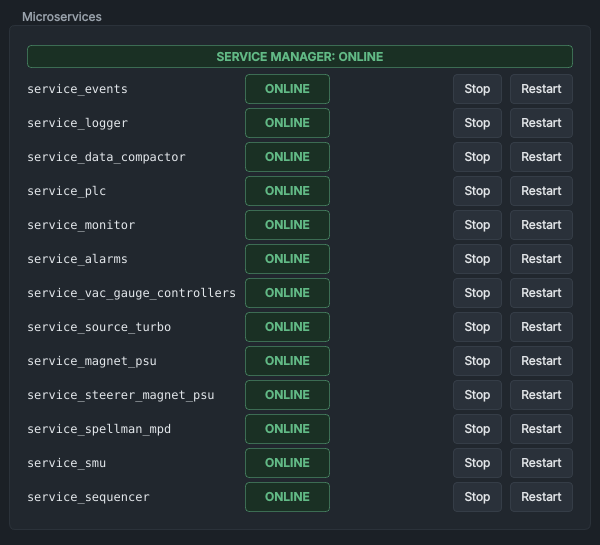

# Service Manager

The **Service Manager** panel shows the state of each SINDIE service, as the service manager reports it, and lets you stop, start and restart them. The services do the work behind the HMI: they talk to the PLC and the instruments, log the data, raise the alarms and run the sequences.

## What it shows

The label at the top says whether the service manager itself is reporting:

| Label | Colour | Meaning |
|---|---|---|
| **SERVICE MANAGER: ONLINE** | green | The service manager is running and reporting. |
| **SERVICE MANAGER: OFFLINE** | red | Nothing from the service manager for 2.5 s. Every service then shows **UNKNOWN**, and the buttons are greyed out. Start it with the launcher's **Start services** (see [Starting the software](../getting-started/starting-the-software.md#the-launcher)). |

Below it, one row per service: its name, its state, a detail, **Stop** (or **Start**) and **Restart**.

| State | Colour | Meaning |
|---|---|---|
| **ONLINE** | green | Running, and sending its heartbeat. |
| **STARTING** | blue | Started, but no heartbeat yet. The manager waits up to 15 s (215 s for `service_data_compactor`). |
| **BACKOFF** | amber | It failed and is waiting to be restarted. The detail reads **restart in** ... **s, failure** ... and its tooltip gives the reason. |
| **STOPPED** | grey | Stopped by an operator. It is not restarted until someone starts it. |
| **CRASHED** | red | Its process has ended. |
| **HANGING** | red | No heartbeat for longer than its time limit. |
| **OFFLINE** | dashed outline | Not running, and no restart is due. |
| **UNKNOWN** | dashed outline | The service manager is not reporting, so the state is not known. |

The detail column also shows **recent restart(s)** with a count, when a service has had to be restarted; the tooltip gives the last problem.

## Controls

| Control | What it does |
|---|---|
| **Stop** | Ends the service's process at once and keeps it stopped: no automatic restarts. The button then reads **Start**. |
| **Start** | Starts a stopped service, and clears its count of failures. |
| **Restart** | Ends the service's process at once and starts it again. It also clears the restart back-off and the STOPPED state. |

Both buttons are greyed out while the service manager is offline. Neither asks for a second click. The commands appear in the [Command Log](command-log.md).

## Automatic restarts

The service manager starts every service when it starts, in four groups 2 s apart: first the event, logging and compacting services; then the PLC, monitor and alarm services; then the device services; and last the sequencer, which needs the others' data.

It restarts a service whose process ends, that sends no heartbeat within its start-up time, or whose heartbeat stops for longer than its time limit: 2 s for most services, 2.5 s for `service_spellman_mpd`, 3 s for the magnet, monitor, alarm and sequencer services, 10 s for `service_smu` and 215 s for `service_data_compactor`. The restarts wait longer each time: 2, 5, 10, 30, 60, 120 and then 300 s. A service that then stays ONLINE for 120 s has its count of failures cleared.

## What stopping or restarting a service does

**Stop** and **Restart** end the service's process at once: it is not asked to finish what it is doing. The services, not the HMI, hold the machine's state, so whatever a service was doing stops with it. While it is away, its readings show as dashes, the controls it serves are greyed out (**no live data from the** ... **service**), and the alarm service raises an alarm for it (low priority if you stopped it; high if it is down for 10 s for any other reason).

> [!WARNING]
> Some services feed the PLC, and losing them can stop the beam:
>
> - `service_plc` writes the watchdog that the PLC checks. If it is stopped, or a restart keeps it away for more than 3 s, the PLC treats the PC as lost: it latches `PC_Watchdog_Timeout` and runs its own shutdown for lost communications, and the latched fault takes away the gate valve's open permissive.
> - `service_vac_gauge_controllers` supplies the vacuum permissive for the gate valve. A **Restart** is safe for up to 60 s: meanwhile `service_plc` keeps giving the PLC the vacuum service's last judgment, and the Vacuum System panel shows **VACUUM PERMISSIVE HELD**. If the vacuum service is stopped, or hasn't judged the vacuum again 60 s after its last judgment, `service_plc` tells the PLC that the vacuum is not good for the gate valve and that both gauge controllers have lost communication. The PLC then latches the gauge controller faults and loses the gate valve's open permissive. See [When the vacuum service restarts](vacuum.md#when-the-vacuum-service-restarts).
> - When `service_source_turbo`, `service_spellman_mpd` or `service_magnet_psu` has been silent for 2 s, `service_plc` reports that device's communication as failed, and the PLC latches the fault.
>
> Without the gate valve's open permissive the PLC closes the gate valve, and the safety relay drops with it. Latched PLC faults stay until **RESET FAULTS** on the [System Health](system-health.md) panel. See [The PLC program](../how-it-works/plc.md).

Which service does what, and what you lose without it:

| Service | What it does | Without it |
|---|---|---|
| `service_events` | Writes events to `data/events.db`: phases, markers, alarms, faults, the command record. | The [Experiment Logging](experiment-logging.md) panel is greyed out. |
| `service_logger` | Records the machine data, 20 times a second. | No data is recorded: a gap in the [data viewer](../viewer/data-viewer.md). |
| `service_data_compactor` | Each night at 02:00, compacts the logged data into day files and makes the backup. | The nightly compaction and backup don't run. |
| `service_plc` | The link to the PLC: the source, the safety relay, the gate valve, the Faraday cup drop-in, the faults. | See the warning above. |
| `service_monitor` | Compares readbacks with setpoints (the amber outlines). | No tolerance outlines or tolerance events. |
| `service_alarms` | The alarm list. | The [Alarms](alarms.md) panel raises its own critical alarm. |
| `service_vac_gauge_controllers` | The vacuum gauges and the gate valve's vacuum permissive. | No pressures. See the warning above. |
| `service_source_turbo` | The source turbo pump. | No turbo data or control. |
| `service_magnet_psu` | The analyser magnet supply. | No magnet control; no mass scan. |
| `service_steerer_magnet_psu` | The steerer magnet supply. | No steerer magnet control. |
| `service_spellman_mpd` | The Spellman supplies: the einzel lenses and the neutral traps. | No control of those supplies. |
| `service_smu` | The Faraday cup SMU: beam current and bias. | No beam current; no mass scan or optimiser sweep. |
| `service_sequencer` | Runs recipes, mass scans and optimiser sweeps. | No sequences. A running one ends at once, without its clean-up (the optimiser does not put its setpoints back, a scan does not put the SMU back), and its controls are freed within 5 s. The sequencer that starts again has nothing running. |

Restarting the HMI does not affect the services. The service for the ADAM-6017 current monitor is not in the list: it is not started at present.

## See also

- [Services and messaging](../how-it-works/services.md)
- [Starting the software](../getting-started/starting-the-software.md)
- [Troubleshooting](../troubleshooting.md)
- [Alarms](alarms.md)
- [System Health](system-health.md)
- [The PLC program](../how-it-works/plc.md)
