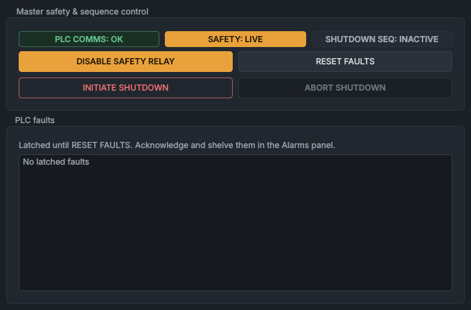

# System Health

The **System Health** panel switches the safety relay on and off, starts and aborts the PLC's source shutdown, resets latched faults, and lists the faults the PLC has latched. Look here first when the machine won't do what you ask; the [Interlocks](interlocks.md) panel, a tab behind it, shows what is holding each interlock.

## What it shows

The **Master safety & sequence control** group has three status chips:

| Chip | Colour | Meaning |
|---|---|---|
| **PLC COMMS: OK** | green | The PLC service is connected to the PLC, and the PLC is receiving the PC's watchdog. |
| **PLC COMMS: OFFLINE** | red | The PLC service is silent or not connected, or the PLC reports that the PC's watchdog has stopped. The other two chips then read **UNKNOWN** (dashed outline) and every button is greyed out. |
| **SAFETY: LIVE** | amber | The safety relay is closed: the supplies it feeds can be live. |
| **SAFETY: DE-ENERGIZED** | green | The relay is open and no relay fault is latched. |
| **SAFETY: TRIPPED/REFUSED** | red | The relay is open and **SAFETY_RELAY_TRIPPED** or **SAFETY_RELAY_REFUSED** is latched. |
| **SAFETY: NO REMOTE IO** | red | The relay is open and the PLC has lost the remote I/O on the source deck. |
| **SHUTDOWN SEQ: INACTIVE** | grey | No shutdown sequence is running. While one runs, the chip names its step: see [Shutdown sequences](#shutdown-sequences). |

The **PLC faults** group lists every fault bit set in the PLC's six fault words, one line each, as the fault's name and description (for example **SAFETY_RELAY_TRIPPED: Hardware safety loop broken. HV disabled.**). The list is red while any fault is latched, reads **No latched faults** otherwise, and **Telemetry offline: fault status unknown** while the PLC link is down. A fault stays in the list until **RESET FAULTS** clears it, even after its cause has gone.

The same faults are alarms on the [Alarms](alarms.md) panel, where you acknowledge and shelve them. Acknowledging an alarm doesn't reset the fault in the PLC; only **RESET FAULTS** does.

## Controls

| Control | What it does |
|---|---|
| **ENABLE SAFETY RELAY** | Asks the PLC to switch the safety relay on, with one click; then press **START** on the **High Voltage Systems Control** box (see [Switching on the safety relay](#switching-on-the-safety-relay)). Greyed out until the gate valve is fully open: "The Gate Valve must be fully OPEN before the safety circuit can be energized." |
| **PRESS PANEL START (5s)** | The same button while the PLC waits for START: it counts down to **(1s)**, with an amber bar that shrinks as the time runs out. Clicking it withdraws the request. |
| **DISABLE SAFETY RELAY** | The same button while the relay is on and the source is cold: one click switches the relay off. |
| **RELAY ENERGIZED (LOCKED)** | The same button, greyed out, while the relay is on and the source is hot or at high voltage: "You cannot drop the safety relay while the source is hot or active. Run a shutdown first." |
| **RESET FAULTS** | Sends a fault reset to the PLC, the Spellman service and the turbo service. Available whenever the PLC link is up; the PLC decides whether to accept it (see [Resetting faults](#resetting-faults)). |
| **INITIATE SHUTDOWN** | Starts the PLC's operator shutdown of the source, with one click and no confirmation. Available only with the safety relay on, no shutdown sequence running, and a supply on or the source hot. |
| **ABORT SHUTDOWN** | Cancels the operator shutdown. Available only during **SHUTDOWN SEQ: HOLD HOT PHASE**, and not for a shutdown the source turbo protection started: "Disabled: the source turbo protection started this shutdown, and it can't be aborted." |

The source counts as cold when the gate valve's close permissive is on: extraction and target (cathode) below 0.15 kV, filament and caesium not hot (see [Vacuum System](vacuum.md)).

All the buttons are greyed out while the PLC link is down. No sequence can take them over (they can't be leased), and a recipe can't send a fault reset.

> [!IMPORTANT]
> When the source turbo's load guard trips, the PLC service shuts the source down: **INITIATE SHUTDOWN**, and the caesium oven's forced cooling. Until that shutdown has finished **ABORT SHUTDOWN** is greyed out and refused, and the shutdown chip ends **- SOURCE TURBO PROTECTION**. Until the trip is reset, **ENABLE SAFETY RELAY** is greyed out and refused too: "the source turbo protection has tripped: the source stays off until RESET FAULTS, once the turbo's load is back to normal". See [The source turbo's load guard](../how-it-works/turbo-guard.md).

## Switching on the safety relay

1. Open the gate valve on the [Vacuum System](vacuum.md) panel and wait for **OPEN**.
2. Turn the key on the **High Voltage Systems Control** box, on the desk next to the HMI's screen, to **ENABLE** (photo in [Safety rules](../safety.md#the-high-voltage-systems-control-box)).
3. Click **ENABLE SAFETY RELAY**. The button counts down from **PRESS PANEL START (5s)**.
4. Press **START** on the box before the count runs out. **SAFETY: LIVE** shows when the relay closes.

The PLC can open the relay but can't close it: it passes your request on as an enable, and the relay closes when **START** is pressed, if the rest of its hardwired loop is made (see [Safety rules](../safety.md#what-protects-you)). The PLC gives the enable only while its relay permissive holds:

- compressed air pressure OK;
- source coolant flowing;
- magnet coolant flowing;
- the gate valve open;
- no relay kill from a shutdown sequence;
- no caesium oven over-temperature.

If the relay hasn't closed 5 s after the request, the PLC drops the request and latches **SAFETY_RELAY_REFUSED**.

Losing any of those conditions while the relay is on opens it. **DISABLE SAFETY RELAY**, with the permissive intact, switches the relay off without a fault; any other opening, a lost permissive included, latches **SAFETY_RELAY_TRIPPED**.

While the source is hot or at high voltage, the PLC keeps the relay request on whatever the PC asks, so the relay can't be switched off from the HMI; the button reads **RELAY ENERGIZED (LOCKED)**. Use **INITIATE SHUTDOWN** instead. The PLC can still open the relay itself, through its permissive.

> [!CAUTION]
> The source deck is the high-voltage area. Both of its doors are interlocked, and switching the safety relay on needs a key. Follow the [Safety rules](../safety.md), and [Bringing up a beam](../procedures/beam-start-up.md) for the checks to make first.

## Shutdown sequences

The PLC runs its own shutdown sequences. It keeps two step counters, one for the sequence that follows a loss of the remote I/O and one for all the others; the chip shows the higher of the two. While any sequence runs, the PLC drives the extraction, target, filament, thermionic and caesium oven itself, and the [TESS Ion Source Control](ion-source.md) panel greys them out ("automated source shutdown in progress").

| Chip | Step | What the PLC does |
|---|---|---|
| **SHUTDOWN SEQ: GRACE PERIOD (75% EXTR)** | 1 | The PLC has lost the PC (no watchdog change for 3 s) or the remote I/O. It holds the extraction at 75 % of its readback for up to 60 s, and ends the sequence if the link returns; the supplies stay as the PLC left them. Otherwise it goes on to step 2. A lost PC watchdog also latches `PC_Watchdog_Timeout`, which closes the gate valve at once and so opens the relay. This is deliberate: without the PC the PLC has no vacuum readings, so it assumes the worst. |
| **SHUTDOWN SEQ: CESIUM COOLDOWN** | 2 | Extraction off, the caesium oven force-cooled, and the gate valve closed, which opens the safety relay. A hardware abort (below) comes straight here. Then step 3 once the caesium and the filament are cold; the remote I/O sequence normally goes to 99 as soon as the relay opens. |
| **SHUTDOWN SEQ: FINAL KILL** | 3 | Target, filament and thermionic switched off, and the relay killed. After a PC link loss or hardware abort, it goes on to 99 once the link is back and no abort is active. |
| **SHUTDOWN SEQ: LATCHED SAFE (RESET REQ)** | 99 | The automatic sequence has finished. It stays here until **RESET FAULTS**. |
| **SHUTDOWN SEQ: HOLD HOT PHASE** | 10 | Started by **INITIATE SHUTDOWN**. Extraction and thermionic off, the Faraday cup asked in, the caesium oven force-cooled. If the filament is above 20 A and the caesium is hot, the target is kept at 3 kV or more and the filament at 15 A or less. Waits for the caesium to cool; **ABORT SHUTDOWN** ends the sequence, and the supplies stay as the PLC left them. |
| **SHUTDOWN SEQ: FILAMENT RAMP DOWN** | 11 | Target setpoint 0, filament ramped down at 1 A/s. At 0 A the target and filament are switched off, the gate valve closed and the relay request dropped, and the chip goes back to **INACTIVE**. |

The chip is amber while a step is running, and red at **FINAL KILL** and **LATCHED SAFE (RESET REQ)**. [The PLC program](../how-it-works/plc.md) gives every step in full.

A **hardware abort** starts the cool-down (step 2) at once: a sustained arc on the extraction, target or thermionic supply, filament over-current (above 38 A), source body temperature high (above 40 °C), source coolant flow low, or caesium oven over-temperature (above 200 °C).

At present a safety relay trip doesn't start a shutdown sequence by itself: the chip stays at **INACTIVE**, and the PLC latches **SAFETY_RELAY_TRIPPED**.

## Resetting faults

**RESET FAULTS** asks the PLC to clear every latched fault, and the Spellman service to clear its software arc latches (it also sends a fault clear to each Spellman supply it can reach). It also resets the source turbo's load guard after a trip, once the turbo's current is back under 1.2 A; while it is still overloaded the turbo service refuses, with the readings (see [The source turbo's load guard](../how-it-works/turbo-guard.md)).

The PLC accepts the reset only while it is receiving the PC's watchdog, and not during **GRACE PERIOD (75% EXTR)**, **HOLD HOT PHASE**, **FILAMENT RAMP DOWN** or the cool-down after a remote I/O loss. It takes the request either way, so a refused reset does nothing and says nothing: check the **PLC faults** list afterwards.

An accepted reset clears all six fault words, returns both step counters to 0, ends any relay kill and forced cooling a sequence had set, and lets the gate valve open again. A fault whose cause is still present latches again.

> [!WARNING]
> **RESET FAULTS** is accepted during **CESIUM COOLDOWN** after a PC link loss or a hardware abort, and ends that cool-down even if the caesium is still hot.

## Things to know

- The PLC drives the traffic-light beacon: red while the safety relay is closed (on), green while it is open, amber while a PLC fault is latched. Spellman faults (**UNIT1_ARC_EXCEEDED** and the like) are latched and listed like the others but don't light the amber. The buzzer sounds for 3 s when the relay closes.
- After **ABORT SHUTDOWN** the PLC can leave the caesium oven's cooling air on (the source panel's **Cesium oven** row says **cooling air on**) until **RESET FAULTS**.
- Closing the gate valve with the relay on trips the relay (see [Vacuum System](vacuum.md)).

## See also

- [Interlocks](interlocks.md)
- [Safety rules](../safety.md)
- [Alarms](alarms.md)
- [Alarms and faults](../procedures/alarms-and-faults.md)
- [Bringing up a beam](../procedures/beam-start-up.md)
- [Shutting down](../procedures/beam-shut-down.md)
- [TESS Ion Source Control](ion-source.md)
- [The PLC program](../how-it-works/plc.md)
- [How the controls behave](../getting-started/controls-and-colours.md)
