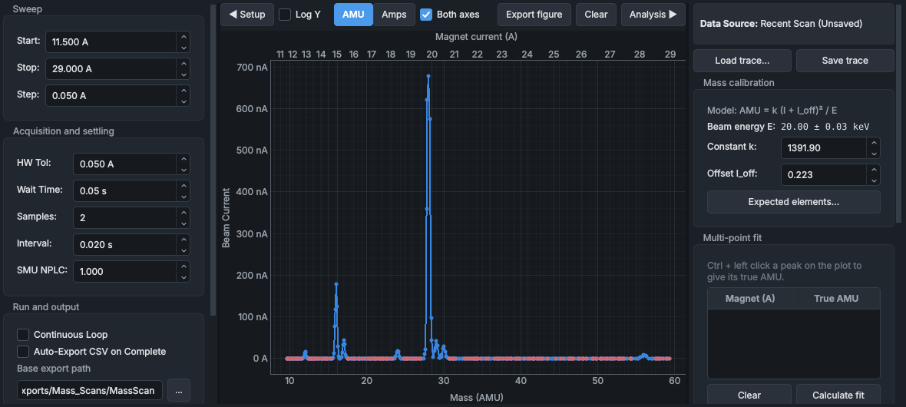

# Selecting a mass and tuning the beam

How to get the ion you want onto the Faraday cup and make the most of it:

1. set up the beamline;
2. find your ion with the analyser magnet, either at a known setting or with a mass scan;
3. calibrate the mass axis;
4. tune the einzel lens and the steering for the most current.

Start once the source is running: see [Bringing up a beam](beam-start-up.md).

## 1. Set up the beamline

1. **Faraday cup.** On the **Faraday Cup & SMU** panel, insert the Faraday cup and bias it correctly: above 50 V. Without the bias the beam current reading isn't right. Check that the reading is live.
2. **Aperture ladder.** At the machine, set the aperture ladder to its largest opening (fully retracted). It is moved by hand; the HMI has no control for it.
3. **Slits.** At the machine, set the object slits (before the magnet) and the image slits (after it). For a first tune they are typically 10 mm each. Type the widths you set into the **Object slits (L / R)** and **Image slits (L / R)** boxes on the **Beamline Optics** panel. This records them in the event log, but doesn't move anything.
4. **Analyser magnet.** Switch it on: **ENABLE MAGNET** on the **Beamline Optics** panel, then the confirming click. Neither a mass scan nor **CALCULATE & SET AMPS** switches it on for you.

## 2. Know the beam energy

The analyser magnet selects ions by mass, charge and energy together. SINDIE's beam energy is the extraction voltage plus the target (cathode) voltage. For singly charged ions, 15 kV + 5 kV gives 20 keV.

The magnet current a mass needs grows with the square root of mass times energy. If you change either voltage, the magnet setting must change too.

## 3. Find your ion

There are two ways.

**At a known setting.** If you know the magnet current for your ion at this beam energy, set the analyser magnet to it. Look in previous logs for it.

**With a mass scan.** Sweep the magnet over a range where you expect the peak (previous logs show where, at a given beam energy):

1. On the **Mass Scan** panel, set the range of magnet currents to sweep: **Start**, **Stop** and **Step**.
2. Set how carefully to measure each point: **HW Tol**, **Wait Time**, **Samples**, **Interval** and **SMU NPLC**. **Est. Scan Time** says how long the scan will take.
3. To sweep again and again while you tune, tick **Continuous Loop**.
4. Press **START PRECISION SWEEP**.

The scan runs in the sequencer, which holds the analyser magnet and the SMU while it runs; the Automation bar shows this.

Watch the spectrum build up. The peaks are the ions the source is giving. **Expected elements...** marks where the isotopes of chosen elements should fall.

The `auto_tune.json` recipe does a scan in one go: it switches the analyser magnet on, inserts the cup and biases it at 60 V, scans 20 A to 30 A and sets the magnet on the biggest peak. The recipe builder's **Mass scan** template is the same, to start your own from.

See [Mass Scan](../panels/mass-scan.md) for every control.

## 4. Calibrate the mass axis

The mass axis comes from `AMU = k (I + I_off)² / E`, where:

- I is the magnet current;
- E is the beam energy;
- k and I_off are constants, shown on the **Mass Scan** panel.

If the peaks don't sit at the right masses, fit the constants to them:

1. Hold Ctrl and left-click a peak whose mass you know, and give its true mass.
2. Do the same for at least one more peak, as far from the first as you can.
3. Press **Calculate fit**. The new k and I_off move the mass axis, and **CALCULATE & SET AMPS** uses them from then on.

## 5. Set the magnet for your mass

1. On the **Beamline Optics** panel, type the mass in **Auto-tune target**.
2. Press **CALCULATE & SET AMPS**. The panel works out the magnet current from the calibration and the live beam energy, and sends it.
3. Check the beam current on the **Faraday Cup & SMU** panel.

> [!TIP]
> The magnet has hysteresis, and the mass scan calibrates with the current rising. For the most repeatable setting, approach the current from below, or run **DEGAUSS ROUTINE** first.

## 6. Tune for current

With the beam on the cup, change one setting at a time and watch the beam current on the **Faraday Cup & SMU** panel. Its **Analog Gauge** view shows the trend at a glance.

- **The source einzel voltage:** **Source Einzel**, on the **TESS Ion Source Control** panel.
- **The steering:** **ENABLE STEERING**, then the **Y-steerer voltage** and the **X-steerer current**, on the **Beamline Optics** panel.

> [!WARNING]
> While you tune the einzel, keep its current below 50 µA. A higher current means the einzel electrode insulators are failing. Switch the einzel off and report it.

To search two settings at once, use the **Optimiser**. It steps through a grid of two parameters, measures the beam current at each point and draws a map of it. See [Optimiser](../panels/optimiser.md).

## 7. Record what you found

Add a marker in the **Experiment Logging** panel with the settings that worked, for example "Si-28 tuned: 112 nA, einzel 10.4 kV". See [Recording an experiment](recording-an-experiment.md).

## See also

- [Mass Scan](../panels/mass-scan.md)
- [Beamline Optics](../panels/beamline-optics.md)
- [Faraday Cup & SMU](../panels/faraday-cup-smu.md)
- [Optimiser](../panels/optimiser.md)
