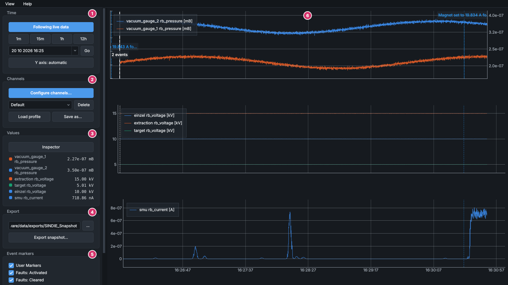
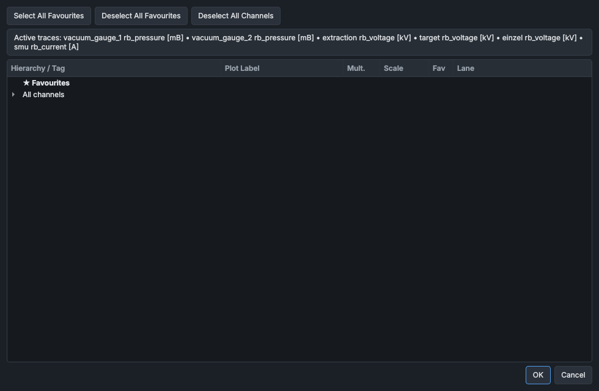
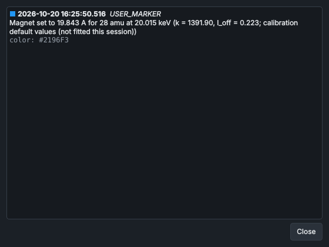

# Using the data viewer

The data viewer plots the machine's telemetry, live as it arrives and back through everything the logger has recorded, in up to four lanes on one time axis, with events from the event database marked on the plots. This page covers moving through time, choosing channels, reading values and the event markers; [Exporting data and figures](exporting.md) covers getting data and figures out.



## The window

The numbers on the picture:

1. **Time**: following live data, the time span, going to a date, and the Y axes.
2. **Channels**: which channels are plotted, and saved profiles.
3. **Values**: each channel's value, and the **Inspector**.
4. **Export**: where exports go, and **Export snapshot...** (see [Exporting data and figures](exporting.md)).
5. **Event markers**: which kinds of event are marked on the plots.
6. The plots: up to four lanes, each with a legend giving its channels' labels and units. The lanes share one time axis, in local time, labelled under the bottom lane only; the labels show dates when zoomed out and seconds when zoomed in.

Drag the divider between the sidebar and the plots to make the sidebar wider or narrower, or hide the sidebar with **View > Sidebar**. The sidebar scrolls when the window is too short for it.

## Starting the data viewer

On the lab PC, start the data viewer with:

```
python src/gui/data_viewer/viewer_main.py
```

`python run_simulation.py` starts it together with the simulator. Started on its own, `--sim` makes it show the simulator's data, live and logged, instead of the machine's. See [Starting the software](../getting-started/starting-the-software.md).

The window opens maximised, following live data with the last 5 minutes on screen, and shows the channels of the profile called **Default** (see [Profiles](#profiles)). Until some channels are chosen, the plot area says **No channels selected**.

As it starts, the data viewer asks the logger to write the rows it holds in memory to disk, so that the logged data reaches up to the live data. If the logger doesn't answer within 2 s (because it isn't running, for example), up to the last 15 minutes before the start can be missing from the history until the logger writes its next file.

## Moving through time

### Following live data

While **Following live data** is on (the button is blue), the plots scroll with the newest data, redrawn five times a second. Click the button to stop the plots where they are: it then reads **Browsing - click to follow live**. Click it again to follow live data, with the same span. Dragging the plots sideways and **Go** also stop following live data.

### Choosing the time span

| Control | What it does |
|---|---|
| **1m**, **15m**, **1h**, **12h** | Show the last minute, 15 minutes, hour or 12 hours. While following live data the span ends at the newest data; while browsing it ends at the right-hand edge of the view. |
| Date and time box | The date and time to go to. Click its arrow for a calendar. |
| **Go** | Shows the plots from the date and time in the box, keeping the span, and stops following live data. |

### Panning and zooming

The mouse moves and zooms the time axis only.

| On the plots | What it does |
|---|---|
| Drag sideways | Moves through time. Dragging stops following live data. |
| Mouse wheel | Zooms in or out in time, around the pointer. While following live data it changes the span, and the plots go on following. |
| Middle-click | While browsing, centres the view on the time under the pointer. |

Zooming and panning stop 10 % of the whole record (at least an hour) beyond the oldest logged data and beyond the present, so a quick zoom-out can't run on into years of empty axis.

When the view reaches back before the live data, the plots fill in from the logged data as it is read: see [How the history is drawn](#how-the-history-is-drawn).

### The Y axes

While the button reads **Y axis: automatic**, each lane's Y axes scale themselves to the data in view, with a margin. Click it to hold every lane's Y axes where they are: it then reads **Y axis: held - click for automatic** and is blue. Click it again for automatic. The mouse doesn't move or zoom the Y axes.

## Choosing channels

**Configure channels...** opens the **Channel Manager**, which lists every channel in the tag registry.



The list has two folders: **★ Favourites** at the top, with the channels you have starred, and **All channels**, sorted into folders by the parts of each tag name (`ion_beam.source.vacuum_gauge_1.rb_pressure` is under **Ion Beam**, **Source**, **Vacuum Gauge 1**). Hover over a channel's name for its description.

| Column | What it does |
|---|---|
| **Hierarchy / Tag** | The channel's name and unit. Tick the box to plot the channel. |
| **Plot Label** | The name used in the legend, the **Values** section and exports. Double-click to change it; the unit is added by itself. |
| **Mult.** | A number the channel's values are multiplied by on the plots and in the **Values** section. Double-click to type it. The legend doesn't show the multiplier. |
| **Scale** | **Linear** or **Log**: see [Linear and log axes](#linear-and-log-axes). |
| **Fav** | Click the star to add the channel to **★ Favourites**, or to take it off. |
| **Lane** | **Lane 1** to **Lane 4**: the lane the channel is drawn in. |

| Button | What it does |
|---|---|
| **Select All Favourites** | Ticks every channel in **★ Favourites**. |
| **Deselect All Favourites** | Unticks every channel in **★ Favourites**. |
| **Deselect All Channels** | Unticks every channel. |

The line under the buttons lists the ticked channels (**Active traces:**), or warns that none are ticked. A channel's scale and multiplier start as the tag registry sets them: the gauge pressures, for example, start on **Log**.

**OK** applies the changes and redraws the lanes, keeping the time on screen. At most 20 channels can be plotted at once: with more ticked, **OK** shows **Too Many Channels** and the Channel Manager stays open.

The favourite stars, labels, multipliers, scales and lanes are part of the channel settings, so a profile saves them and loading a profile brings back its own.

### Lanes and line colours

The lanes are drawn top to bottom from **Lane 1** to **Lane 4**. A lane with no channels isn't drawn, and the others share its space.

Each lane's channels take the eight line colours in turn; the colours are checked to be told apart by colour-blind readers. A channel keeps its colour while it stays in its lane, so adding or removing another channel doesn't change it; a channel moved to another lane takes the first free colour there. A ninth line in one lane repeats the colours dashed, and a seventeenth dotted. The **Values** section shows each channel's colour next to its name. The colours differ slightly between the dark and light themes.

### Linear and log axes

Each lane has a linear axis on the left and a log axis on the right. A channel on **Linear** is drawn against the left-hand axis and one on **Log** against the right-hand axis, so a lane can hold pressures on a log scale next to, say, currents. The two axes scale separately.

- The right-hand axis appears only when the lane has a log channel. Its numbers are in scientific notation, such as `1.0e-06`.
- In a lane with only log channels, the left-hand numbers are hidden and the grid lines follow the log axis.
- On a log axis, zero, negative values and anything below 1×10⁻¹² are drawn at 1×10⁻¹².

## Profiles

A profile is a saved set of channels with their settings. The profiles are kept in `config/workspace_profiles.json` on this PC (not in git) and are shared by every data viewer window.

| Control | What it does |
|---|---|
| Profile list | The saved profiles. Choosing one here doesn't load it. |
| **Load profile** | Shows the channels of the profile chosen in the list, in place of those shown now. |
| **Save as...** | Saves the channels shown now as a profile, under the name you type. A profile that already has that name is replaced without asking. |
| **Delete** | Deletes the profile chosen in the list, after a question, for every window. The data viewer then loads **Default**. |

The data viewer starts with the profile called **Default**, which is empty until a profile is saved under that name. To have the data viewer open with your channels, show them and save them with **Save as...** as `Default`. Nothing else keeps the channels when the data viewer closes.

## Reading values

### The Values section

With the **Inspector** off, the **Values** section shows the newest value of each channel shown, with its line colour and label, updated five times a second; **---** means no value has arrived yet. The values include the channel's multiplier. Channels in A are given in A or with a prefix (mA, μA, nA or pA), pressures in scientific notation (`5.30e-07 mB`), and other channels to two decimal places.

### The Inspector

Click **Inspector** to read the plots under the pointer. The button then reads **Inspector on: values under the cursor**, the pointer becomes a cross, a dashed line follows it through every lane, and the **Values** section shows each channel's value at that time.

To measure a difference, pin a time:

1. With the Inspector on, hold Ctrl and click the plots. A solid line marks the pinned time in every lane.
2. Move the pointer. **Δt** beside the pointer gives the time between the pin and the pointer, and the **Values** section adds each channel's difference from its value at the pin, for example `12.40 kV  (Δ: +0.35 kV)`.
3. Right-click the plots to clear the pin.

The Inspector reads the samples drawn: on live data, each channel's last reading at or before the pointer; on the history, the drawn point at or before the pointer. Zoomed out on the history, a drawn point is the lowest or highest value of an interval, not a logged sample (see [How the history is drawn](#how-the-history-is-drawn)). Zoom in to read logged values, or export the range.

## Event markers

The data viewer draws events from the event database (`data/events.db`) as dashed vertical lines through every lane, labelled along the top of the first lane. Events written by the services, the HMI or another data viewer appear within about a second. The **Event markers** section chooses which kinds are drawn:

| Check box | Marks |
|---|---|
| **User Markers** | Markers added in the data viewer and with **ADD MARKER** in the HMI's **Experiment Logging** panel, and notes the **Beamline Optics** and **Mass Scan** panels and the optimiser add themselves (a slit width set by hand, a magnet current set for a mass, the start and end of an optimiser scan). Ticked when the data viewer starts. |
| **Faults: Activated** | A PLC fault becoming active. |
| **Faults: Cleared** | A PLC fault clearing. |
| **Watchdog Drops** | The logger hearing nothing from a service for more than 1 s, and the service's data coming back: see [When a service stops](#when-a-service-stops). |
| **Phase Changes** | A phase set with **SET NEW PHASE** in the **Experiment Logging** panel. |
| **Readback Tolerance** | A readback going out of tolerance of its setpoint, and coming back. |
| **Operator Commands (audit)** | Every command sent by the HMI, a recipe, the optimiser or a scan, with the service's answer. There are a great many of these. |

Each kind has its own colour in the theme: active faults red, cleared faults blue, watchdog events orange, phase changes green, tolerance events amber and commands grey. A user marker keeps the colour it was given, drawn darker or lighter where needed to show on the plot background. Alarms, configuration changes and general messages from the services aren't drawn.

An export includes the events of the kinds ticked here: see [Exporting data and figures](exporting.md).

### How events are drawn

- Each label is one line, shortened to 26 characters, in rows along the top of the first lane. Hover over a line or label for the time and full text.
- Events closer together than about 6 pixels are drawn as one thicker line, labelled with their number (for example **12 events**) and coloured by the most important of them: an active fault first, then a watchdog drop, then a tolerance event or user marker. Hovering lists up to 15 of them. Zoom in to separate them.
- A label that would overlap another label or the lane's legend is left off, but its line still shows the texts on hover and opens the details on a click.

### The event details window

Click an event's line or label to read it in full in the **Event details** window.



The window lists every event of the line, or of the group, oldest first: its date and time to the millisecond, its type (such as `FAULT` or `USER_MARKER`), its full text, and the details stored with it (for a fault, its `fault_key` and `is_active`). The text can be selected and copied. The window stays open while you work, and clicking another line shows that line's events in the same window.

### Adding a marker

1. With the **Inspector** off, double-click the plots at the time you want to mark, away from any event line.
2. In **Add event marker**, type a **Note:** and choose a **Colour:** (Cyan, Yellow, Magenta, White, Purple or Pink).
3. Click **OK**.

The marker appears at once, and **User Markers** is ticked if it wasn't. The data viewer sends the marker to the events service, which stores it in the event database, where other data viewers and exports find it. If it hasn't reached the database within about 7 s, the data viewer takes it off the plots and shows **Marker not saved**: the events service isn't running, or the data viewer and the services were started for different systems (one with `--sim`, the other without). A marker with an empty note isn't added.

### Deleting a marker

Right-click a user marker's line or label and choose **Delete marker** followed by the marker's time and text. The menu also has **Show the full details...**, and lists the group's other events as read-only; for a group of more than 25 events it lists the first 25 (zoom in for the rest).

**Delete marker** deletes the marker at once, without a further question, from the event database: it goes from every data viewer and from later exports. Markers added in the HMI can be deleted in the same way. Faults, watchdog, phase, tolerance and command events can't be deleted.

## The menus

| Menu item | What it does |
|---|---|
| **View > Sidebar** | Shows or hides the sidebar. |
| **View > Theme > Dark**, **View > Theme > Light** | Switches the theme. The HMI follows within a second, and both programs start in it next time (it is kept in `config/appearance.json`). |
| **View > Theme > Switch theme** | Switches to the other theme. **Ctrl+Shift+T** does the same. |
| **Help > Using the data viewer** | Opens this page. **F1** does the same. |
| **Help > Help contents** | Opens the help's home page. |
| **Help > Exporting data and figures**, **Recording an experiment**, **Safety rules** | Open those pages: [Exporting data and figures](exporting.md), [Recording an experiment](../procedures/recording-an-experiment.md) and the [Safety rules](../safety.md). |
| **Help > About SINDIE** | The software's version and where it keeps its files. |

**F12** captures the plots, the sidebar or the whole window as a figure for a report: see [Capturing a window as a figure](exporting.md#capturing-a-window-as-a-figure).

## How the history is drawn

The data viewer draws from two sources:

- **Live data.** The services publish their readings, and the data viewer keeps the last 30 minutes of each service in memory, at the service's own sample times. Everything since the data viewer started, up to 30 minutes back, is drawn from these.
- **Logged data.** The logger records a row 20 times a second, holding the latest value of every channel, and writes the rows to disk in 15-minute files. At 02:00 each night the compaction service (`service_data_compactor`) joins each past day's files into one day file and makes two summaries of it: the lowest and highest value of every channel in each minute, and in each 20 minutes. See [Data logging and storage](../how-it-works/data-logging.md).

When the view reaches back before the live data, the data viewer reads the logged data for the view and for half a view either side, so that a short pan needs no new read; it reads again when the view leaves that range or you zoom in far enough to need finer data. Where it reads from depends on the time on screen:

| Time on screen | Read from |
|---|---|
| Up to 12 hours | The logged rows |
| 12 hours to 10 days | The 1-minute summaries |
| More than 10 days | The 20-minute summaries |

However much time is on screen, the data viewer draws no more than a few thousand points of each line across it. Once there is more data than that (more than a few minutes of logged rows, or any view drawn from the summaries), each point is the lowest or the highest value of an interval, and the line runs up and down between them. So, zoomed out:

- a steady signal still looks like a line, but a noisy one becomes a band as wide as its noise;
- a short spike stays visible however far you zoom out;
- the average isn't drawn;
- a gap shorter than an interval doesn't show.

To see the logged values themselves, zoom in, or export the range (**Exact** or **Time-averaged**: see [Exporting data and figures](exporting.md)).

Today's data has no summaries until the following night: in longer views the data viewer adds it from the logger's 15-minute files. The data viewer loads the 20-minute summaries when it starts and again at 02:30 each day.

> [!NOTE]
> Views of more than 12 hours rely on the nightly summaries. If the compaction service hasn't run for some days, those days can be missing from such views: zoom in to 12 hours or less to see them from the logged rows.

## When a service stops

- **Live plots.** A stopped service's lines end at its last reading, while the other services' lines carry on. When it starts again, its lines start again with a break: a line is broken wherever its readings are more than 2 s apart (further apart when zoomed out). A channel that a running service leaves out of its messages for more than 1 s is drawn as a gap.
- **Following live data.** The plots scroll with the newest reading from any service. If every service stops, the plots stop scrolling.
- **Logged data.** Once the logger has heard nothing from a service for more than 1 s, it records that service's channels as empty (NaN), so the history has a gap there. It also records a watchdog event, `Network Timeout: <topic> silent for >1s. Forcing NaNs.`, and another, `Network Recovery: <topic> data stream restored.`, when the data comes back: tick **Watchdog Drops** to see them.
- **The logger itself.** While the logger is stopped, nothing is recorded: the live plots still work, but that time will be missing from the history. When the logger starts, it records an empty row first, so the history isn't drawn as a straight line across the time it was off.

> [!NOTE]
> The **Values** section keeps showing the last value a stopped service sent. Before relying on a value, check that its line is still moving, or look at the **Service Manager** panel in the HMI.

## See also

- [Exporting data and figures](exporting.md)
- [Data logging and storage](../how-it-works/data-logging.md): what the logger records and how the files are kept
- [Recording an experiment](../procedures/recording-an-experiment.md)
- [Experiment Logging](../panels/experiment-logging.md): phases and markers from the HMI
- [Service Manager](../panels/service-manager.md): which services are running
- [The simulator](../how-it-works/simulator.md)
