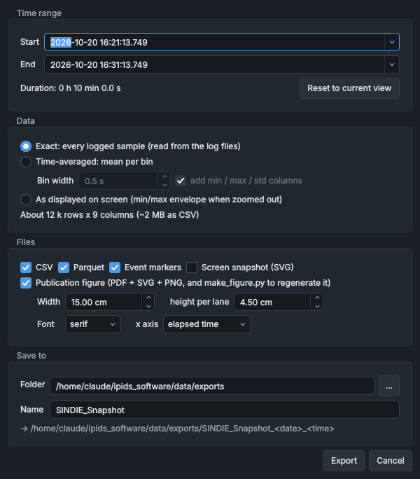

# Exporting data and figures

The data viewer exports a time range of the channels it shows: the data, a record of where it came from, a summary, and a publication figure with the script that draws it. **F12**, in the data viewer or the HMI, saves part of a window as a figure for a report. This page covers both.

## Exporting a time range

1. Show the channels you want and move the view to the time range. Only the channels shown are exported, lane by lane, and the export starts from the range on screen.
2. Under **Event markers** in the sidebar, tick the kinds of event to include.
3. Click **Export snapshot...** in the sidebar's **Export** section, check the choices in **Export data and figure**, and click **Export**.

The export runs in the background. The button shows how it is getting on (**Reading log files...** or **Rendering figure...**, for example), then **Exported** for 3 s, and the **Export complete** message gives the folder, with **Open folder** to open it. If the export fails, the button reads **Export failed** and a message gives the reason, such as `No data in the selected range.`

**Export snapshot...** is greyed out while an export runs, and does nothing when no channels are shown.

| Control | What it does |
|---|---|
| Folder and name box | The folder for exports and the start of their name: `data/exports/SINDIE_Snapshot` at first. The export dialog starts from it and writes its own choice back to it. |
| **...** | Chooses the folder and name in a file dialog. |
| **Export snapshot...** | Opens the export dialog. |

## The export dialog



The dialog remembers its choices for the next export.

### Time range

| Control | What it does |
|---|---|
| **Start**, **End** | The range to export, to the millisecond. They start as the range on screen. Click a box's arrow for a calendar. |
| **Reset to current view** | Puts **Start** and **End** back to the range on screen, and **Bin width** back to its starting value for that range. |

**Duration:** beside the button gives the length of the range. **End** must be after **Start**.

### Data

| Choice | What is exported |
|---|---|
| **Exact: every logged sample (read from the log files)** | Every row the logger recorded in the range: 20 a second, each holding the latest value of every channel. Data not yet on disk comes from the data viewer's live data, at each service's own sample times. |
| **Time-averaged: mean per bin** | The mean of the samples in bins **Bin width** long, counted from **Start**; each row's time is the middle of its bin. Gaps (NaN) are left out of the means. Tick **add min / max / std columns** for each bin's lowest value, highest value and standard deviation as well. |
| **As displayed on screen (min/max envelope when zoomed out)** | The points the data viewer holds for the plots. Zoomed out, these are pairs of lowest and highest values, not logged samples: see [How the history is drawn](data-viewer.md#how-the-history-is-drawn). |

- **Exact** and **Time-averaged** read the logger's files, never the nightly summaries. When the range ends in the last 20 minutes, the data viewer first asks the logger to write the rows it holds in memory to disk.
- **Bin width** (0.1 s to 86400 s) starts at the smallest round value that gives no more than 1500 bins in the range.
- **As displayed** has only the data the data viewer has loaded around the view, so keep its range within the view.
- The line under the choices estimates the number of rows and columns, and the size as CSV. An **Exact** export of more than 2 million rows is marked as large, with the advice to export Parquet only, or to time-average.

### Files

| Check box | Writes |
|---|---|
| **CSV** | `data.csv` |
| **Parquet** | `data.parquet` |
| **Event markers** | `markers.csv`, and the events in `metadata.json` and on the figure |
| **Screen snapshot (SVG)** | `screen.svg`: the plots as they are on screen, in the current theme |
| **Publication figure (PDF + SVG + PNG, and make_figure.py to regenerate it)** | `figure.pdf`, `figure.svg`, `figure.png` and `make_figure.py`, and `data.parquet` for the script to read |

The figure's settings are **Width** (5 cm to 40 cm; 15 cm at first) and **height per lane** (2 cm to 20 cm; 4.5 cm at first), **Font** (**serif** or **sans**) and **x axis** (**elapsed time** or **clock time**). See [The publication figure](#the-publication-figure).

### Save to

| Control | What it does |
|---|---|
| **Folder** | The folder the export goes in. **...** chooses it. |
| **Name** | The start of the export's folder name. |

Every export goes in a new folder of its own, named with the date and time of the export. The line under **Name** shows it as `<Folder>/<Name>_<date>_<time>`; a real one is named like `SINDIE_Snapshot_20261020_143502`.

> [!NOTE]
> On the lab PC, exports and figures saved under `data/exports` are copied to the OneDrive backup every night. Folders elsewhere aren't backed up.

## What an export contains

| File | Written | Contents |
|---|---|---|
| `data.csv` | With **CSV** | The data table |
| `data.parquet` | With **Parquet**, or with the figure | The same table, as Parquet |
| `metadata.json` | Always | Where the data came from and how it was exported |
| `summary.csv` | Always | Statistics of each channel over the range |
| `caption.txt` | Always | A draft caption for the figure |
| `markers.csv` | With **Event markers**, when there are events in the range | The events |
| `screen.svg` | With **Screen snapshot (SVG)** | The plots as on screen |
| `figure.pdf`, `figure.svg`, `figure.png` | With the figure | The publication figure |
| `make_figure.py` | With the figure | The script that draws the figure |

### The data table

`data.csv` and `data.parquet` have one row per sample, or per bin, and these columns:

- `Timestamp_UNIX`: seconds since 1970-01-01 UTC;
- `Human_Time`: the local date and time, to the microsecond;
- `Elapsed_s`: seconds since **Start**;
- one column per channel, in lane order, named `<label> [<unit>]` from its plot label and the unit in the tag registry. The values are in the logged units, without the channel's multiplier. An empty cell, `nan` in the CSV, means no sample;
- for a channel with a multiplier other than 1, another column, `<label> (x<multiplier>)`, with the multiplied values;
- with **add min / max / std columns**, `<column> min`, `<column> max` and `<column> std` for each channel.

A second channel with the same column name gets ` (2)` added to it.

### The other files

- `metadata.json` records when the export was made and with which version of the software (the git commit, marked `-modified` if the code had changes not yet committed); the range, in Unix and local time; the data choice, bin width and logger rate; each channel's tag, label, unit, lane, scale, multiplier, description and column name; where the rows came from (`sources`: rows from the log files, rows from the live data and from when, whether the logger wrote its rows first, and any files that couldn't be read); the events; and notes that explain the columns.
- `summary.csv` has a row per channel: `Channel`, `Unit`, `Tag`, `Basis`, `N`, `Mean`, `Std`, `Min`, `Max`, `First`, `Last`, `First_time_unix` and `Last_time_unix`. `Basis` says what the statistics are of: logged samples, bin means (for a time-averaged export) or displayed points.
- `markers.csv` has the `Timestamp_UNIX`, `Human_Time`, `Elapsed_s`, `Type`, `Text` and `Color` of each event in the range, of the kinds ticked under **Event markers**.
- `caption.txt` is a draft caption that names the channels in each panel, says when they were recorded and what the lines show (for example `Data are all logged samples (20 Hz).`). Edit it to suit.

> [!IMPORTANT]
> If a log file in the range can't be read, its rows are missing from the export. The message then reads **Export incomplete** and names the files, and so does a note in `metadata.json` that starts with `INCOMPLETE`.

## The publication figure

The figure is drawn with matplotlib from the exported data, for a report or a thesis:

- one panel per lane, stacked on one time axis;
- a white background, 9 pt text (**serif** is Times New Roman where it is installed, **sans** is Arial), and the colour-blind-safe Okabe-Ito colours, given to the channels in turn rather than the data viewer's line colours;
- vector PDF and SVG with the text kept as text, so that it can be edited, and a 300 dpi PNG;
- in a lane that mixes linear and log channels, the log channels on their own right-hand axis, drawn dashed;
- an SI prefix for a linear axis whose channels share one unit and have no multiplier (A becomes µA, for example), and mbar for `mB`;
- for a time-averaged export with min/max columns, a shaded band from each bin's lowest to highest value;
- the events as grey dashed lines through every panel, with their text above the top panel;
- on the time axis, the time since **Start** (in s, min, h or days, depending on the length of the range), or clock time;
- long series cut down to about 4000 points per line, keeping each interval's lowest and highest value, which looks the same at print size.

### Drawing the figure again

`make_figure.py` in the export folder is a copy of the script that drew the figure (`src/gui/data_viewer/thesis_figure.py`). Run it in the export folder to draw the figure again, at another size for example. It needs Python with numpy and matplotlib, and polars or pandas to read `data.parquet`; without either it reads `data.csv` instead, so tick **CSV** as well if the figure may be redrawn on a PC without them.

```
python make_figure.py
python make_figure.py --width-cm 16 --lane-height-cm 5 --sans
python make_figure.py --clock
python make_figure.py --start 120 --end 900
```

| Option | What it does |
|---|---|
| `--width-cm`, `--lane-height-cm` | The figure's width and each panel's height, in cm |
| `--font-size` | The text size in pt; 9 without it |
| `--sans` | Sans-serif text |
| `--clock` | Clock time on the time axis |
| `--start`, `--end` | Draws only this part, in seconds from the start of the export |
| `--no-markers` | Leaves the events out |
| `--no-band` | Leaves the min/max band out |
| `--title` | Puts a title above the figure |
| `--formats` | The files to write; `pdf,svg,png` without it |
| `--folder` | The export folder to read; the script's own folder without it |
| `--out` | The name of the files to write, without the extension; `figure` in the export folder without it |

> [!NOTE]
> The script doesn't know the choices made in the export dialog. Without options it draws a figure 15 cm wide with 4.5 cm per lane, in serif type, against elapsed time: repeat the options (for example `--sans --clock`) to match the first figure. It writes over `figure.pdf`, `figure.svg` and `figure.png` unless `--out` gives another name.

To change more, such as the line colours, the line width or the PNG's resolution, edit `OKABE_ITO` and `DEFAULTS` near the top of the copy.

## Capturing a window as a figure

A screenshot of the software prints badly: a whole window shrunk to the width of a page makes its text tiny, and a screenshot blurs when the page is zoomed. **F12** draws part of a window again, straight into a vector PDF and SVG (sharp at any zoom, with selectable text) and into a PNG at a high resolution, without the title bar or the mouse pointer. It works in the data viewer and in the HMI, where it is also **View > Capture GUI figure...**.

1. Hold the mouse pointer over the part you want and press **F12**.
2. In **Capture GUI figure**, choose what to capture and its width on the page, and check how big its text will print.
3. Click **Capture**.

| Control | What it does |
|---|---|
| **Capture** | What to capture: the part under the pointer and the parts that contain it (innermost first; over a plot, the plot), each panel in view in the HMI, the main areas of the window (in the data viewer, **Sidebar** and **Plot area**), or the whole window. The choice is outlined on the window. |
| **Window size** | **As on screen**, or **Re-lay out window at** one of six sizes from 1024 x 640 to 1920 x 1080. The window takes the new size at once, so you can see what will be captured, and goes back afterwards. |
| **Width on page** | The width the figure is drawn at: 2 cm to 40 cm, 16 cm at first. The thesis' figures are drawn 16 cm wide and included at the text width, 15 cm (`\includegraphics[width=\textwidth]`), so their text prints a little smaller than its size here; a capture at 16 cm matches them. A capture drawn wider is shrunk more, and its text with it: at 22 cm its numbers print at under 6 pt. In the thesis style, **In the thesis** gives the sizes. |
| **Trim empty margins (e.g. a stretched panel)** | Crops the capture to the area that differs from the background. Ticked at first. |
| **Style** | **As on screen**, or **Thesis figure (Computer Modern)**: the plots drawn in the style of the thesis' own figures. See [Thesis figure style](#thesis-figure-style). The dialog keeps the last choice until the program closes. |
| **Figure text** | In the thesis style: the figure's axis titles and legend names, to be changed. See [The figure's words](#the-figures-words). |
| **In the thesis** | In the thesis style: how big the plots' text prints once the figure is included at the text width, 15 cm. Green at 7.5 pt or more for the numbers and legend (8.0 pt at 16 cm, as in the thesis' other figures), amber from 6.5 pt, red below. |
| **Plot lines** | How wide the plot lines (the traces, and event markers) print, in points, for a line 1 pixel wide on the screen; a line drawn 2 pixels wide prints twice as wide, and the legend's line samples match. While the dialog is open, the plots in what will be captured show their lines as wide as they will print. 0.75 pt at first, and 1.5 pt on choosing the thesis style (the thesis figures' lines); about 0.5 pt to 1.5 pt reads well on A4. At the bottom of the range, **Unchanged (hairline)**, the lines are left as they are: they print one pixel of the PDF or PNG wide (1/1200 inch in the PDF), too thin to see on paper. The dialog keeps the last value until the program closes. |
| **UI text prints at** | How big the window's text will print at that width: green at 7 pt or more, amber from 5 pt, red below 5 pt. Body text is usually 10 pt to 12 pt, and captions 8 pt to 10 pt. |
| **Formats** | **PDF (vector)**, **SVG (vector)** and **PNG**, and the PNG's resolution: 150 dpi to 1200 dpi, 600 dpi at first. |
| **Folder**, **Name** | Where the files go (`data/exports/figures` at first) and the start of their name. |

The files are `<Folder>/<Name>_<date>_<time>.pdf`, `.svg` and `.png`. The **GUI figure saved** message lists them, with **Open folder** to open the folder. With a **Plot lines** width, it also says how many plot lines were drawn that wide, or that the captured area has none.

- For legible text, capture one panel rather than the whole window, or re-lay out the window at a smaller size. Aim for text of at least 6 pt to 7 pt.
- In the SVG, as in the PDF, the plot lines keep every reading however long the data viewer has been open, and stop at the edge of the plot. The **Screen snapshot (SVG)** of an export draws them the same way.
- If the window can't shrink to the size chosen, the dialog says so: capture a single panel instead.
- **As on screen**, the capture is drawn in the current theme: for a white background, switch to **View > Theme > Light** first. A thesis style draws the plots on white in either theme.
- Qt can't put colour emoji into a PDF or SVG, so emoji on buttons and labels are missing there; the PNG has them. The dialog warns when the area has any.

### Thesis figure style

With **Style** set to **Thesis figure (Computer Modern)**, the plots in what is captured take the look of the thesis' own figures (the thesis repository's `analysis/common/thesis_style.py`), at their sizes on the page:

- a white background, dark grey axes 0.8 pt wide with the ticks out and black numbers, and a light grey grid 0.6 pt wide behind the data, at the major ticks;
- Computer Modern, as the thesis' text: 9.5 pt for axis titles, 8.5 pt for the numbers on the axes, the legend and event marker labels. The type is Latin Modern Roman, which comes with the software (`src/gui/assets/fonts`), so the computer needn't have it;
- numbers written as in the thesis: a minus sign, and 1.6×10⁻⁷ (the power of ten raised) rather than 1.6e-07;
- the channels in the light theme's colours, the thesis' (in the dark theme too); event markers keep their colours, darkened where needed to stand out on white, and are drawn as fine as the axes;
- lanes lined up with one another: each side's axes as wide as the widest, with the room kept empty in a lane that has no axis there;
- the words as a figure has them: see below.

What makes it the software's stays: the lanes, the legend's box, the clock-time axis and the event markers. Only the plots change: anything else captured (panels, buttons) is drawn as on screen. While the dialog is open, the window shows the style, so the text and lines on the screen are as big, relative to the plots, as they will print. The SVG names Latin Modern Roman with CMU Serif and cmr10 as alternatives, as the thesis' SVG figures do.

The PDF and SVG are lines and text only: no picture in them. (Until 27 October 2026 the plot's white background went in as a picture of itself, a JPEG in the PDF, under the traces, which were lines already.)

#### The figure's words

The thesis style writes the plots' words as a figure has them, rather than as the data viewer does:

| | Data viewer | Thesis figure |
|---|---|---|
| Legend | `Source.Filament RB Power [W]`, `Source.Thermionic SP Actual Current [mA]`, `Source VG1 Pressure [mB]` | `Filament power`, `Thermionic current set point`, `Source VG1 pressure` |
| Axis titles | none | `Power (W)`, `Current (mA)`, `Pressure (mbar)`; `Time of day` under the bottom lane |

A channel's name loses the part before its full stop (`Source.`) and the reading's `RB`; a set point (`SP`, `SP Actual`, `SP (Act)`) says so at the end; `Temp` is written out, and `Cesium` spelled Caesium; the words after the first are in lower case, except abbreviations, names with figures in them (VG1) and two-letter ones (Cs). A name you gave the channel in **Configure channels** goes the same way: its words kept, those after the first in lower case. Its unit goes on the axis title, with the quantity it measures: watts are power, amperes current, volts voltage, mbar (the software's `mB`) pressure, °C temperature, hertz frequency, ohms resistance. An axis whose channels don't share one of those units has no title, and each name in its legend keeps its unit, as `Filament power (W)`. Axes that have a title of their own keep it. The time axis is `Date and time` when its ticks are hours apart (the viewer writes the date too), and `Date` when they are days apart. The unit is the one the software logs the channel in: a channel drawn with a multiplier (**Mult.** in **Configure channels**) is in other units, so correct its axis title.

**Figure text** in the capture dialog has a field for each of these texts: change any of them, and the window shows it. An axis title left empty is left off; a legend name left empty is the worked-out one. What you change is remembered, in `data/figure_text.json`, for the next capture of the same channels (an axis title, for the same channels on that axis); **Worked-out texts** puts every field back, and forgets them.

## See also

- [Using the data viewer](data-viewer.md)
- [Recording an experiment](../procedures/recording-an-experiment.md)
- [Data logging and storage](../how-it-works/data-logging.md): what is logged and where the files are
- [Experiment Logging](../panels/experiment-logging.md): phases and markers from the HMI
